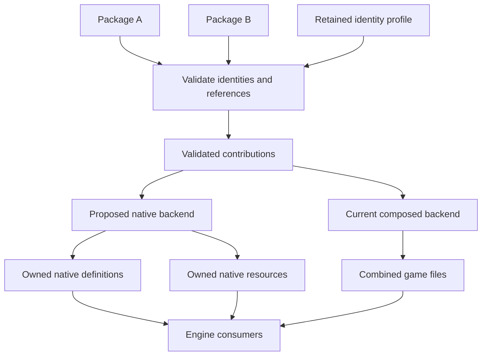
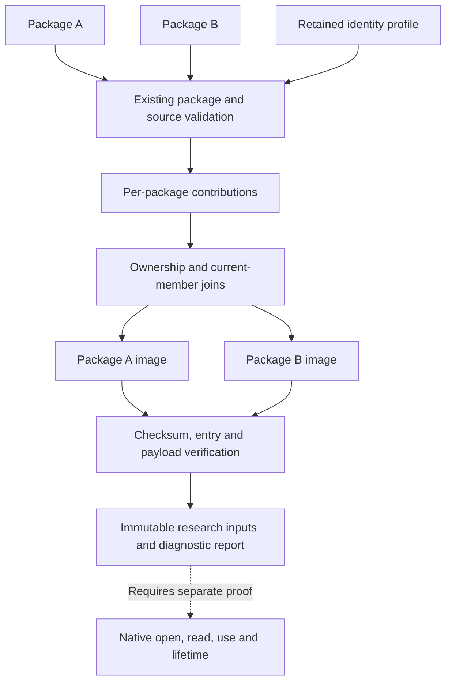
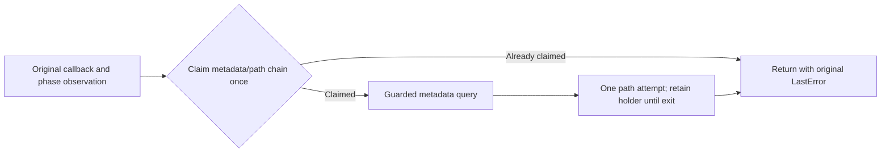
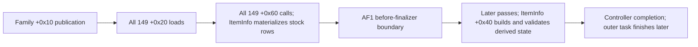
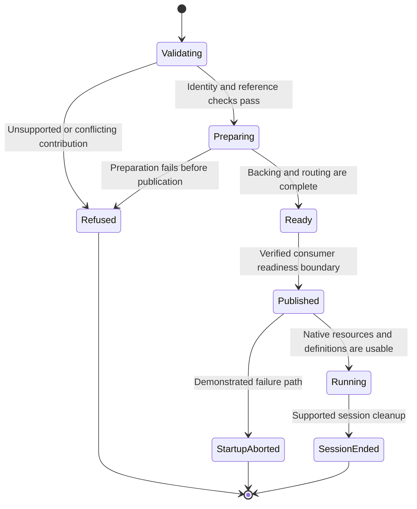

# Independent item packages (Experimental)

Choose **Output > Independent item package (Experimental) · .cditem**, build the plan and
select **Write item package**. Share the resulting `.cditem` file. Recipients add it
to **Mod Management > Mods**, choose **Apply changes**, then **Launch game** for
experimental virtual loading. Physical installation remains available through
**Advanced > Item identities > Install into game archives**. Existing folder exports and
game overlays remain available.

The advanced item identity list sorts by **Item**, **Game ID** or **Status** when you click a column
heading; clicking again reverses the order. Game IDs sort numerically. Drag the
column edges to change widths. Refresh preserves the sort, widths and selected
package. The default layout keeps IDs and status readable as the pane resizes.

**Removed / reserved** entries are saved ID mappings, not installed mods. Select one
and choose **Delete saved identity…** to permanently free its IDs after review and a
verified backup. Active or disabled items must be removed first; for virtual items,
remove them from **Mods** and choose **Apply changes**. Old saves may no longer
recognize a forgotten item, and another item can reuse its IDs. Reinstallation may
allocate new IDs. Cleanup preserves game archives, saves and payload recovery history;
restore the matching backup to recover deleted mappings. A remaining installed item
whose compilation references the mapping must be rebuilt or removed first.

CDMW composes the game's shared files during installation. Separate `.cditem`
files are portable authoring packages, not standalone archives the game discovers.
No manual mod merge is required for compatible packages installed through CDMW.

Current equipment packages can include supported template or imported models and
their item-owned materials, textures, icons and validated accompanying resources.
The item authoring UI writes v1. V2 admits the same legacy item, existing ItemInfo
field and package-link modules, and standalone `texture.replace@1` packages.
Texture tools create and update packages for supported existing DDS targets without
an equipment recipe or numeric item allocation. See
[`INDEPENDENT_TEXTURES.md`](../../services/INDEPENDENT_TEXTURES.md) for the exact
source, descriptor, resource and registry limits. General material replacement,
character, body, hair and outfit adapters remain unimplemented. Armor items must
still satisfy the equipment matrix. Ordinary mod-folder admission does not add a
new `.cditem` module.

## Identity and ownership

Each package has a permanent UUID. **Write item package** creates a new identity,
including when duplicating the current draft. **Update an existing item package**
explicitly selects the UUID to preserve, even when names or appearance change.
Technical game identities are managed; player-facing names remain editable.

Primary `CDI_<UUID>` ItemInfo names also receive a conservative 32-bit hash
collision check under ASCII lowercasing. Selected packages are compared with one
another, stock and external ItemInfo names, and active, disabled and removed
identity reservations. Refusals identify both names and their owners. Reinstalling
or updating the same owner keeps its identity. This check does not certify
arbitrary Unicode/CRT locale behavior, auxiliary name families or native lookup.

Successfully installed independent packages have distinct identities and cannot
silently overwrite each other's owned records or assets. CDMW refuses ambiguous
overlap, unknown owned reference layouts, incompatible dependencies, hash/name
collisions and exhausted allocation ranges. This is not universal compatibility
with arbitrary external mods, and does not establish runtime save compatibility.

Installation allocates item/perk, recipe and reward integers in the existing
1,990,000–1,999,999 range. No numeric range was widened. Names, localisation keys,
model families and effects are rebuilt from the destination bindings. Reflection
references use decoded values and bounded, declared strings; effect names retain
their byte lengths. Embedded emitter file types are rebound with emitter names
and included in dependency validation. Bare inline-emitter labels are not external
file dependencies; explicit `emitter/...` names and inherited `.paem` types still
require verified files. For v1 and the v2 legacy module, original shared table records are
preserved, apart from supported additive shop stock and item-group membership.

Updates retain prior identities and atomically replace the selected item's
contribution. Importing identical content is a no-op when the installed compiler
record matches the current compiler. Removal deletes only that
contribution from composed output. All issued identities and asset paths remain
reserved, including retired auxiliary records. Normal CDMW overlay installation
also refuses to take an independent package's reserved item keys. External tools
cannot be forced to honour these reservations; detected overlaps are refused.

**Advanced > Item identities > Rebuild selected item…** regenerates an installed
item from its retained package with the current compiler. It preserves the UUID,
item IDs and asset reservations, then uses the normal change review and verified
backup flow. Cancelled preparation leaves the installation unchanged. Publication
failures follow the verified per-target recovery boundary described below;
unknown target contents retain recovery material and refuse automatic overwrite.
Missing or changed recovery packages are refused. An older or unrecorded
compiler requires this explicit rebuild before an identical-package import can
be treated as already installed.

Saves can still reference removed items. CDMW does not edit saves. Export an
**identity profile** (`.cdprofile`) with saves when moving computers, import it
before the packages on the destination, then install the original packages.
Conflicting profiles are refused instead of renumbering saved identities.

## Inspecting ownership and isolation

The developer command `scripts/inspect_cditem_isolation.py` recompiles selected
packages through current package admission, source verification, identity allocation
and per-package dependency checks. Run it from the repository with the project
virtual environment, choosing the packages' current deployment route:

```powershell
.\.venv\Scripts\python.exe scripts\inspect_cditem_isolation.py --game-root "C:\path\to\Crimson Desert" --target virtual A.cditem B.cditem
```

The JSON report identifies package UUIDs and content hashes, proposed bindings
and paths, actual record additions, shared-file outputs, shop/group additions,
source dependencies, decoded resource references and remaining ownership limits.
Proposed bindings include retained and retired reservations; they are not all
records emitted by this compilation. Generated strings, localisation keys, prefab
bindings, icons and texture registrations are included. V2 `item.fields` and
`texture.replace` operations remain explicit stock edits; `package.links` retains
its exact provider pins. Package metadata cannot supply ownership evidence or
enable a loading route.

The resource graph separates contribution paths from authoring-validation roots
and records supported implicit material sidecars. Borrowed and unclassified
resources remain explicit. Its 16,384-edge diagnostic cap bounds report storage;
`graph_complete` describes that inventory only. Truncation or an unknown layout
prevents a closure claim. This graph does not establish native lookup or lifetime,
and remaining donor-record, texture and unchanged-physics protections still apply.
An unwalked namespace-qualified material resource also keeps source closure false,
so source-carrier verification remains required.

Inspection publishes no package, identity reservation or game output. Existing
reservations constrain the preview; new allocations are not committed. The report
covers validated per-package outputs and does not establish aggregate installation,
native lookup, rendering or save compatibility. Both current backends still compose
shared game files, so `isolated_new_item_admitted` is false.

Use `--folder` for each additional ordinary mod folder included in dependency
checks. Exit status 0 means inspection produced a report; invalid or incompatible
inputs return 2. Adding `--require-isolated` returns 3 when the stronger isolation
claim is refused. This check currently refuses every package and cannot be used
as a substitute for the native definition and resource-discovery proof.

## Package and installation contracts

Version 1 uses ZIP with `item.json` and SHA-256-addressed `assets/` entries.
The data-only recipe contains a closed set of typed authoring choices, prepared
mesh/material/icon payloads and hashed game dependencies. It carries no complete
replacement game tables, author machine paths, export history or executable code.
All owned identifiers are symbolic until installation. Game-dependent numeric
choices, such as the template and crafting materials, remain pinned dependencies.

The v1 vocabulary is fixed in `cdmw/domain/new_item/independent_wire_v1.py`.
Internal class names, newly added fields and enum members do not extend it.
The codec explicitly translates that vocabulary to current authoring models;
internal field renames or new defaults require a reviewed adapter. Values that
v1 cannot represent refuse instead of silently losing behavior. Reading and
rewriting a package preserve its UUID and canonical content digest. Synthetic
fixtures captured from revision `d08bd77343e1` cover the known vocabulary; earlier
shipped schema variants still need historical examples before claiming support.

Physical ownership layers record the compiler revision, adapter revisions and
frozen wire-schema digest independently of package content and identity bindings.
Planner semantic changes require a compiler revision change; output or admission
changes in a named adapter require its revision change. Existing layers without
this record remain readable for recovery and removal, but cannot claim current
compilation. The compiler record itself does not change the v1 package schema.
Compiler revision 10 includes private material DDS copies and the narrower donor
record rule below. Previously compiled installations use the existing explicit
rebuild flow; virtual profiles require **Apply changes**. IDs and the portable
v1/v2 package schemas remain unchanged.

## Version 2 admission and compilation identity

Readers also accept the version 2 envelope. Item authoring still exports v1;
Texture tools write v2 existing-texture packages. The developer helper
`independent_mod_package.migrate_v1()` explicitly wraps a verified v1 package for
developers testing v2. It preserves the package UUID, original canonical v1 digest
and `item` symbol. It does not renumber existing installations. A v1-only editor
refuses to overwrite v2 because doing so could discard modules or provenance.

V2 keeps ZIP, `item.json` and addressed `assets/` members. Its exact root fields are
`format`, `version`, `identity`, `title`, `release`, `requires`, `modules`,
`dependencies`, `blobs`, `provenance` and `metadata`. `format` remains
`cdmw_independent_item`; `version` is integer 2. `requires` maps capability names
to integer schema versions. Each module has a stable `id`, `type`, integer
`version`, `required` flag and `data`. These names are independent of Python types.

**`item.legacy` version 1** uses ID `item`, `required: true` and a frozen v1 recipe
as its data. It uses the existing physical and virtual compilation paths. Exact
game resource hashes, allocation ranges and equipment limitations still apply.
V2 also admits **`item.fields` version 1** for the narrowly defined existing-record
operations and **`package.links` version 1** for the installation dependency graph
below. **`texture.replace` version 1** owns existing DDS replacements without a
legacy recipe and contributes exact final-byte requirements to both deployment
routes and semantic export. Existing v1 readers explicitly reject the version 2
boundary.

Unknown required features, module types and versions refuse before allocation.
Optional behavior also refuses until a supported explicit alternative exists;
it cannot be counted as executed. Bounded `metadata` is preserved uninterpreted
and grants no behavior or capabilities. Missing or unreferenced resources and
invalid migration provenance refuse. Runtime, quest, audio and other domain
modules remain unimplemented; naming a module does not establish its consumer.

`CapabilityResult` reports support, constraints and scoped `EvidenceClaim` entries.
Adapter and synthetic test evidence do not imply native, packaged, game or save
evidence. A failed capability result is available with its refusal exception.

Package UUID, canonical manifest digest and exact ZIP artifact digest are separate
identities. ZIP generation fixes timestamps and host attributes for reproducible
artifacts. File reads hash before and after parsing to catch changed content even
when length and modification time are unchanged. Optional metadata is included
in canonical content identity; no cryptographic authenticity claim is made.
ZIP members are decoded and encoded in 1 MiB chunks with cancellation checks,
including while validating an existing export and immediately before replacing
it. ZIP CRC and declared resource lengths are checked. File exports write to a
sibling temporary file, then recheck the previous artifact before replacement.
Cancellation observed by the final guard, write failure or a changed destination
preserves the existing file. Replacement itself is noncancellable: once it succeeds,
a late cancellation request cannot hide the completed export or its identity.
The Studio consumes typed worker outcomes for completion, committed publication,
cancellation and failure. Publishing callers explicitly opt into committed-result
delivery; their services must return only after success and raise `RunCancelled`
before commit. A cancellation request cannot replace a real error. Cancelled
read-only preparation still disposes its unused result, and shutdown suppresses
late UI callbacks. Legacy worker result/error signals remain available for other
callers; consumers subscribe to either those signals or the typed outcome.
Compression boundaries may change exact artifact bytes while preserving the
canonical content and UUID; recorded artifact digests always describe actual bytes.
File export avoids holding an additional complete compressed ZIP in memory.
Imports still retain decoded member contents for validation and compilation,
and `package_bytes()` deliberately returns an in-memory ZIP. The full pipeline
does not use constant memory.
Within one preparation, packages can share byte-identical validated resource
buffers. Each package is still validated independently and keeps its own UUID,
resource mapping and installed paths. Logical batch limits count every package's
resources, including shared bytes. This sharing lasts only for that preparation.

A bounded preparation cache keys fully admitted packages by their exact ZIP artifact
and current admission limits. Consumers receive independent mutable metadata while
reusing immutable validated resources. Identical compressed members can reuse already
decoded bytes only after their compressed representation and local ZIP metadata match;
CRC, size, path, capability and complete-package checks remain mandatory. Semantic
admission, resolution and retained-package recovery share that preparation owner.
An ordinary ZIP classification checks its member directory without decoding every
asset just to decide which reader owns the package.

Physical contributions and complete virtual profiles carry a checksummed
compilation record. It links compiler and adapter revisions, package content and
source/retained artifact digests, negotiated features and module schemas, exact
source hashes, the allocation ledger, conflict policy, composition order, runtime
protocol, provider inputs and generated output hashes. Physical records describe
individual contributions; virtual records describe the complete prepared view.
Unknown/malformed records refuse, and missing current records require rebuilding.
These records are provenance, not proof that the game accepts the result.

Physical inventory `cdmw_owned_overlays_v2` stores common allocation, ordering and
resolved-link inputs once in `compilation_contexts`, keyed by their canonical
SHA-256. Each contribution retains its own package, source, compiler and output
evidence in a `cdmw_compilation_reference_v1` record. Readers verify the context
digest and reconstruct the original logical compilation to check its identity.
Missing contexts, altered content, ambiguous duplicate JSON keys and mismatched
ownership bindings refuse.

Legacy inline inventories remain readable. Their stored records are converted
only as part of a reviewed overlay publication, with the existing backup and
rollback flow. This preserves their original compiler stamps and logical
compilation identities; old results still require an explicit rebuild when their
compiler differs. Older CDMW versions cannot read the new physical inventory.
The `.cditem` package, identity-profile and virtual-profile formats are unchanged.
Contexts needed by retained contributions are kept, and byte-identical contexts
can be reused across rebuilds without discarding history.

## Package dependencies and exported objects

The required `package.links@1` capability and one matching required module add
declared installation dependencies to a v2 package. An implemented content module
must also be present. Its data has exactly three arrays:

```json
{
  "packages": [{"identity":"<provider UUID hex>","release":"v1","content":"<SHA-256>"}],
  "exports": [{"symbol":"items/travel-sword","kind":"item","module":"item","object":"item","lifetime":"installation"}],
  "references": [{"id":"uses-sword","package":"<provider UUID hex>","symbol":"item","kind":"item","ownership":"borrowed","lifetime":"installation"}]
}
```

The example illustrates the field grammar; replace placeholders with actual
provider identities and content hashes. Exports belong to the declaring package;
references name another package explicitly. V1 providers use release `v1`; v2
providers use their manifest release. Pins require both that exact release and
canonical content digest, with no version-range or load-order substitution.

Every v1 package and v2 legacy item already exports `item`. Explicit exports may
give that same owned legacy object additional stable symbols; they cannot claim
stock rows, unknown kinds or another package's ownership. The resolved reference
uses the provider's retained ItemInfo ID. Duplicate providers/symbols/references,
missing exports, unpinned references, cycles, unsupported ownership/lifetimes and
changed releases refuse before publication. Dependencies are checked before game
allocation, again during composition, and when enabling, rebuilding or removing
physical contributions. Updating a pinned provider requires updating its active
consumers in the same batch. Disable/remove consumers first when removing it.

References currently require the same deployment: one physical installation set
or the selected packages of one virtual profile. They express installation
admission and lifetime requirements; they do not patch recipe ingredients,
relocate game references, create runtime handles or establish save compatibility.
Those consumers require separate verified adapters. Active graphs are limited to
4,096 packages and 4,096 total exports, pins and references. Provider reads retain
only bounded declarations while graph resolution runs.

Graphs with links use `cdmw_compilation_v2`; other compilation records retain
their v1 grammar. The lock records actual provider content, reference closure,
dependency order and retained item IDs. Old records remain readable, while the
compiler revision requires rebuilding before an old compilation is treated as
current. `tests/test_independent_package_links.py` covers both deployment orders,
v1 providers, aliases, coordinated updates, removal/disable/reinstall, hostile
inputs, stale retained packages, subprocess transport and publication rollback.

## Existing ItemInfo field operations

An `item.fields` module contains `data: {"operations": [...]}`. Developers can use
`independent_item_operations.from_iteminfo_operations()` with a verified shipped
snapshot to author it, then the existing package writer and import/Apply flows.
There is no separate field-authoring UI yet. It can be a standalone package or
accompany one legacy module, provided all whole-record requirements remain valid.

Every operation has exactly `id`, `kind: "field.assign"`, `target`, `field`,
`value_type`, `expect`, `value`, `precondition_base: "source"` and `source_row`.
`source_row` is the SHA-256 of the pristine stock row; complete table-body and
header hashes remain mandatory package dependencies. The target contains
`table: "ItemInfo"`, a positive u32 `key`, and an explicit adapter:
`cd.iteminfo.prefix-stat-11-v1` or `cd.iteminfo.prefix-stat-12-v1`. Stat operations
require the selected marker layout; stack operations use their shared prefix.
Only the verified u32-key/u16-count table directory is admitted.

The supported field selectors and value types are:

| Field selector | Type and range | Admission |
| --- | --- | --- |
| `{"name":"max_stack_count"}` | `u32`, 1–4,294,967,295 | Recognized prefix with unchanged identity and layout |
| `{"name":"stat_value","enchant_level":0,"status_key":1000002}` | `i32`, −2,147,483,648–2,147,483,647 | Exactly one existing stat at the specified level, in the selected marker layout |

No operation accepts arbitrary offsets, new stats, structure edits or executable
code. There are at most 4,096 assignments across an active composition and 64 KiB
per target row. Unknown layouts, duplicate operation IDs, ambiguous stats, wrong
expectations, booleans masquerading as integers and overflow refuse.

The adapter derives source reads, field writes and final invariants. Disjoint
field assignments commute; equal assignments coalesce; opposing assignments name
both owners and the field. Preconditions refer to pristine source, never the
output of whichever mod ran first. All unassigned bytes, row lengths and identities
are preserved and assigned values are parsed back. Complete table pairs are
published even when the directory bytes are unchanged.

Required v1/legacy records are collected across the complete active profile before
field composition. A later v2 module cannot bypass a v1 requirement, and installing
that v1 package later also refuses the conflict. An assignment whose requested
value equals the verified source value can coexist with a whole-record requirement;
it retains its ownership and still conflicts with an opposing assignment.
Untyped changes to the same
target row remain incompatible. Removal recomposes from source plus the remaining
active operations; it does not subtract bytes or replay inverse edits. Rebuilding
the installed overlay set retains each field operation against pristine rows,
including disabled contributions, so re-enabling or removing one preserves the
others. These rules
are covered by synthetic physical, virtual, subprocess and transaction tests;
gameplay and save behavior still need witnesses.

Field-only packages allocate no dummy items or asset names. Their Game ID column
is blank, while their UUID and installation history remain available for rebuild,
removal and profile transfer. Installing the first such package upgrades the
identity ledger to `cdmw_mod_identity_profile_v2` in the same reviewed transaction.
Existing and retired numeric bindings remain unchanged. V1-only readers refuse
this ledger explicitly; failed publication restores its previous format and data.
The v1 ledger remains in use for installations containing only item reservations.

## Resource validation

Imports reject duplicate/unsafe paths, symlinks, encryption, unknown fields or
versions, malformed types, missing/unreferenced blobs and checksum/size failures.
Reader and writer limits are 4 MiB of metadata, 256 MiB per resource, 1 GiB of
expanded metadata and resources combined, and 4,096 entries. Exports exceeding
these limits are refused before replacement. One installation batch accepts up
to 128 packages.

Owned DDS textures must contain a complete supported single-surface, 2D block-
compressed payload and every declared mip. Registration compares the full DX10
extension, including format and alpha semantics, and computes raw mip sizes from
the payload layout. Arrays, cubes, volumes, unknown codecs and unexplained trailing
bytes are refused. This validation also applies when the source has no texture
registry; it does not establish in-game support for every accepted DDS codec.

Independent compilation privately copies supported stock DDS files referenced
by already-owned model materials, including selected variants and their decoded
prefab companions. Only complete, unqualified `ResourceReferencePath_ITexture`
`_path` attributes are rebound. Matching uses the full normalized source path;
comments, labels, unrelated attributes and other material bytes are preserved.
Each item reuses one unchanged private copy per source path. Explicit imported
texture outputs keep their existing destination rules.

Automatic copies use the item's allocated stem plus a stable source-path digest,
and pass through the existing DDS/PATHC registration and collision checks.
Their original source hashes stay in the package dependency contract. These
copies add compiled output bytes without adding new portable input blobs.
Automatic extraction checks the source size first; independent additions through
`_Planner.add` count their logical bytes and paths even when memory is shared.

An unsupported source DDS retains its original borrowed binding with a warning.
Malformed reference XML, missing source witnesses and resource-limit violations
refuse preparation. Other resource types, namespaces, socket descriptors and
unknown physics remain explicit limitations. Donor DDS replacement guards still
apply, and current output still uses shared-file composition.

The icon registry is flat UTF-8 XML with multiple self-closing `Texture` elements.
Its writer and merge validator share the same grammar. The BOM, comments and
unknown surrounding content are retained; conflicting edits to that content
refuse. Duplicate names within one registry refuse case-insensitively. Separate
mods claiming the same icon must agree on its entry bytes.

The initial baseline uses only direct, four-digit shipped archive directories
0000 through 0035. Named manager folders such as `dmmgen` and `dmmsa`, other mod
groups and nested archive copies are excluded from authoring inputs. Custom item
IDs already present in shipped tables are refused. Required source
payload hashes must match the author's source. This is conservative version
compatibility, not proof that a user's base archives are an untouched retail copy.
Ordinary New Item listings, stock snapshots, selected and mounted mod-base
snapshots, independent composition and generic Merge retain the digest of the
exact PAMT bytes parsed to select their archive resources. The original witnesses
survive derived snapshots, per-package views, scanning, merged export and both
publication routes.

An unwitnessed entry catalogue must match a fresh parse of the current index at
every supplied path, coordinate and flag. A resident catalogue must also match
the parsed record inventory, including duplicate counts and index owners, before
its cached entries or tables are used. Reusing parsed resident tables rechecks
the retained original index digests. A newly computed hash alone cannot justify
coordinates or tables cached from different bytes. Later source fingerprints
must agree with the parsed bytes, even when a replacement preserves file size
and all recorded timestamps. Payload checks remain in place. Other processes can
still write between validation checkpoints; this does not establish
cross-process snapshot isolation.

Repeated independent **Build Plan** requests can reuse one immutable clean-stock
catalogue and parsed-table generation. Reuse revalidates its root, discovery metadata,
original index/content witnesses and reader/service authority. Each request gets
separate dependency tracking, mutable entry views and working caches, so cancellation
or another plan cannot populate its provenance. The cached baseline remains the
clean-stock view; mounted texture-registry rebasing is performed for each request.

Opaque dependencies on another mod are unsupported. Mounted external archive
folders may use letters, digits, underscores and hyphens. Their actual payloads
are compared, including providers below CDMW in the mount order. Identical files
are harmless. Supported unrelated record changes are preserved in the composed
output; changes to required records or claims on owned identities/assets refuse
installation with the mod, file and record involved.
Unmounted external archive folders do not participate in that check. Authoring
also restores the texture baseline from retained overlay history, so installing
an item with generated textures does not prevent preparing the next package.
Custom dye masks that still refer to a local file are refused; this package version
does not import files from the recipient's computer.

## Compare and compose other mods

In **Mod Management > Shared files**, **Scan installed mods** compares archive-installed
items and the saved virtual profile with all mounted external archive providers.
Virtual items are read from the applied generation's retained `.cditem` packages,
using their saved identities, and include the profile's selected mod folders.
Moving or editing the original package downloads does not change the applied
versions scanned. Removed identity reservations are not active contributors.
Missing or mismatched retained packages cannot produce a compatible result. **Scan mod
folder...** additionally inspects an extracted, uninstalled mod folder, including
loose game-relative files, `files/` layouts and PAMT/PAZ packages. Scans are read-only.
They report compatible data, shared files that can be merged, record conflicts,
and unsupported inputs. This is an on-demand file-data comparison, not a runtime
plugin analyser or continuous external-manager monitor.

External providers can contain unrelated game folders, such as `sequencer/`.
Those paths retain the same canonical-path and archive-containment checks;
they are tracked for comparison rather than admitted as `.cditem` resources.
The package resource-root restrictions remain unchanged, and private resource
images contain only the selected packages' owned compiler outputs.

Recognized loose `meta/0.papgt` supplies archive discovery and is excluded from
game-resource payloads. Its parsed bytes retain an original digest. A valid
`meta/0.pathc` that exactly matches the current game's texture registry is accepted
as unchanged metadata, with both inputs verified. A changed incoming registry
still requires recorded texture ownership: use **Merge** with the original CDMW
export before selecting that folder. Unknown metadata and malformed mount indexes
refuse before composition. This shared folder admission covers scanning,
prospective physical resolution and virtual profile preparation, including
archive exports produced by CDMW.

Scanning validates the same retained package graph and composes the same typed
contributions as installation, rebuild and virtual preparation. Disjoint field
edits to one ItemInfo row can coexist. Explicit requirements to keep a source
value are retained even when their output bytes equal the source; an external
change to that required row produces a conflict. Export checks those same
contracts before deciding whether its output can preserve them. Diagnostics may
stop at the first active-graph conflict, so resolve it and scan again.

For comparisons that include a virtual profile, update the shared files through
**Mods > Apply changes**. The archive rebuild and export actions are unavailable
for these results because they do not include virtual contributors. Scanning
does not publish a profile or change game archives, saved identities or mod files.

**Rebuild installed shared files…** prepares a reviewed rebuild for mounted mods. It uses
the existing verified backup and recovery transaction, preserves independent
item identities and journals, and never edits external archives. The composed
CDMW archive is mounted first. Removing the last CDMW item restores the external
mount order; a foreign archive originally below the shipped game remains below it.
The current underlay is read again during rebuild, so unmounting a foreign mod
does not resurrect its old contribution from recovery history.

**Export installed items…** can write a separate archive-format package for active
legacy items, including v1 packages and v2 legacy modules, through the existing
Merge exporter. Inputs remain unchanged. Use that package instead of the source
mods and composed CDMW overlay, and retain the identity profile for saves. Export
is not installation and does not transfer CDMW's per-item management to another
manager. Changed sources require a new comparison before publication.

### Semantic export and reimport

When active packages declare `item.fields`, `texture.replace` or `package.links`,
**Export installed items…** writes `cdmw-semantic.cditem` inside the chosen folder. Add that file to
**Mods** or **Virtual loader**, or use the reviewed physical **Install into game
archives** flow. **Merge mods** also combines supported semantic export folders.
The opaque wrapper retains every original package and exact contributor binding,
including source-equal field and texture requirements, provider pins and exported references.
CDMW validates the payload and source witnesses, recompiles the original recipes,
then composes them with the other active packages. Equal requirements retain both
owners; compatible fields in the same row and disjoint texture targets combine. Contradictory requirements,
occupied or different numeric bindings, changed known game identities and changed
archive indexes refuse. No game-reference relocation is implied.

Retained contributors use ordinary package update, enable/disable and removal
services. A virtual wrapper is one selection entry; to select a subset, use the
retained original packages as the next profile selection. Required providers must
remain selected. Retired identities are never reassigned. A disabled field owner
does not block the unchanged legacy-only export route.

Semantic exports cannot be installed by a legacy byte-only manager. Mixed foreign
folders or untyped ownership layers remain unsupported for semantic export. A
manually extracted legacy folder has only the guarantees supported by its bytes;
checksums do not prevent stripping or authenticate the author. The exact negotiated
`export.semantic@1` schema is in [SEMANTIC_EXPORT.md](../../core/SEMANTIC_EXPORT.md).

The first supported record boundaries are:

- ItemInfo: referenced item/perk/material/price rows stay unchanged. The donor's
  own row may coexist with an external or typed field edit only after the compiled
  primary row has a distinct key, `CDI_<UUID>` name and ASCII name hash, and no
  retained donor identity is found in emitted records/resources or transitive
  borrowed rows. Explicit donor references, ambiguous names and incomplete table
  changes keep the original protection. Unrelated records and external added IDs
  can coexist.
- EquipTypeInfo and StatusInfo: complete referenced equipment and stat records
  stay unchanged; unrelated records can coexist.
- StoreInfo and ItemGroupInfo: the existing structured stock/member merger
  combines supported additions and rejects incompatible changes.
- Other dependency tables and localisation/prefab collections: existing records
  stay protected; supported appended records can coexist. Unverified resource
  changes still refuse rather than assuming they are unrelated.

The donor exception changes only its required ItemInfo record. Exact author-source
hashes and index witnesses remain mandatory, and equipment, status, perk, price
and resource dependencies retain their guards. It is a compiled-record result;
it does not establish closed resource ownership or native lifetime.

Both halves of a changed table are required. An external ItemInfo row's serialized
key must equal its table-directory key; a mismatched identity is refused before
composition. Multiple external tables can be
combined automatically when every shipped row remains byte-identical and all
changes are verified additions. Other different external replacements of
the same file remain ambiguous without their original baselines; the report points
to the existing **Merge** workflow for packages with recorded baselines. Runtime
plugins, unapplied JSON patch instructions, nested packages and unproven texture
registry ownership are reported as unknown, not compatible. Patching the shipped
archives directly still falls under the package's original game-hash checks.
This extends installation/composition without changing the `.cditem` v1 format.

### Physical publication and recovery

Persistent ownership lives in `.cdmw/independent-items.json`; immutable recovery
packages live beside the existing overlay journals. Reservation checksums are
cross-checked with layer ownership; altered mappings require matching recovery
material. The ledger, cached packages,
overlay inventory, composed archive and mount/texture metadata are published by
the existing overlay mutation transaction. Review includes the exact game folder
and affected files. The game must be closed and the existing backup verification,
stale-source checks and recovery must succeed. A failed/cancelled preparation
writes nothing.

Physical overlay publication records each target's original digest and attempted
write or deletion before invoking the mutating call, including calls that replace
or unlink a file and then raise. Automatic rollback restores only attempted
targets whose current bytes match a recorded transaction result. Targets already
equal to their originals need no write. Unknown contents refuse automatic
recovery and preserve the diagnostic journal and verified recovery copies.
Unattempted targets and foreign files added to a directory remain untouched.

The original backup manifest and copies stay immutable. Recovery uses a separate
manifest scoped to verified changed targets, checks restore/delete readback, and
removes only known created artifacts and empty directories created by that
transaction. Cancellation before the first attempted mutation skips target
restoration and cleanup. This boundary applies to managed overlay changes,
retirement, legacy installation, migration and removal. The per-target journal
currently provides diagnostics and manual recovery evidence; it does not add a
restart-time automatic recovery command. Cooperating CDMW writers share the
installation lane, but an arbitrary external writer can still race a filesystem
check and operation.

Large rebuilds release completed composition data before collecting the original
destination bytes. Backup, stale-file, staged-output and rollback verification
compare complete files through a reusable buffer of at most 1 MiB. Original bytes
are still retained for review and recovery; this does not bound total archive memory.
Ordinary and independent overlay operations pin the initial ownership inventory,
identity ledger (including its absence), mount list and texture registry. Changes
during preparation, review or backup require a new preparation before publication.
The existing overlay rebuild also checks retained packages against their pinned
game dependencies and backs up their matching identity and recovery data.

Export and preparation run in the controller's existing worker lifecycle. A
changed draft invalidates an older plan; a closed page discards pending reviews.
The reviewed apply is serialized on the shared installation lane. The Rust UI
projects and invokes these same controls and callbacks.

## Supported-format matrix

This matrix describes v1 and the v2 legacy module. The explicit `item.fields`
exceptions are defined in [Existing ItemInfo field operations](#existing-iteminfo-field-operations).

| Dependency | Version 1 handling | Refusal boundary |
| --- | --- | --- |
| ItemInfo, StringInfo and localisation | Typed owned additions; destination keys and names | Existing records changed, collisions or unknown table layouts |
| Current recipes and reward sets | Owned recipes/outputs; template references rebound to the new item | Undecoded connections or missing tools/materials/rewards |
| Legacy enhancement rows | Existing verified transition editor, with reserved keys | Unknown row/reference boundary |
| Embedded perks | Verified game dependency; optional owned zero-price copies | Undecoded stat blocks or missing localisation |
| Shops and groups | Add stock and group membership | Stock replacement or edits to existing reward consumers |
| Imported PAC meshes | Final output checked against each exact template attachment or skin palette at export and installation, without reapplying authoring edits | Undecodable geometry, missing target binding or incompatible skinning |
| PAC XML and DDS | Parsed resource paths and owned textures/icons; composed texture registry | Unknown XML root/reference attributes, unresolved resources or absent registry |
| PAPPT and prefabs | Existing structured editors and relocation | Incomplete or inferred prefab reference layouts |
| Owned effects/emitters/presets | Complete reflection decode, bounded fixed-length reference edits and reserved tokens | Missing dependencies or ambiguous reflection boundaries |
| Collision physics files | Item-owned byte-for-byte copies of the verified Havok 2024.2 convex/compound template layouts | Unknown type dictionaries, malformed boundaries, changed collision data or changed companion mesh |
| Cloth and jiggle accompanying copied collision physics | Preserve every PAC LOD and its skin/cloth data; retain model-property bindings and pin the referenced PBD catalogue/profiles | Changed geometry or simulation bindings, missing or ambiguous profiles; no physics transfer to a different mesh |
| Equipment visibility suffixes | Independent variants retain the template's existing matching suffix rules | Changes requiring shared visibility descriptors remain unsupported |
| Global rendering edits | Unsupported | Any required shared rendering change outside the additive whitelist |

The matrix constrains only experimental package export/install. Existing export
support is unchanged. Material and equipment experiments retain their existing
game-validation limits even when their package graph is structurally supported.

### Copying template physics

Owned physics is deliberately limited to unchanged template geometry. The package
audit checks the exact source HKX and PAC bytes, including all mesh LODs, weights
and cloth lanes. It permits render-material edits such as emission while requiring
unchanged model and cloth bindings. Referenced PBD configuration and profile files
remain hashed game dependencies; their contents are not regenerated or clamped to
preview values. Export and installation perform the same checks.

The HKX recognizer accepts only the two witnessed 2024.2 convex/compound collision
type dictionaries. It checks container and ITEM boundaries and does not rewrite
Havok objects or assume arbitrary binary references can be relocated. These files
hold collision shapes; cloth motion also requires the preserved mesh data and
PBD bindings. Copying an HKX alone is insufficient.

An imported replacement with different vertices must leave **Template cloth /
physics** off until a compatible transfer is implemented and verified. Its rigid
or skinned attachment is a separate check and is not evidence of cloth physics.
Source checks cover copying and composition; armor movement, collision behavior,
coexistence and save/reload still require controlled in-game comparison before
advertising community support for that equipment.

## Evidence and remaining checks

The long-term goal is to represent every mod category through typed adapters and
verified consumers. The current envelope does not make unknown formats usable by
the game or make contradictory requirements compatible in one game context.
Unknown required behavior refuses; new domains need their own parsing, reference,
serialization, activation, teardown and persistence evidence.

Save/profile lineage has a data-only policy and read-only capture/comparison
tools. Trusted producer lineage, a production save-commit verifier, migration
admission and the required game evidence remain pending. Exact backup hashes,
stable IDs and installation dependency checks do not identify the providers
needed by arbitrary saves. Failed or unknown save attempts retain their observed
byte changes and reported outcome without claiming a committed save. The
[save admission boundaries](VIRTUAL_LOADER.md#save-lineage-and-migration-admission)
describe the current policy, missing origin evidence and absent-provider
experiment. Game-update admission likewise retains exact source hashes until a
record-level adapter has independent layout and semantic witnesses. No general
runtime command API or unrestricted native-plugin compatibility guarantee is
supplied by `.cditem`.

### Capacity and retained history

The current ceilings are admission budgets, not a promise that every combination
at the ceiling fits memory or every retained installation:

| Resource | Current bound |
| --- | --- |
| Selected packages | 128 per batch/profile |
| Expanded selected package content | 1 GiB total, including manifests |
| One resource blob | 256 MiB |
| Package manifest / identity ledger | 4 MiB each |
| Members in one `.cditem` ZIP | 4,096 including `item.json` |
| Physical overlay inventory | 4 MiB, including retained history and compiler records |
| Field operations / target row | 4,096 active assignments / 64 KiB |
| Declared package graph | 4,096 providers and 4,096 combined exports, pins and references |
| Item allocation namespace | Existing range 1,990,000–1,999,999; occupied and retired IDs stay reserved |

Both graph limits apply together. Stem capacity also depends on the template's
fixed-width naming family and existing reservations. No integer ranges, stem
lengths or unknown-format acceptance are widened to bypass exhaustion.

Physical inventory output uses compact JSON. A metadata lower bound is checked
before journal decoding, then the projected final size is checked before payload
compression and archive construction. Exact serialization is still checked before
returning a preparation and again before backup/publication. Refusal reports the
required minimum and byte limit; a refused rebuild leaves the prior installation
readable. Package count alone cannot predict capacity: distinct shared contexts
and each contribution's own evidence still consume space. Retired layers, journals and
bindings still accumulate. Virtual generations and save/recovery backups are
also retained; there is no automatic history deletion or shared on-disk blob store.
Storage growth and reusable content should be measured before changing retention
or sharing semantics.

For reproducible source measurements using owned fixtures only:

```powershell
.\.venv\Scripts\python.exe scripts/benchmark_independent_items.py --counts 1 8 32 128 --generations 3 --output workspace/reports/cditem-scale.json
.\.venv\Scripts\python.exe scripts/benchmark_independent_items.py --counts 1 8 32 --kinds icon --generations 3 --output workspace/reports/cditem-scale-icons.json
.\.venv\Scripts\python.exe scripts/benchmark_independent_items.py --counts 1 8 --kinds texture-shared texture-distinct --generations 2 --output workspace/reports/cditem-texture-scale.json
```

Choose a new report path for each run. The harness accepts no game directory,
creates its own temporary fixtures, and measures each case in a separate child
process. It records preparation/publication time, peak process resident memory,
expanded/ZIP inputs, retained storage, final inventory readability, unchanged
stock archive bytes and cancellation at a specific composition checkpoint.
Icon cases use complete 256×256 BC3 data matching the fixture's source registry.
Imported-texture cases use complete 4096×4096 BC3 data and a small synthetic mesh,
with identical or distinct pixels across packages; these cases accept at most
eight packages. The report includes compiled file hashes for before/after checks.
Peak memory includes fixture setup, which is also recorded separately. Authoring
payloads and completed preparations are released before subsequent jobs. The
owned backup fixture uses bounded disk copies followed by production verification;
it does not retain the general test helper's extra assertion snapshots. The full
backup service and UI are outside this measurement. Storage
measurements identify repeated full-file content by size and SHA-256; those totals
describe logical file bytes, not filesystem allocation or permission to delete
recovery data. Neither storage measurement nor memory sharing changes retention.
The results are machine-local evidence, not real-game proof, a 1 GiB memory test,
a large-mesh benchmark or a worst-case cancellation bound. Keep reports outside
version control.

For isolated package import, file export and update measurements:

```powershell
.\.venv\Scripts\python.exe scripts/benchmark_independent_package_io.py --mib 16 128 --output workspace/reports/cditem-package-io.json
```

This harness uses deterministic, incompressible opaque resources in both v1 and
v2 containers. Each case runs in a fresh process and verifies the resulting
identity and resource bytes. Peak memory includes fixture setup; elapsed time
covers the requested operation, and write readback runs after memory measurement.
The payload is not a valid game icon or model, so these results establish codec
behavior only. Full-pipeline texture measurements use the preceding harness;
large-mesh and maximum-budget behavior, shared on-disk blob storage and safe
history collection remain separate work.

### Focused contracts

`tests/test_independent_items.py` constructs separate authoring environments with
deliberately identical source IDs and names. It covers both template installation
orders, imported model/icon paths, owned effects, priced perks, recipes and
localisation; repeated imports, updates, restart-style re-reading, removal and
reinstallation, and transfer through an identity profile. Corruption, incomplete
dependencies, incompatible source hashes, collisions, allocation exhaustion,
stale mappings and rollback/cancellation have focused fixture checks.

`tests/test_independent_item_resource_sharing.py` checks preparation-local memory
sharing in v1 and mixed v1/v2 batches. Equal payloads retain separate ownership,
updates and removal through both deployment routes. Each later package still
passes checksum validation, and shared content does not enlarge the batch budget.

`tests/test_independent_item_physics.py` adds malformed/unknown collision refusal,
mesh and cloth binding checks, pinned PBD dependencies, changed recipient profile
refusal, and two independently authored physics copies resolved in both orders.
It also checks that variant name collision retries retain inherited visibility
rules without modifying the shared descriptor. Synthetic dictionaries in tests
exercise the boundary checks; they are not additional production format witnesses.

`tests/test_independent_item_regressions.py` covers overlapping overlay operations,
ledger changes before publication, authoring after a generated-icon installation,
invalid imported attachment bindings with valid package hashes, and unmounted
external archives during installation and rebuild.

Physical publication rechecks consumed archive payloads and the content of source
indexes and loose files before and after backup. Equal sizes and timestamps do
not make changed dependencies valid. This checks the consumed source graph;
it does not scan every byte in an unrelated PAZ archive. Source drift refuses
before writes, preserving external changes; cancellation uses the normal recovery
path. Synthetic cases are in `tests/test_independent_item_source_guards.py`.

`tests/test_independent_item_index_witness.py` and
`tests/test_cditem_index_consumers.py` cover changed PAMT mappings with identical
recorded stamps, ordinary/resident snapshot and worker consumers, original witness
retention through mod bases and Merge, and a single resident-row verification
scan across multiple indexes.

`tests/test_independent_folder_metadata.py` exercises real exported folders through
scan, physical resolution and virtual composition, including unchanged PATHC and
changed original metadata digests. `tests/test_independent_export_requirements.py`
and `tests/test_independent_item_semantic_routes.py` exercise actual semantic export,
disk readback, reimport, update, disablement, removal and reinstallation.
`tests/test_semantic_export_contract.py`, `tests/test_semantic_export_composition.py`
and `tests/test_semantic_merge_admission.py` cover malformed or contradictory
artifacts, logical resource budgets, unchanged-stamp source changes, exact worker
witnesses and atomic publication. `tests/test_semantic_export_ui.py` drives the
queued exporter and reviewed importer with owned fixtures.

`tests/test_overlay_target_recovery.py` checks per-target rollback after
replace/unlink errors, foreign changes to attempted and unattempted targets,
immutable backup evidence and verified cleanup. Virtual publication outcomes and
save-attempt evidence have separate focused contracts in the
[Virtual loader notes](VIRTUAL_LOADER.md#evidence-gates-and-validation).

`tests/test_independent_items_ui.py` and the Output test in
`tests/test_new_item_rust_ui.py` drive the real Qt controls through the Rust input
bridge without a visible renderer. They test preservation of authoring choices,
package export, reviewed installation/removal and shutdown with pending work.

These tests are source and synthetic-package evidence. Separate controlled game
results for selected swords, effects and save/reload are recorded in the
[Virtual loader validation notes](VIRTUAL_LOADER.md#evidence-gates-and-validation);
they do not certify every supported authoring configuration.
Before claiming a usable game configuration, test the actual executable version
and inputs with a disposable save: acquire and equip both colliding-source items,
check models/icons/localisation/perks/effects and crafting, save/reload, update one,
save/reload again, and test removal/reinstallation and profile transfer. Keep the
source, package and game evidence separate.

## Runtime registration research

### Objective and current boundary

The native-content objective is independently owned definitions and resources
with stable logical identity and retained engine bindings, loaded without combined
replacement game tables, indexes or archive carriers. A central runtime registry
can contain entries owned by different packages. It must preserve that ownership
and the relevant lifetime rules.

The current authoring and overlay code still rebuilds shared table paths.
Physical installation does not enable a native loader or modify the executable.
[Virtual loading](VIRTUAL_LOADER.md) uses the same package identity reservations
for a private composed profile and reviewed experimental launches. Both current
backends therefore keep `isolated_new_item_admitted=false`.

The separate runtime Workshop route exposes export; its inventory type
identifiers are not established substitutes for ItemInfo table keys. An engine
function address or successful metadata lookup does not enable a new package
capability.

### Identity and backend architecture

| Identity layer | Existing contract | Native continuation requirement |
| --- | --- | --- |
| Package | Stable UUID, separate canonical content and exact archive digests | Preserve UUID across supported revisions |
| Object | Namespace and stable local symbol resolve through retained bindings | Use the same mapping for each admitted native object |
| Engine | Destination-specific numeric keys, names and resource identities | Refuse collisions; do not renumber an established object |
| Resource | Owned paths and decoded dependency assessment | Prove actual lookup, payload use and lifetime for the supported graph |
| Profile | Retained current and retired reservations | Preserve mappings on supported transfer; do not infer save migration |

The following diagram shows the current deployment branch and the proposed
native branch. The proposed branch is not a production loading route.



Two clean profiles can assign different numeric bindings to the same package
UUID. The existing `.cdprofile` transfer contract preserves the mapping needed
by its packages; arbitrary saved-reference relocation remains unimplemented.
Intentional `item.fields` and `texture.replace` stock edits retain their current
classification rather than acquiring an independent-new-item claim.

### Retained evidence and unresolved contracts

Review scope: 2026-10-21 continuation from
`099e9f7e7a5555f07246ab475b399c15215e419c`, retained native/publication results
and the new per-package resource preparation. The new verification uses actual
package/compiler and archive code on owned synthetic fixtures. Historical
native/game results and the preceding C++ run remain separate evidence.

| Evidence | Established for that scope | Not established |
| --- | --- | --- |
| Controlled composed-profile observations | Two saved swords, name-only updates, one-package removal and reversed reinstallation under retained bindings | Native no-composition behavior or saving while a provider is absent |
| B84 recorded game experiment | Four additional ItemInfo rows with numeric/name/getter joins | Full inventory acquisition, all consumers or ordinary cache lifetime |
| B106 native isolated experiment | Original typed array backing and retained cleanup under explicit helper substitutions | Live allocator/unwind admission or coherent publication |
| B111 native isolated experiment | Stable selected map backing and initialized results during deterministic write-step observations | Full native name callback, concurrent readers/writers, coherent ItemInfo owner or game admission |
| New portable paired-publication experiment | Common preflight, concrete modeled backing, reentry refusal and retained ownership across both map store phases | Actual engine constructors/lookups/metadata/decoding/I/O, atomic concurrent visibility or game admission |
| B99 recorded game experiment | Private metadata parsing and lookup of the expected entry | Native payload read/use, shared visibility, retirement or saved ownership |
| B109 and current concrete I/O source qualification | Wrapper, actual open/read/size and holder construction; bounded normal-return completion inference | Actual private byte delivery/use, generic diagnostic paths or safe general retirement |
| Per-package resource image preparation | Actual validated compiler outputs, separate archive bytes, retained/proposed reservations and owned-fixture lifecycle | Native routing, image consumption, full resource closure, runtime lifetime or saves |

The retained B111 result is built and executed, correcting an earlier
prepared-only handoff. Its qualified receipt has SHA-256
`98ecd954cfe82c35847ca0c19b4be66957bec9a05bcb1ed0881c5e8b5230552f`.
A read-only integrity review matched all twelve referenced artifacts, including
the seven prepared source files and exact fixture binary. The result remains
owned-memory evidence with heap/TLS substitutes and an explicit DWORD model.

**Publication constraint:** the selected native numeric lookup can return a new
ordinal when a bucket pair becomes visible, before the final map header count
changes and before a diagnostic owner count includes that ordinal. Count-last
is not a readiness barrier. Actual primary/expiry/metadata storage and private
decoder routing must be ready before the first visible entry in either map.
Other readers, iterators, writers and borrowed-pointer lifetimes still require
their own qualification.

### Paired map publication and retained ownership

The maintained [C++ experiment and diagram](../../../native/cdmw_virtual_loader/research/README.md)
join both maps to one owner of primary cells, expiry, modeled metadata, decoded
fixture rows and resource bytes. Both snapshots and every new ordinal's concrete
joins validate before the first map write. The remaining store phases allocate
nothing and perform no fallible validation. A publishing state rejects recursive
prepare/publish and fault-injection calls without releasing active backing.

A new isolated reproducer confirmed the retained B111 composition hazard:
numeric publication can succeed before name publication refuses its stale state.
Source review also found that observer reentry could release nodes while the
outer B111 publication continued. The new unit addresses those failure boundaries
without changing the sealed predecessor.

The portable successor passes 41 cases and 963 checks with address/undefined
sanitizers. Its 34 write observations include 42 valid backing resolutions before
the final owner count and 32 partial numeric/name visibility observations.
Those partial states explicitly preserve the need for a qualified game reader
boundary. Final tested/reviewed source hashes match the project files; evidence
is in `workspace/reports/cditem-execution/20261021-publication-readiness/`.

Both lookup paths and resource completion are modeled. The fixture checks exact
owned archive/range/payload bytes; it performs no file I/O or native query.
B106's separate native constructor evidence initializes null pointer cells and
does not establish construction of full decoded ItemInfo rows. Fixture teardown
is single-threaded and proves no native retirement with outstanding readers.
The new sources remain outside production CMake targets and release provenance.

The 2026-10-22 source join against build `1.0.0.2976` further separates B106's
typed backing from definition-byte delivery. The ordinary getter returns
resident primary cells directly; its cold branch obtains the stock body Reader
before calling the materializer. Bulk materialization has a separate direct
call. B81's retained real-constructor/decoder result used explicit private-cache
calls and proves no central-getter routing. A private materializer can select
retained row bytes once reached, but the earlier stock-fetch dependency and
both actual consumer routes still need qualification. No new game failure or
publication safety is established by this source join.

### Per-package resource image preparation

The research service [independent_item_native_resources.py](../../services/independent_item_native_resources.py)
prepares separate resource images from actual validated package/compiler
contributions. The diagnostic command
[inspect_cditem_native_resources.py](../../../scripts/inspect_cditem_native_resources.py)
consumes those same images and prints their identities and byte-level checks.
This is the `CDISO-RE-03B` preparation increment. It does not install a profile
or provide a callable game backend.

Each package retains its own PAPGT, PAMT and PAZ byte strings. The private PAPGT
contains one group for that package, and the archive contains only the current
resource additions joined to its validated ownership and reservations. The group name `0000` and archive ordinal zero are local to each image;
they do not allocate global engine identities or establish native routing. Shared
definition tables, texture registries and shop/group integrations remain listed
as omitted work. The builder never combines the packages into one carrier.



#### Identity and reservation provenance

| Identity | Meaning |
| --- | --- |
| Package UUID | Logical owner, preserved across supported revisions |
| Canonical content digest | Package recipe/content identity |
| Artifact digest | Exact input ZIP bytes, which can change on repacking |
| Binding digest | Destination reservation mapping, including retained claims |
| Resource image digest | Exact generated resource files, separate from package identity |

Each symbol/path is classified against the resolver's captured prior profile.
Existing matching claims remain retained; new claims remain proposed. An update
can contain both. The preparation does not commit proposals or make them stable
in a later independent profile. Retired reservations remain visible but are not
silently emitted as current archive entries.

Two fresh profiles can assign different numeric bindings depending on order.
Reversed-order equivalence therefore requires the same retained or imported
profile. A name-only update can change package content while leaving every
resource-image byte unchanged, because shared definitions are outside the image.
Repacking identical canonical content can change the artifact digest without
changing the resource image.

#### Byte contract and side effects

The implementation reuses the existing archive serializers and readers. It
validates the captured source PAPGT before preserving its header metadata,
builds a fresh private group list, then checks the full PAPGT/PAMT/PAZ checksum
chain, exact member set, offsets, sizes and payload bytes. Current image entries
are uncompressed raw data. This proves a generated format/input relationship;
it does not prove that every game resource family accepts this storage route.

Package, source revision, external contribution and observed registry/profile/
mount state are checked through the existing owners. A changed state refuses
preparation. Limits and cancellation apply before a successful image set is
returned. Stock-only/mixed packages, unsupported private ownership and empty
private-resource contributions refuse this research route.

The images remain in memory and the command does not publish a game archive,
profile or resource image. Existing checksum policy may use temporary PAZ data
and the installed checksum helper above its size threshold. The work does not
build that helper, and helper execution is distinct from invoking the game's
native file manager.

#### Evidence and continuation

Verification uses actual package reading, compiler lowering, identity
reservation logic, archive serialization and parsing on owned synthetic game
fixtures. It covers two same-donor packages, exact member bytes, retained-profile
order, independent update/removal/reinstall and profile transfer, plus input
and output refusal paths. Native capture, game asset consumption and save
compatibility remain separate evidence.

The focused Windows verification establishes 24 cases: 23 initially passed,
then the cancellation assertion was corrected to the actual `RunCancelled`
type and its single targeted rerun passed. The service and command were unchanged.
The other 23 passing cases were not rerun. Independent source and identity
reviews pass. The update case demonstrates retained numeric symbols with mixed
retained/proposed resource paths; fresh-profile numeric proposals are a separate
case.

Both archive and default virtual preparation contexts produced these small
fixture images. These sizes describe this fixture, not a general mod budget or
a performance benchmark.

| Observed image | Members | Logical payload | PAZ | PAPGT + PAMT | Total |
| --- | ---: | ---: | ---: | ---: | ---: |
| 1 | 4 | 2,818 B | 2,848 B | 843 B | 3,691 B |
| 2 | 4 | 2,820 B | 2,848 B | 845 B | 3,693 B |

Their PAZs are below the existing 64 KiB helper threshold. Evidence, exact source
pins, the initial assertion failure and the successful correction are retained
in `workspace/reports/cditem-execution/20261021-package-resource-images/`.

#### Commands and API

Run the diagnostic command from the project root. Paths below are placeholders:

```powershell
.\.venv\Scripts\python.exe scripts\inspect_cditem_native_resources.py --game-root "C:\path\to\Crimson Desert" "C:\path\to\item.cditem"
```

The default `--target virtual` selects the existing identity/dependency context;
`--target archive` selects the other current context. Neither option selects a
native backend. Repeat `--folder` for ordinary mod folders required by the
existing dependency checks. The command prints JSON and does not export images.

The service API returns a tuple of `NativeResourceImage` owners. Each owner's
`files` property returns the exact `meta/0.papgt`, `0000/0.pamt` and
`0000/0.paz` relative names paired with immutable bytes. `report()` returns a
detached JSON object. A future research producer must consume these exact
bytes and establish its own current source/profile and native-lifetime checks;
this result is not a persistent runtime lease.

The focused verification owner is the single new test module:

```powershell
$cditemImagesTemp = Join-Path $env:TEMP ("cdmw-resource-images-" + [guid]::NewGuid().ToString("N"))
.\.venv\Scripts\python.exe -m pytest -q -s -p no:cacheprovider tests\test_independent_item_native_resources.py --basetemp "$cditemImagesTemp"
```

### Native I/O continuation after image preparation

The 2026-10-21 continuation qualifies the concrete methods against the unchanged
`1.0.0.2976` executable and current/retained REA evidence. Manager `0x146a85460`
uses vtable `0x1457122f0`. The complete open/read/size roots contain 1,582
bytes/371 instructions; size has an additional 5-byte entry thunk. The 205-byte,
50-instruction holder constructor matches an existing full REA capture. Empty
older instruction replies and the new size-entry decompilation refusal remain
retained evidence; they were not treated as complete bodies.

| Method | Qualified selected contract | Refusals and limits |
| --- | --- | --- |
| Open `0x1413273a0` | Manager, fresh holder-output pointer, narrow NUL-terminated path, 64-bit cached-size override, fifth DWORD flags; returns the output-slot address | Use override `UINT64_MAX` and flags zero for a real size query; null output means failure. Return address is not an open Boolean |
| Read `0x1413276b0` | Manager, private holder, buffer, DWORD capacity, DWORD requested count, DWORD low file offset; seventh retained caller argument is unused | Only AL is defined. AL `1` also follows diagnosed I/O failure and exposes no actual transferred count. Refuse request zero, offset beyond size, or request exceeding capacity/remaining bytes |
| Size `0x141327b50` → `0x14b68a7e0` | Returns holder `+0x10` when size-valid byte `+0x0c` is set; otherwise calls `GetFileSizeEx` without caching that query | Null holder diagnoses and returns zero; failed query diagnoses and returns `UINT64_MAX` |
| Holder `0x141326550` | Allocates 24 bytes aligned to 16 using current TLS byte `+0x1fd`; initializes HANDLE `+0`, flags `+8`, dword `+0x0c=0x100` and size `+0x10=0` | Allocation failure raises a noncontinuable exception. B109 release ignores conditional-close failure and chooses the free family from current TLS; general retirement is unproved |

The read uses a unique stack `OVERLAPPED` and event. With a valid retained
private handle, original Win32 semantics, one outstanding operation and normal
return, every captured branch is terminal: a pending `ReadFile` always reaches
`GetOverlappedResult(..., TRUE)` before event close and return. This is an
inference from the complete body and the official
[ReadFile](https://learn.microsoft.com/en-us/windows/win32/api/fileapi/nf-fileapi-readfile)
and [GetOverlappedResult](https://learn.microsoft.com/en-us/windows/win32/api/ioapiset/nf-ioapiset-getoverlappedresult)
contracts, not observed native completion. Process retention is an ownership
choice; it is not the completion barrier and does not qualify exceptional or
invalid-handle diagnostic paths.

The next bounded discriminator must open the exact B93 archive with real size
112, require capacity/request 102 and offset zero, seed each buffer byte with
`expected[i] ^ 0xff`, then compare all 102 bytes and expected SHA-256 only after
normal return. Keep the private index, native/raw paths, file holder and buffer
until the owned process exits. A passing comparison would establish observed
exact content, not an API success status, exposed transferred count, decoding,
resource use or production retirement. Actual replay remains unperformed.

Source pins, physical captures, retained failures, API assumptions and joins
are recorded in
`workspace/reports/cditem-execution/20261021-native-path-continuation/io-method-review/io-source-joins.json`,
SHA-256 `0516d5f8f51bef73c4ef3c2495ce6ac6be1307704e1854e470ddd5d2581d25d6`.
The complete provider bundle was exported and normally closed. Preparing
per-package images does not close native byte delivery or admission gates.

### Bounded private-path probe continuation

The separately versioned B113 current-loader experiment continues B112's
path-only scope. One atomic claim covers both metadata production and the
following path call. A concurrent or reentrant callback must not independently
win the path one-shot while another callback writes the metadata result.
Deterministic native controls reproduce that old interleaving; the successor
passes with explicit synchronized fixture dependencies. These checks execute
the actual callback headers, not the engine metadata/path functions.



The current game matches retained build `1.0.0.2976`. Static UAL 9.7.4 inspection
preserves the required forwarding/startup instruction shapes at moved offsets.
A differing whole-file hash alone does not establish incompatibility. The
experiment uses separately qualified witnesses and retains actual IAT, phase,
first-thread, outside-loader and observed-frame guards. Its strict build,
startup-frame fixture and no-session inert check pass. The first controlled
activation now passed startup and callback/phase/IAT installation with that
loader. It closed on monitor liveness before any result body; four valid headers
and an empty stock wire are incomplete failed evidence, not a path result.
The consumed heartbeat was not logged. Source review found a clock race and
terminal packet misclassification; v5 reads heartbeat before sampling uptime,
samples the decision clock after all blocking identity/file work, records the
close judgement and measures completion after restoration. It preserves every
native guard and the fixed 225/240-second deadline. Seventy-six focused mocked
cases and independent source review pass. The unchanged B113 binary then
produced a complete actual exact-path result through that caller.

The first run restored original ASI absence and exact stock staging, left all
owned processes absent and retained 14 selected input/preservation matches.
The old 32.422s value is a pre-restoration sample, not exact total duration;
the preserved timing correction makes that distinction. Current FastLoad's
automatic latest-save transition stays unchanged under existing recorded human
scope, while the caller issues no input/explicit load or configuration change.
The next actual run independently verifies the exact prepared B93 private
archive path, with provider 1/1 and ItemInfo 6816 unchanged. All five complete
wires, actual process/birth/session/source joins and restoration pass fresh
review; post-restoration duration is 24.406s with healthy-heartbeat terminal
closure. The first failed result remains retained. Native byte delivery/use and
general retirement remain unproved. Production bootstrap/admission and sealed
B112/native B113 bytes are unchanged.

The retained B114 source provides the fixed 102-byte normal-return byte
observation. The separate B115 successor adds three selected Windows module
identities, 17 complete entry/root spans (1,949 bytes), eight thunk slots and
nine exports, preserving the strict IAT planner and AL/byte distinction. Full
system-file hashing occurs at configure; the callback rechecks bounded live
identity/bytes/slots/exports and preserves LastError. Exact selected R29/R30/R31
hook-source/compiler joins transfer the conditional source interpretation.
Internal OS callees/handlers/data retain the documented-semantics assumption.

The B115 wire has 70 QWORD fields, ten pointers and 102 bytes in each 744-byte
frame; six added witnesses record the selected guard counts before/after read.
Source review and 69 synthetic decoder checks pass. All four strict native
targets compile, but only eight API controls and five pre-call read refusals
pass the first compiled run; 13 read controls terminate `0xc0000409` after
reaching the simulated getter boundary. Static COFF/PE inspection finds fixture
function addresses computed 4 GiB too high; the actual targets have valid linked
CFG entries. The abort site itself was not captured. Retain the failed source
and ASI. On 2026-10-23 the separate fixture-only runtime-address correction
passes all 18 compiled cases using the unchanged actual header and CFG. The
actual own-process API guard reports 3 modules/17 spans/1,949 bytes/8 slots,
and the unchanged original ASI remains inactive without a session. The complete
six-step envelope and source/binary pins validate; that qualification used no
game or installation. The original failed fixture remains retained.

The subsequent reviewed caller-v5 game run on 2026-10-23 returned all 102
expected B93 payload bytes from the exact 112-byte archive, with capacity/request
102, offset zero and zero mismatches. Independent external review joins all six
physical captures to the retained wires, actual process/source/session and exact
PAZ open inside the native interval before read. The selected guards pass before
and after. The fixed normal-return byte observation is verified under the stated
API assumptions; AL does not expose terminal API success or transferred count.
The wire-only decoder's false provenance/execution/API flags remain unchanged.
Private holders remain process-retained. Exact restoration and owned-process
closure completed in 39.235 seconds. Both full stock snapshots precede the
private operation; no post-read full-stock comparison is claimed.

Two distinct actual-compiler fixture images now prepare a 144-byte DDS each at
offset 2704. The bounded native read through both retained contexts is recorded below.
Their selected 20-byte file records are identical; the final payload byte differs.
Each image has 19 folder/four file records, with the selected file at `files+60`.
The constructor's global-byte addition requires explicit A-after-B metadata,
query and path observations before inferring coexistence. These synthetic inputs
preserve proposed-binding and unresolved-reference limits. Resource-consumer
use, general retirement and native item admission remain open. The separately
frozen producer now passes 17 compiled native cases and 13 aggregate reviews,
using engine substitutes for the construction/query/path/read flow. These include
the complete A-after-B recheck, both full payloads, byte-143 discrimination and
alias/refusal controls. Its actual caller-v2 game attempt then refused both
metadata checks before reading: the preparer selected PAPGT 16:28 instead of the
serialized 12:24 group record, and the fixture seeded that same wrong expectation.
Both factories had returned true once; this is not a demonstrated format refusal.
Independent physical/source/restoration review passes, with restoration in 40.860
seconds. Separately frozen v4 corrects the expected arrays and passes four actual
generation/parser/serializer boundary cases. Runtime algorithms, guards and input
images are unchanged. V4 now passes its own 17 native cases/13 aggregate reviews
and inactive loading in 21.304 seconds, followed by independent linked review.
Caller-v3 now compares both complete 144-byte payloads in the game, rechecks A
after B construction and joins exact PAZ opens 381/382 in the 538-record trace to
each read interval on thread 41096/TLS family 0, distinct from AF1 thread 21752.
Restoration takes 40.985 seconds; independent actual-capture review passes with
no material defects. Original raw/offline false flags remain unchanged. This fixed-byte
observation does not establish resource consumption, general independence or
retirement.

The separate B120-v2 reserved-tail adapter passes 21 compiled cases and inactive
loading with owned responses and synthetic caller instructions. It forwards four
original helpers, reserving cookie/capacity N+4 while logical counts/maps stay N;
the observer checks full stock joins and null tails. A pre-CAS terminal-refusal
gap is corrected and covered. Current PE guards include actual cleanup entry
thunks, but no original game-header/cleanup instructions execute in these
fixtures. Independent linked and controlled-caller source reviews now pass. The
caller protects all 216 full pins/167 runtime origins with 210 recovery sources
within the unchanged 256 limit. Its subsequent controlled game capture passes
four original-helper forwards and the AF1 shape: logical counts/maps 6,816,
cookie/metadata capacity 6,820, four null tail slots and all stock rows resident
on thread 51672/TLS family 0. Root physical/process/restoration checks pass in
30.719 seconds; independent actual review also passes. That reservation-only
capture supplies no private Rows/Cache staging, public-map, cleanup or lifetime proof.

B121 now uses that unchanged Cache with base N/actual spans N+4. Router and the old
null-tail observer remain separate rejecting contracts. The stage calls the real
constructor and checked Bool decoder (Reader*, record), while the four-argument
central materializer remains unhooked. Source/stock/map/previous-allocation alias
guards and retained partial failures pass eight owned native cases. Actual
encoder bodies pass separate production-parser checks while strict game review
correctly refuses the ordinary fixture addresses; independent linked review
joins 100 emitted functions. The 218-pin caller retains all 167 runtime origins
and three decoders with 212 recovery rows within the unchanged 256 limit.
Its subsequent game capture completes four checked records with exact keys,
names and input cursors. All represented stock prefix/header/maps remain equal
except four exact tail pointers; public counts/maps stay N=6,816 and capacity/
cookie N+4. Root physical/source/process checks and 29.391-second restoration
pass; independent capture review also passes. This proves one item/three perk
records in off-count slots, without central lookup/bulk, resource use, derived
state, cleanup execution, reader lifetime, retirement or save acceptance.

B122-v4 now qualifies B66/B64/B67 unpublished pair preparation on owned native
responses: ten cases, including N=6,816, five physical encoder channels, strict
game-address refusal and inactive loading pass. Independent emitted-code review
joins 166 functions and 26 core cross-image contracts. The 369-pin native proof
is sealed. Independent caller classification/final packet review pass with 222
full pins and 216 recovery sources inside 256. The first controlled game capture
also passes: two unpublished 6,820-entry maps, eight native inserts, twelve
callbacks, 45 steps and 13,636 allocations from stock N=6,816 plus four Rows.
Public maps/counts and represented source/owner/metadata/expiry/records remain
unchanged. Root physical/source/process/restoration checks pass in 47.188 seconds;
independent actual-capture review now passes with no material defects. Guardian
closure used the stale-heartbeat policy at age 5,218ms while offline review ran,
without a close request at that decision. This historical recovery predates the
later authorized Sword overlay; it proves no central header/count/map publication,
cleanup execution or native admission.
Native name-map values are DWORD item keys, numeric values are WORD ordinals and native
metadata contains body offsets. The portable model's name values/route indexes
are fixture contracts. Its publication ordering cannot supply native ABI or
reader safety. Known source/clone aliases must be guarded before adapter-controlled
writes/releases; uncertain native insertion state stays retained.

A first external sword package also passes actual full import, four hand/sheath
attachment checks and exact package/model/texture readback with a persistent
UUID. Its separate compiler image contains 24 private PAC/PAC_XML/DDS/prefab
resources; 29 shared outputs stay excluded and 12 resource boundaries remain
unresolved. Source material double-sided behavior has no verified plain-PBR
shader mapping. Package/image preparation does not establish rendered appearance,
native discovery/use, acquisition, equip or persistence. At the user's request,
the existing composed physical installer subsequently installs this package as
item 1,990,000 in group 0041. A subsequent supported update adds quantity one to
Tranan's compiled stock, retaining all 112 prior lines and the other 435 stores.
Its 54-file overlay, verified pre-write backups, nine exact target writes and
seven unchanged loader companions are verified, including independent actual
review. The user then reports successful shop acquisition and supplies
screenshots showing the custom sword at Tranan and visibly equipped. Sheath
duplication and incorrect held orientation remain accepted test limits, with no
cosmetic work requested. Live Edit's longstanding Add timeout remains separate;
save/reload and independent native activation remain unproved. PAPGT/PATHC intentionally change after
the historical B122 recovery, and the consumed grant cannot be replayed. This is
a separate composed-route test, not independent native activation.

Executable-source review identifies typed ItemInfo manager loader slots and
the global setter/clearer. Vtable `+0x08` resets the manager; `+0x20` loads
definitions. The 2026-10-23 passive game witness now observes the global owner
equal to `this` at loader entry while count/metadata/backing are empty. Normal
return has 6,816 entries, matching metadata count/capacity and primary cookie.
The worker differs from the bootstrap thread; TLS was not sampled. Global
pointer presence is not a metadata-readiness boundary. Sequential observations
do not prove another reader used partial data, exclusion, safe publication or
lifetime. Constructor-registered key/name adapters are not lifecycle callbacks.
The later actual return RIP joins the unchanged serial dispatcher. Its observed
ordering is:



Consumed B115 already supplies actual AF1 source/unwind guards, controller
membership and two full stock snapshots with all 6,816 slots resident, matching
keys, zero expiry and both maps. Body `owner+0x90` is zero; both snapshots precede
the private operation. This avoids a duplicate phase observation. It does not
establish a stock cold-reader path, phase TLS, all-reader exclusion or borrowed
pointer lifetime. Join actual backing/private metadata/decoder/cache to ordinary
getter and direct bulk, then qualify coherent paired publication, reader and
maintenance coverage and failure-stop. Source inspection further establishes
that expiry zero permits sampled eviction and a hot getter does not refresh it;
eager loading is insufficient for future private rematerialization. The later
ItemInfo finalizer also needs manager state beyond the old private 0xA0 descriptor.

First qualify actual original-header reservation with four extra null slots:
keep logical counts/maps N, primary cookie N+4 and metadata capacity at least N+4. Getter,
bulk and maintenance use N, while reset/destruction uses the cookie. A reserved
observer must validate that exact shape; unmodified Snapshot/Router refuse it.
Actual typed forwards and cleanup entry thunks need their own proof before
private rows are staged in those slots. Metadata-reserve Bool false is a normal
no-growth result. The
[execution checkpoint](../../../beta-progress/cditem-execution-goal.md#resumed-with-direct-authority-2026-10-23)
owns exact source/capture/restoration pins and the retained failed controls.


### Proposed startup admission lifecycle

This is a target contract, not an implemented native state machine. Startup-only
activation bounds the first milestone; arbitrary live unloading is separate.



Publication requires a demonstrated consumer/readiness boundary. A Boolean
readiness assertion, final count store or successful isolated fixture cannot
supply that evidence. Partial publication must use a qualified cleanup or startup
abort path; it must not continue as a successfully loaded package.

### Private archive path evidence review

The maintained research command
[review_cditem_native_path.py](../../../scripts/review_cditem_native_path.py)
closes a specific gap in the prepared B112 decoder: membership beneath a private
root did not identify the exact archive. It leaves the sealed B112 producer and
decoder unchanged. It is an offline research tool, not a runtime backend or an
application admission API.

The expected archive comes from independently pinned preparation inputs, never
from the observed path. The current supported fixture has one group, one PAZ and
one nonempty, uncompressed resource. Other representations refuse review.

| Input or relationship | Required check |
| --- | --- |
| Preparation manifest | Independent SHA-256; bounded JSON; exact three private file references |
| Native candidate input | Independent SHA-256; exact supported root and resource declarations match preparation |
| Private PAPGT and PAMT | File pins; parsed group; checksum chain; one selected resource and PAZ ordinal |
| Private PAZ and resource | Exact declared archive path and digest; parsed offset and stored size; bounded uncompressed slice; expected payload digest |
| Path packet and metadata receipt | Independent input pins; existing callback/object/time joins; exact process ID and complete before/after wire |
| Observed archive path | Exact expected identity, allowing only slash/backslash equivalence; different archives, drives, case, relative components and stream suffixes refuse |

The observed path is comparison data. The tool reads only files selected from
the pinned preparation and explicit input arguments. A successful review does
not authenticate the capture, prove that the native candidate used every
initializer byte, or demonstrate native open/read/use. The existing execution
manifest and separately reviewed parent result still own those bindings.
Every output keeps `native_execution_verified`, `native_payload_read_verified`,
`resource_use_verified` and `native_admission` false.

From the repository root, first inspect the prepared inputs:

```powershell
.\.venv\Scripts\python.exe scripts\review_cditem_native_path.py prepare `
  --prepared "<absolute-prepared-inputs.json>" --prepared-sha256 "<independent-pin>" `
  --native-input "<absolute-resource_input.hpp>" --native-input-sha256 "<candidate-input-pin>"
```

The `review` operation uses the same preparation arguments and additionally
requires `--metadata`, `--metadata-sha256`, `--wire`, `--wire-sha256` and `--pid`.
It prints JSON to standard output. Exit 0 means the selected offline checks
passed; exit 2 means invalid or inconsistent inputs; exit 3 preserves an
explicit native refusal in a structurally valid packet. None grants a native
operation or certifies game behavior.

On 2026-10-21, the focused tests and read-only `prepare` operation verified the
retained B93 manifest, B98 native input, 112-byte private PAZ and its 102-byte
payload. This was a new offline check of retained files. No actual B112 path
call or native payload read was run. Evidence is retained locally in
`workspace/reports/cditem-execution/20261021-independent-content-start/`.
The [regressions](../../../tests/test_cditem_native_path_review.py) own this
checker's focused verification. Run them from the repository root:

```powershell
.\.venv\Scripts\python.exe -m pytest tests/test_cditem_native_path_review.py -q --basetemp "$env:TEMP\cdmw-cditem-native-path-<run-id>"
```

The local test matrix carries the same focused scope. The source-input reader
accepts the supported generated header form and pinned wide file-path literals.
It refuses comments, conditional preprocessing, line splicing and additional
root/resource declarations. It does not parse arbitrary C++ or attest compiled
initializer behavior.

### Next decisive proof

Carry the paired-publication ordering and ownership discipline into actual
constructed backing, private metadata and decoder routing for both native maps.
Qualify the real reader boundary and concrete native private-resource
open/read/use path. Then exercise two separately authored same-donor packages
with distinct private assets through acquisition, equip, restart, supported
updates/removal and save reload without combined replacement game files.

Keep load-with-provider-absent separate from save-with-provider-absent. After
restoring a provider, inspect the newly written absent-provider save as well as
the original saved copy. [Save-lineage and receipt limits](VIRTUAL_LOADER.md)
remain unchanged. Native independence and general persistence admission stay
open until the relevant observations exist.
