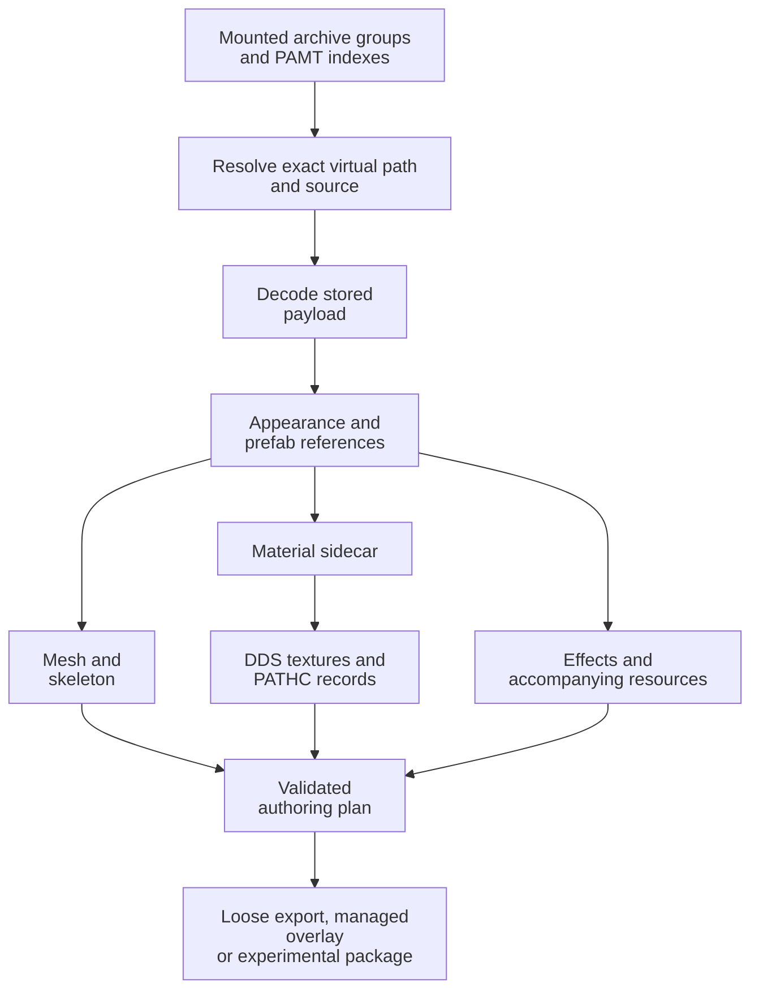

# Crimson Desert Research Reference

**Reviewed:** 20 October 2026

**Research baseline:** [CDMW Full `e22f3b1a`][baseline], labelled `0.11.0-alpha.24`

**Scope:** Recorded CDMW research into game resources, authoring, rendering,
mod composition and runtime integration.

This reference brings together the conclusions behind CDMW's tools: what the
formats contain, how resources connect, which operations are implemented, where
the evidence stops, and which questions remain open. It is intended for mod
authors, tool developers and contributors who need more than a feature list.

The baseline is a public CDMW Full source snapshot. Capabilities in other
revisions and released executables can differ. Source links are pinned to that
baseline so that the implementation being discussed remains inspectable.
Consult the installed version's release notes for availability.

“Complete” here means a consolidated account of the recorded research areas,
including unsuccessful approaches and unknowns. It does not mean the entire
engine has been decoded. Historical measurements describe their original sample;
they are not fresh verification of every asset in the current game.

## Contents

1. [Reading the status and evidence](#1-reading-the-status-and-evidence)
2. [Research overview](#2-research-overview)
3. [Archives, resource identity and dependencies](#3-archives-resource-identity-and-dependencies)
4. [Textures and materials](#4-textures-and-materials)
5. [Meshes, skeletons and character appearance](#5-meshes-skeletons-and-character-appearance)
6. [Cloth, jiggle and collision physics](#6-cloth-jiggle-and-collision-physics)
7. [Animation, placement and rig behaviour](#7-animation-placement-and-rig-behaviour)
8. [Prefabs and reflection containers](#8-prefabs-and-reflection-containers)
9. [Game tables, localisation and item creation](#9-game-tables-localisation-and-item-creation)
10. [Effects and particle rendering](#10-effects-and-particle-rendering)
11. [World, projectiles, audio and other resources](#11-world-projectiles-audio-and-other-resources)
12. [Independent packages and mod composition](#12-independent-packages-and-mod-composition)
13. [Virtual loading, native resources and saves](#13-virtual-loading-native-resources-and-saves)
14. [Rendering, performance and validation](#14-rendering-performance-and-validation)
15. [Conclusions and unresolved work](#15-conclusions-and-unresolved-work)
16. [Reproducing and extending the research](#16-reproducing-and-extending-the-research)
17. [Format inventory](#17-format-inventory)

## 1. Reading the status and evidence

Implementation status and evidence are separate. A byte-exact writer can still
produce an edited resource whose gameplay consequences have not been tested.
A convincing screenshot can still conceal an incorrect dependency or export.

| Status used in this reference | Meaning |
| --- | --- |
| Implemented | An owning reader, writer or workflow exists for the stated subset. Its source and restrictions are identified. |
| Constrained | Selected fields, layouts or operations are supported; the surrounding format is not unrestricted. |
| Experimental | A workflow is available with material compatibility or game-validation questions still open. |
| Research only | A layout, consumer or possible route has been investigated without establishing an end-to-end supported workflow. |
| Unresolved | The required semantics, implementation or evidence is missing. |
| Superseded | A dated finding or plan has an identified replacement. Retained as history, with the current conclusion or owner identified. |

| Evidence | What it establishes | What it leaves open |
| --- | --- | --- |
| Source and owned-fixture tests | Implemented rules and behaviour on the tested inputs | Acceptance of arbitrary game assets |
| Read-only asset inspection | The observed bytes, declarations and references in a particular corpus/build | Runtime activation or generality across updates |
| Byte-exact round trip | An unedited parse/rebuild preserves the tested input | Correctness of an intentional edit in the engine |
| Executable or shader analysis | The inspected consumer's calculations, fields or dispatch path | Whether that path is active in a particular scene |
| Headless or offscreen rendering | The tested renderer produced measurable output | Normal-window usability, packaged behaviour or game appearance |
| Packaged validation | The built distribution contains and runs the checked components | Gameplay correctness |
| Controlled game observation | The stated operation worked under the recorded conditions | Other equipment, versions, save histories or mod combinations |
| External report | A contributor's observation or proposed explanation | Independent local reproduction |

There is no general “fully supported” percentage. The capability inventory uses
`full`, `partial`, `surface` and `none` for decoding, and `full`, `constrained`
and `none` for writing. These are maintained catalogue labels, not guarantees
that every operation or every asset is supported. In particular, a text format
can be writable without a semantic validator for its contents.

## 2. Research overview

| Area | Established conclusion | Current boundary |
| --- | --- | --- |
| Archives | Indexes, payload ranges, known compression and filename-derived encryption can be decoded. Mounted resources have an explicit priority order. | Unknown encryption/compression and unsupported partial layouts remain refused. |
| Textures | Supported DDS resources can be reconstructed, decoded, edited and registered. Material parameters are stronger evidence than filename suffixes. | A valid DDS is not proof that a particular game material accepts a changed layout. |
| Meshes | Proven PAC/PAM/PAMLOD layouts support inspection and bounded authoring; static PAT geometry has a read-only route. | Export depends on format, LOD, source mapping and the specific operation. |
| Skeletons | Proven PAB hierarchy and bind transforms support bone resolution, skinning and clip playback. | Arbitrary skeleton restructuring and unknown layouts are not supported. |
| Physics | Several render-cloth, jiggle and collision consumers have been traced and reproduced as bounded reference stages. | Preview motion, resource activation and game physics compatibility remain distinct. |
| Animation | PAA tracks, supported clocks, bind-relative motion and lossless encoding are implemented. | Action-chart semantics, arbitrary timing profiles and game acceptance of edited clips remain incomplete. |
| Prefabs | Reflection metadata and a supported structural heap grammar enable safe reference and placement edits. | Ambiguous or incomplete walks restrict editing; related reflection formats have different unresolved heap rules. |
| Game data | Known table directories and typed item, string, shop, group, recipe and reward subsets support new-item composition. | Unmodelled fields and unrelated table families remain opaque. |
| Effects | PAE/PAEM reflection, keyed inheritance and constrained authoring are implemented; selected particle shader behaviour is reproduced. | Exact runtime target binding, animated surfaces and complete game appearance remain open. |
| Packages | Independent packages retain identities, owned resources, explicit requirements and recoverable lifecycle changes. | Typed adapters cover selected domains, not every mod category. |
| Virtual loading | A guarded launch route has narrow recorded game evidence; native registration has also been investigated. | General redirection, additive native registration and save compatibility cannot be inferred from those results. |

## 3. Archives, resource identity and dependencies

### 3.1 Storage and mount order

Numbered archive groups pair a `.pamt` index with numbered `.paz` payloads.
The index records paths, payload locations, stored/original sizes and flags.
`meta/0.papgt` describes mounted archive groups and their ordering. Correct
resolution must use the active mounted view, rather than whichever duplicate
path a directory scan happens to find first.

The same extension can have different roles. The outer archive-index `.pamt`
is not a morph-target PAMT resource, nor is it necessarily equivalent to a
`.pamt` file found as content inside another archive. This explains why a
catalogue row for an embedded `.pamt` can say undecoded while the archive
browser successfully reads the installation's indexes.



### 3.2 Compression and encryption

The known archive flag layout separates compression and encryption nibbles.
Stored and LZ4 data have implemented paths. The supported Partial DDS path is
a texture-specific reconstruction operation; it is not a generic decompressor
for every resource marked Partial.

Filename-derived ChaCha20 uses the lower-case basename, lookup3/hashlittle and
the recorded key/nonce derivation. Encryption type and content validation still
matter: a filename-derived key does not make every encrypted entry readable.
Unknown algorithms and malformed results must remain explicit failures.

`PAR ` sectioned resources and `PARC` wrappers have their own container rules.
Archive-level compression and internal resource compression must be handled at
the appropriate layer instead of treating all assets as one LZ4 blob.

### 3.3 Identity and dependency tracing

Paths, numeric IDs, hashed names and registry names serve different purposes.
The common `hashlittle(..., 0xC5EDE)` contract appears in several registries,
but each caller determines which name or stem is hashed. A matching stem is
not enough to infer a mesh path or ownership relationship.

Appearance XML, prefabs, material sidecars, texture registries and item tables
must be followed as a graph. An inventory record commonly identifies a prefab
through a name hash; its actual mesh path must be read from that prefab.
PAPPT part/prefab registrations and socket descriptors add further bindings.

**Conclusion:** Resolve exact resources from the mounted snapshot and retain
the source evidence used by the final plan. Do not identify an asset by a
convenient filename alone. Missing, ambiguous and unindexed references are
different states; an index that does not cover a resource cannot prove absence.

Sources: [archive format][archive-format], [extraction][archive-extraction],
[mount table][papgt], [resource graph and prefab resolution][item-family],
[PAPPT][pappt].

### 3.4 Safe modification

Browsing, scanning, previewing and extraction read the source. Physical archive
changes are separate service-owned transactions with exact targets, verified
recovery material, stale-source checks and rollback. New output is prepared
before publication. An unknown recovery target is preserved for diagnosis
rather than overwritten on the assumption that rollback is harmless.

Checksums, file identity and size/timestamp checks serve different purposes.
Same-size changes can preserve timestamps, so metadata alone is insufficient
where a content witness is required. Cached catalogues and prepared outputs
must retain the original archive indexes used to interpret the bytes.

Sources: [archive mutation service][archive-mutation],
[core patching][archive-patching], [independent-package recovery][independent-items].

## 4. Textures and materials

### 4.1 DDS and PATHC reconstruction

Supported legacy and DX10 DDS layouts retain dimensions, format, mip count,
caps and extension metadata. `meta/0.pathc` supplies the texture registry data
needed for supported archive reconstruction and registration.

For supported Partial DDS entries, reconstruction resolves the exact virtual
path, validates the registry/header and mip layout, then decodes the admitted
single-chunk or first-four-mip LZ4 arrangement. Supported Sparse DDS handling
reconstructs only within validated declared bounds. These are offline resource
operations; they do not by themselves establish how the running game streams
or replaces GPU textures.

The writer derives mip block information for supported raw DDS layouts and
checks complete payload lengths. New registry entries have format and capacity
restrictions; collision-table authoring is not implemented. Arrays, cubes,
volumes, unknown formats and incomplete payloads require their own supported
route rather than being accepted as ordinary 2D textures.

**Conclusion:** A replacement must satisfy both the DDS layout and the registry
contract. Preserve source headers and unknown fields when a workflow promises
layout compatibility. Changing compression, mip count or dimensions is a
separate compatibility decision, not an automatic improvement.

Sources: [PATHC codec][pathc], [DDS bounds][dds-limits],
[DirectXTex helper][texture-helper], [existing-texture package contract][independent-textures].

### 4.2 Texture roles and channel interpretation

Material parameter names and shader consumers take priority over suffixes.
Short suffixes such as `_ma`, `_mg`, `_m`, `_f` or `_sp` are not universal
promises about albedo, roughness or a particular packed channel. The same
suffix may participate in a different role under a different wrapper or shader.

The material pipeline retains owner-bound base, normal, surface, opacity,
emissive, detail, flow, wrinkle and other supported roles. Packed roughness,
metallic and occlusion must follow the actual material contract. An explicitly
resolved separate map and a packed map cannot be combined by filename guess.

Colour-space metadata is also part of the input. A decoded presentation-space
image must not be gamma-converted a second time on re-encoding to an sRGB DDS.
Normal maps and numeric masks require their own channel and filtering policies.
Unchanged DDS resources can remain unchanged instead of incurring another
lossy encode.

Sources: [parameter-first role rules][texture-roles],
[material authoring notes][modding-notes], [texture output policy][texture-output].

### 4.3 Shader behaviour and approximate preview

The production viewport is the Rust `wgpu`/D3D12 host. Material preparation and
authoring remain coordinated by CDMW's Python services. Retained `.NET`,
Vortice and `d3d11_*` filenames can be compatibility names; they do not identify
the active production renderer.

Preview correctness must be judged against the game consumer. Agreement between
two preview implementations can merely reproduce the same assumption. Shader
reflection identifies bindings; instructions establish how a parameter is used;
the active runtime permutation and final scene still require separate evidence.

Selected Wing reveal, TornCloth, HairAnimatedUV, Anisotropy, Poster and static
Dissolve controls have constrained authoring routes. Compatibility depends on
the source family, required masks and vertex channels. A plain material cannot
become every supported experiment by changing its shader name.

Glow and opacity are distinct. Emissive intensity is not always an exponential
brightness multiplier: the inspected lightning pixel shader uses
`_emissiveIntensityExponent` as a power on sampled mask channels. An additive
effect can emit visible light with zero base opacity.

Sources: [renderer contract][renderer-contract], [rendering ownership][rendering-notes],
[shader compatibility guide][shader-controls], [effect consumer reference][effect-preview].

### 4.4 Transparency and underlying body parts

Ordinary translucent materials, Ghost/dithered cutouts and EyeCover composition
are different mechanisms. The EyeCover investigation found inspected shaders
reading character/scene buffers and writing render targets. Overlapping
translucent islands produced a reported game symptom consistent with an
ordering problem. A specific aliasing hazard or active failing permutation has
not been proven by that investigation.

Disabling conservative rasterization did not resolve the reported overlap.
It is not a general transparency-ordering control. Practical workarounds include
avoiding overlap, excluding selected islands or using a different compatible
material; each changes the resulting appearance. A verified engine-side fix
remains open.

Equipment can also hide underlying skin, head, hair or beard through shrink
profiles and conditional prefab rules. CDMW's experimental controls create
isolated prefab/profile changes and preserve matching suffix-based conditions.
They do not simulate every game cut rule in preview, create absent body
geometry, or override every other equipped item's hide condition. The separate
live-process helmet visibility-bit approach reported by community tools is not
an established CDMW export contract.

Sources: [EyeCover investigation][eyecover], [underlying-part workflow][new-item],
[lossless visibility edits][equipment-visibility], [transparency mask preparation][transparency-masks].

## 5. Meshes, skeletons and character appearance

### 5.1 Mesh containers and exact output

PAC uses a sectioned `PAR ` container with metadata, submeshes, LODs, vertex
layouts, indices and accompanying material data. Supported PAM and PAMLOD
layouts provide static geometry; PAT has a bounded read-only geometry path.
Companion resources are part of the source identity and must remain attached
to the mesh they describe.

LOD section order and metadata order are not interchangeable. Proven PAC
builders account for the file's lower-detail-to-higher-detail section arrangement
while maintaining the corresponding offsets and size records. A file that
renders once is not enough to establish that every later LOD/reload path is valid.

Exact authoring is selected by format, LOD and operation. The proven exact
topology path is LOD0; lower LODs are not granted arbitrary topology editing.
Other constrained operations can preserve or deliberately update validated
records across multiple LODs. The final writer remains authoritative for each
operation.

PAC island exclusion can follow exact retained UV and skin records through
simplification, including movement within the matching preceding-LOD vertex's
incident neighbourhood. Each vertex must agree on inclusion, and the matching
preceding component must be consistently mapped. The movement limit is the
matching vertex's longest incident edge, measured from that vertex or a directly
connected neighbour. A neighbour's longer edges do not enlarge the allowance.
Conflicting records, mixed inclusion and movement outside that local bound
remain refused.

Reviewed on 2026-10-21 against `1b2cea2e56e7` plus the scoped island-mapping fix.
Owned fixtures reproduce the LOD3 corner failure. A retained copy of
`cd_m0001_00_de_phm_ub_11002.pac` (SHA-256
`a2bf53e967398f4f6c74c3c2da65525f689ecc9bd87ebc2da515d3281fb5862c`)
confirmed all six islands of `CD_PHM_00_Belt_0281_00_01_01` can be excluded
individually across four LODs, with only the expected triangle indices changing.
The source copy remained unchanged. This is source, fixture and retained-asset
evidence; packaged, visible-UI and in-game behaviour were not checked.
The [island mapper](../cdmw/modding/mesh_islands.py) and its
[focused tests](../tests/test_mesh_islands.py) own this bounded correspondence.

Exact PAC LOD0 **Remove Doubles** retains original-relative vertex and face
lineage, original donor skin/cloth records, bounds and opaque data. The native
result is composed before geometry/history commit, and Finish must pass the
existing exact serializer. Review scope: 2026-10-21, `1fe43bf7` plus this scoped
native cleanup/writer change. Changed weights, missing or stale lineage,
unsupported layouts and unrepresentable output remain refused.

The supplied `cd_phw_00_ub_00_0163.pac` (SHA-256
`7ef0e06838ac0380bdb3a05a2b12cdff19a4853d3f4f4953d830d7dc87d9f41e`)
stores four byte-identical geometry payloads. Compacting LOD0 alone was correctly
blocked because a lower LOD would outrank it. Cleanup can synchronize independently
stored copies only after proving identical complete payloads, descriptor counts
and vertex/index splits. Output checks cover all rewritten payloads and counts;
distinct lower LODs retain the original rank guard and byte-preservation checks.
The supplied asset passed Undo/Redo, Exact Finish, PAC reparse and JMM loose-package
creation for part 3 (917 to 817 vertices) and all five parts (3,522 to 2,915 vertices).
Surviving skin/cloth and tangent/handedness bits, source bounds and the input ZIP
were preserved. This is source/native, headless and supplied-asset export evidence;
packaged visible UI, animation and in-game behavior remain unverified.

Free Edit is a separate non-exact interchange output. Its new OBJ-based package
does not confer unrestricted PAC/PAM/PAMLOD writeback. Importing geometry from
OBJ, glTF/GLB, DAE or the configured Blender FBX route also does not establish
retention of every game-specific vertex or physics field.

Mesh Editor replacement materials use the exact PAC sidecar part binding rather
than the binary material label. Repeating bindings in distinct `ModelProperty`
indices are separate variants; selected changes preserve each variant's unrelated
parts. True shared owners, duplicate bindings within a variant and ambiguous
property indices remain refused. Reviewed on 2026-10-21 against `fc18bc78cc14`
plus the scoped replacement-material correction. Owned fixtures cover label/case
differences, shared-owner refusal, variant matching and restoration. Bounded
read-only preparation with `cd_phm_00_hel_0010.pac` and the supplied textured helmet
GLB generated DDS and a sidecar retaining all five property variants. This is
source, fixture and asset-preparation evidence; packaged, visible-UI and in-game
material appearance remain unverified.

Sources: [mesh parser][mesh-parser], [exact capability rules][authoring-capability],
[PAC builders][pac-builder], [topology builder][pac-topology],
[PAT reader][pat], [Mesh Editor output notes][mesh-editor].

### 5.2 Skinning: palette slots are not bone indices

In the proven 40-byte PAC vertex layout, the fields at bytes 20 and 24 each
pack three 10-bit influence slots. Six byte weights begin at byte 28. A slot
addresses the mesh's bone palette, whose hashes must resolve against the
selected PAB skeleton. Reading these fields as four byte-sized bone indices
produces plausible-looking but incorrect bindings.

Cloth-bound records use some lanes differently. When byte 39's low six bits
equal 63, all six packed slots are skeletal. Below that value, only the first
four are skeletal; two packed slots and two half-float lanes at bytes 12–15
address cloth guides. The weights at bytes 32–35 then have separate cloth
meaning. They must not appear as invented named skeleton influences.

A rigid attachment may have one full-weight slot and no palette. Its actual
attachment comes from prefab/socket context. Conversely, a matching filename
does not prove that a smooth-skinned mesh belongs to a particular rig. Related
character races can share the principal PHM, PHW or PTM skeletons; resolution
must be demonstrated by the palette.

These are supported authoring limits for the inspected layout, not a claim that
every stored game record has at most six influences. Untouched records can retain
extra raw influence data. The authored import mapper refuses more than six
influences, but the lower-level ordinary-record packer still selects the strongest
six in other call paths. Retained cloth records reject more than four; the full
topology rebuild can instead clear donor cloth lanes and use an ordinary record.
Those are separate weight-loss and physics decisions which a shared import policy
must expose explicitly.

**Conclusion:** The reader and writer must use the same proven layout, preserve
protected lanes, and reject unresolved or unapproved excessive influences.
Agreement between two implementations is not useful if both use the same wrong
offsets.

Mesh Editor **Import Replacement** now retains authored GLB/glTF influences for
compatible PAC targets. Used joint names must resolve uniquely into the captured
target palette. Matching known joints must retain their hierarchy and establish
one conversion into the game rig's bind space. A common inverse-bind conversion
is accepted directly. Blender's per-bone local-axis changes are also supported
when noncollinear rest-joint centers prove one proper rotation, positive uniform
scale and translation. Unused foreign joints do not require palette entries;
unused matching game joints still participate in the compatibility proof.
Unknown used bones, incompatible frames, unsupported layouts and excessive
influences are refused; foreign-rig retargeting remains unavailable.
PAC output quantizes weights to its byte representation. Unskinned replacements
retain donor-weight transfer. Create New Item now preserves compatible authored
skin before conversion using the same proof, starts in game bind space and offers
explicit per-part preservation, four/six-influence reduction and named template/body
transfer. Reduction, donor filtering and byte quantization have separate reports.
Preservation failure cannot initiate transfer. Free Edit's OBJ output does not retain a rig.

The initial authored-weight route was reviewed on 2026-10-21 against
`277b82ccc786` plus the scoped authored-weight patch.
The [mapping service](../cdmw/services/mesh_replacement_skinning.py) and
[owned regression fixtures](../tests/test_mesh_replacement_imported_skinning.py)
verify joint-to-palette mapping, bind-space conversion, serialization and reparse,
history, repeated imports, and the actual neutral Rust-host import/Finish handoff.
The [material UV checks](../tests/test_scene_gltf_uv_bake.py) cover weight retention
through texture-driven vertex reordering and seam splits.
The Blender bone-axis correction was reviewed on 2026-10-21 against
`a7ca7e498ab4` plus the scoped compatibility patch. The
[bind-frame checks](../tests/test_mesh_replacement_bind_frames.py) cover changed
local bases, a single used joint, neutral-coordinate PAC serialization, and
refusal of changed hierarchy, changed unused known joints, reflection and
degenerate rest centers. The two authored-weight test files passed together
(21 tests). This is source and executable fixture evidence, not game proof.

Inspection of the supplied Rosa Cassius Blender/GLB pair found matching garment
geometry and all 448 named joint parents. The source has up to nine influences
per vertex; the GLB keeps four, affecting 5,469 original garment vertices and
discarding up to 32.86% of a vertex's original weight before renormalization.
An analytical strongest-six preparation would still affect 1,465 original vertices,
remove up to 12.93% of a vertex's weight, and remove over 5% on 61 vertices. Those
figures measure source reduction, not output quantization. CDMW's authored-skin
reader retains the weights actually present in the GLB. A separate ordinary-record
packing check found a maximum individual weight change of 1.345 percentage points;
the byte writer reserves a nonzero byte for each retained positive influence.
Neither result establishes deformation quality. The
rest-joint centers match the installed PHW skeleton within 1.1 micrometers after
one common transform, despite differing local bone axes. Blender 5.1.1 read a
file saved by 5.2.45, so this establishes the inspected geometry/rig data, not
complete newer-version feature or source-material parity. The GLB contains eight
embedded PNGs; its source armour materials reference external DDS files that
were not supplied alongside the Blender file.

Installed item tables, English localization and prefab references resolve the
reported **Elegant Carmine Leather Armor** to five PACs. Its primary
`cd_phw_00_ub_00_0170.pac` has 93 resolved palette entries, but lacks the GLB's
used `Bip01 L Thigh_Side` and `Bip01 Neck` joints. Preparing the complete GLB
against that exact PAC correctly refuses the missing palette bone without
changing the live mesh revision. A matching whole skeleton therefore does not
establish compatibility with a single equipment PAC. Asset provenance for this
inspection is the primary PAC SHA-256
`dacc5740226f21d075535ee54a4ebd690294b9ec920b653163b79624cab9dafa`
and PHW PAB SHA-256
`1686637e26ecde30943cb6519178b6efc8bcc40f4c5c053ea7620c1ba6621605`;
Steam's installed app manifest reports build ID `25477059`. This is installation
metadata, not a runtime executable or in-game check. The selected PAB resolved
with palette confidence; exact appearance/variant consumers remain a separate
question. The five item PAC palettes together still lack Neck, which is the sole
influence on the imported 337-vertex `Main_submesh3.001` part. A bounded scan of
45 primary PHW torso PACs in the selected archive found no complete 51-bone match;
this is not a search of every possible target asset.

The 2026-10-21 investigation also verified that the matching PHW nude body is not
a complete skeleton palette: it lacks Neck and R UpperArm used by this outfit.
The current [body donor filter](../cdmw/services/new_item_skinning.py) removes
unsupported influences and renormalizes partially supported rows before excluding
faces with zero-supported vertices. Against the selected armor palette this
changes 3,119 body rows and leaves 5,228 rows with no supported influence, before
garment transfer. A 128-vertex-per-part closest-triangle sample against the filtered
usable donor measured a 0.363 m p95 and 0.435 m maximum for the rigid pelvis-bound
part. These are sampled surface distances, not transferred-weight or animation
results. They support explicit donor selection, region review and preservation
of intentional rigid weighting instead of an automatic whole-outfit substitute.

A bounded metadata-only palette experiment on an owned copy appended the two
missing existing PHW hashes at slots 93 and 94. Sequential decoding located the
count at byte 27,570 and the following bounds/volume trailer at byte 27,944.
Inserting eight bytes required the metadata size and eight absolute LOD stream
pointers to grow by eight. All four geometry sections remained byte-identical;
all parsed LOD parts, original influences, guide data and embedded-volume
semantics remained unchanged. Independent decoding of a standalone weight record
resolved both appended slots. Full-GLB replacement preparation then succeeded
against this copy without publishing a live edit.

The 2026-10-21 implementation adds a [semantic palette writer](../cdmw/modding/pac_palette_extension.py)
for bounded decoded 3/9 layouts and a source/PAB-bound extension contract. It
preserves old slots, uniquely resolves appended existing identities, relocates all
LOD streams, and rejects malformed or undecoded metadata. The
[New Item validator](../cdmw/services/new_item_variants.py) retains palette equality
unless the exact contract authorizes the appended identities; it checks every LOD.
Replacement output, history and versioned drafts retain that intent separately
from original archive bytes. Extending this list does not add or modify PAB bones.

A complete seven-part primary from the supplied four-influence GLB was written
with 95 entries, imported
materials and inherited template physics disabled. Independent decoding of every
stored skin record verified both appended slots across four LODs; matched source
rows retained their named influence sets with maximum byte-weight change of
1.345 percentage points. Lower LODs compact/reorder source vertices, so the
comparison matched final positions rather than assuming identical vertex order.
The supplied GLB/Blender hashes and all 34 available PAMT fingerprints stayed unchanged.
This is final file-level output evidence. Source-owned tests cover strict refusal,
all-LOD relocation, authored New Item import, reduction, donor loss, selected donor
surfaces, hidden companion slots, history and draft reopen.

A separate unapproved six-influence Blender/GLB candidate was then exported directly
from the original Blender vertex identities, with the supplied GLB's embedded
material/image graph retained. Position-only restoration was rejected because
coincident source vertices have different weights. Deterministic reduction affects
1,465 original vertices; 61 lose over 5%, with maximum removed mass 12.93%. It still
needs only the same two extra palette bones. Complete 95-slot six-influence primary
output also passed independent all-LOD checks, with maximum byte-weight change
1.892 percentage points. The review copy, loss-hotspot CSV and output are preparation
and file-level evidence; original inputs stay unchanged.

The authorized rendered follow-up produced **60 Rust D3D12 captures** on the Radeon
RX 9070 XT: seven controlled PAB joint poses and three full-decoder PHW PAA frame
samples, comparing the exact written four/six-weight LOD0 PACs with the original
nine-weight Blender geometry from two views. All motion tracks matched the same PHW
PAB hashes; bind reconstruction error stayed below 4.19e-6 in matrix elements. Shared
camera/framing and exact generated DDS base/normal pixels were retained. The sampled
walk's symmetric nearest-vertex p95 error decreased from 2.63 to 0.44 mm; the crouch
sample decreased from 4.95 to 1.02 mm. This metric does not establish source-vertex
correspondence or triangle-surface error. A separate comparison using original
surface vertex IDs, excluding one unused vertex, still measures up to **10.5 mm**
displacement from six-weight reduction in the raised-arm stress pose. The 61 vertices
losing over 5% still need artist approval. The material presentation is common
imported glTF appearance; PABC/body masks, inherited material auxiliaries, body
clipping, simulation, full playback and lower-LOD deformation are not qualified.

Bounded static analysis of build **1.0.0.2976**, executable SHA-256
`57da440d72f4db974f25fef047cf84c4dadd999a88cb2a3c5af4c9bd67fde1e7`,
confirmed the current metadata loader at `0x142C619E0`, counted-palette read at
`0x142C6505B`–`0x142C650CE` inside `0x142C63D60`, and bounds/volume reader at
`0x142C65110`. The palette is a u16 count followed by u32 hashes, stored at model
offsets `+0x88`/`+0x90`. Binding work at `0x142CD53B0` sizes a u16 remap to that
count and binary-searches skeleton hashes, with explicit 1,024-entry/index bounds.
Unresolved hashes fall back to bone zero in that engine path; CDMW requires unique
resolution before writing. The remap-resource path jumps from `0x142C6AA30` into
`.xtls` at `0x1508E2CF0` and prepares a resource using the captured count. Seven
complete bounded bodies, 3,308 instructions, matched independent PE/Capstone
decoding byte for byte. REA's automatic provider analysis timed out; the confirming
exports came from an isolated read-only Ghidra project copy without full analysis.
Older source-comment addresses are interior instructions in this build and were
not treated as current function entries.

Palette extension remains an internal experiment behind the consumer rollout
gate. Final resource stride, matrix allocation/upload, draw/shader/partition and
special-physics consumers remain unqualified. Source six-influence approval,
selected PABC/companion appearance, full motion playback and game acceptance remain open.
No packaging, installation or game launch was performed for this implementation.

Sources: [skinning research][modding-notes], [weight writer][mesh-skinning],
[real-layout regression entry point][skin-tests].

### 5.3 PAB bind transforms and appearance variations

The fixed PAB reader retains hierarchy, bone names/hashes and four row-major
matrices per bone: global bind, inverse global bind, local bind and inverse
local bind. The latter pair are not disposable copies. In the inspected layout,
`localBind * parentGlobalBind` reproduces the global bind transform.

PABC appearance records and morph-target PAMT resources affect the presented
character, including shared head/body relationships. The appearance pipeline
retains the resolved authored bone indices so a head override does not reset
body bones it never authored. Restoring neutral geometry and reversing
interchange coordinates must retain the relevant source transforms and each
mesh's own palette.

The fixed-layout decoder and a best-effort legacy scan carry different proof.
A recovered bone-shaped record is not authority to add, remove or rename bones.
There is no general skeleton restructuring writer.

Sources: [PAB reader][skeleton-parser], [variation reader][skeleton-variations],
[appearance assembly][appearance], [bind-transform findings][modding-notes].

### 5.4 Morph & Refit

Morph work distinguishes authored shape changes from bind-pose and presentation
differences. Body-region decomposition requires proven correspondence. Equal
vertex counts alone do not establish matching topology, part names or ordering.
Regions whose correspondence is unresolved are skipped or refused instead of
being subtracted as if they matched.

Morph & Refit retains the body driver, selected garment parts, flexible/rigid
roles, regional masks, procedural or sculpted definitions and optional garment
corrections. Reset, Bake and saved fitting setups have different ownership
consequences. Transient preview deformation is not automatically a permanent
mesh edit, and a correction for one source binding cannot silently transfer to
another.

Reviewed 2026-10-22: body-centred rigid assemblies retain their lateral placement
during fitting; an incidental one-sided cloth contact is not an attachment.
Flexible layer fitting takes up authored slack while preserving ordered layers,
waist-band height contours and raised cord relief. Compact touching knot pieces
share a backing motion; rolled band edges have local repair for new transverse
self-crossings. Solid wall depth requires coherent, closed geometry; duplicated
or open skins remain flexible. The native conform/contact owners and focused
rigid-assembly, layer-boundary and tightening tests own these contracts.

Two caller-provided PAC outfit saves cover the actual authoring Fit command,
Undo/Redo, repeat fitting, Bake and PAC export/reload on
`cd_phw_00_nude_00_0001_damian.pac`. Independent static triangle checks found no
body crossings, band/wrap crossings or band self-crossings in either runtime or
exported geometry; the necklace remained rigid and centred. Unlit Part-ID colours
and solid offscreen captures expose the cord, band and wrap separately from front,
back and both sides. Grey shaded silhouettes alone were insufficient: they hid
buried rope detail and small rolled-edge crossings in the earlier fit.

An additional fixed selection of twenty original upper/lower garments was tested
on that body, with verified appearance mappings and archive provenance. Thirteen
fitted and exported with no transverse body crossings; seven refused while
retaining geometry, settings and edit history. Eleven accepted garments still
have self-crossing folds also present with the older fitter; their crossing counts
were unchanged or lower. Distinct surface colours and solid captures were reviewed,
so those results are not a claim that all twenty outfits are visually clean or
that general cloth self-collision is solved. Some previously accepted, intersecting
fits now refuse publication. Original PACs and source PAMT/PAZ fingerprints were
unchanged. This is native-source, authoring, asset and offscreen-renderer evidence;
packaged, visible-UI and in-game proof remain separate.

The exact output policy still applies after fitting. A useful preview does not
establish absence of clipping during all game animations or compatibility with
every retained physics profile.

Sources: [Morph & Refit workflow and limits][mesh-editor],
[body-region decomposition][region-decompose],
[native contact owner](../native/cdmw_mesh_core/src/owners/session_morph_01.cpp),
[layer regressions](../tests/test_mesh_refit_layer_boundaries_native.py).

### 5.5 Hair creation

Experimental Hair Tools generate and edit guide/card geometry, resolve mounted
character references and retain material and skinning provenance. Rust owns
interactive grooming, geometry and preview motion; the host validates history,
drafts and output.

The XPBD preview includes supported scalp, neck and shoulder contacts and a
head-relative rest-shape force. It does not simulate the donor's in-game hair
rig. Simulation frames are transient; adopting a settled shape is an explicit
undoable rest-shape change. New game physics rigs and hair-to-hair collision
remain outside the established workflow.

**Status:** Implemented experimental authoring and output paths; generated
hairstyle behaviour in game remains unverified in the recorded reference.

Sources: [published hair research][hair-reference], [Hair Tools implementation notes][mesh-editor].

## 6. Cloth, jiggle and collision physics

### 6.1 Separate data, solver and activation

Physics investigation has three distinct questions:

1. Which bytes describe weights, profiles, constraints and collision geometry?
2. Which CPU/GPU consumers transform those bytes into motion?
3. Which runtime owner loads, activates, updates and retires those consumers?

Answering the first two does not establish the third. Preview controls must
identify whether they edit exported resource data or only the preview solver.

### 6.2 Render-cloth bindings and profiles

The proven PAC layout separates skeletal and cloth-guide weights. Inspection
can retain zero-weight records; editing requires a valid supported binding.
Existing cloth influence reduction, profile overrides and constrained guide
generation have explicit source-layout and all-LOD checks.

Free Edit source inspection is independent of its output policy. Retained PAC
bindings and exact variant assignments describe the source; current geometry's
binding-layout eligibility is reported separately and does not validate edited
physics. Free Edit's OBJ output retains no game rig, cloth, jiggle or physics
profiles. Source descriptor ownership, rather than current part ordering, keeps
inspection attached to surviving parts after deletion. Owned-fixture and
headless-control checks reviewed on 2026-10-21 against `fc18bc78` plus this scoped
fix confirm that separation and native Delete/Undo/Redo without a preliminary
clone. They do not reproduce the reported armour PAC's underlying clone failure
or establish packaged, visible-UI or in-game behaviour.

PBD configuration/profile XML, PAC guide data, skeleton references and runtime
shader records form a dependency chain. A generic `.pbd` binary listed as
undecoded in the format catalogue is not evidence that every PBD-related XML
or PAC field is unknown. Equally, editing an XML profile does not supply an
arbitrary `.pbd` binary writer.

Decoded cloth reference stages and supported collision inputs drive bounded
preview motion. Wind, water, animation samples, profile selection and game
activation remain separately supplied or unresolved where stated. Generated
guides, new profiles and copied template physics retain experimental game
compatibility limits.

Sources: [PAC cloth bindings][pac-cloth], [runtime reference][cloth-runtime],
[profile editing][pbd-profile], [physics workflow][mesh-editor].

### 6.3 Jiggle contribution and native reference

For the traced skinned-mesh consumer in game build `1.0.0.2944`, the per-vertex
jiggle contribution is:

```text
contribution = (15 - (byte38 & 15)) / 15
```

Only the low nibble is edited by that contribution control. Every `xF` value
has zero contribution; neither `255` alone nor the whole byte is the correct
general test. The upper nibble and unrelated lanes must be preserved. This
supersedes the earlier assumption that full-byte and low-nibble interpretations
were equally likely for the traced path.

The native reference covers ordinary and timed bone effects, frame continuity,
origin resets, spring acceleration, damping, linear/angular limits, fading and
matrix reconstruction. CPU activation and resource-to-shader handoff have also
been traced as pure stages over supplied runtime records.

These stages require caller-supplied animation, frame/time and runtime state.
Per-update damping, vector-length linear limits and independent angular limits
must not be replaced with a generic spring approximation while claiming native
equivalence. Reflected frequency fields not consumed by the inspected body are
not proven solver controls.

**Boundary:** Vertex contribution is not a spring constant or proof that the
mesh has an active game solver. Bone masks can override the vertex blend.
Other builds and consumer paths need their own evidence.

Sources: [jiggle contribution and consumer analysis][modding-notes],
[bone reference][jiggle-bones], [CPU/runtime stages][jiggle-runtime],
[shader-consumer study tool][shader-study], [focused reference tests][jiggle-tests].

### 6.4 Skeleton volumes and weapon collision

Supported PABV and embedded PAB/PAC volume layouts have bounded read-only
decoders. Serialized shape tags differ from the CPU/GPU shape enum, and
standalone versus embedded records have different bone-key conventions.
Resolution must use the correct hash/index interpretation before binding a
volume to a skeleton.

A weapon PAC can provide collision shapes without providing a rendered weapon
mesh. Mesh Editor can inspect those shapes and use supported references for
cloth preview. Constrained collider/profile export is experimental; shape
visibility in the editor does not establish game-side collision activation.

Sources: [volume decoder][pabv], [weapon collision layouts][weapon-collision],
[collision and profile workflow][mesh-editor].

### 6.5 Havok HKX

The HKX investigation includes tagfile sections, SDK version, type/string
registries, ITEM records, data spans, fixup observations and selected object
layouts. Recognised skeleton poses and collision shapes have bounded previews.
Arbitrary object graphs are not converted into invented proxy geometry.

The native helper provides raw-preserving no-edit rebuilds and whitelisted
fixed-size float patches. Structural edits that change counts, topology,
references, arrays or strings require a semantic writer and remain blocked.
Havok XML export is an inspection/interchange representation, not proof that an
arbitrary edited XML document can be compiled into a compatible game asset.

Independent item packages can copy witnessed convex/compound collision templates
under stricter unchanged-mesh and dependency rules. Copying a collision HKX alone
does not transfer cloth motion to a new mesh.

Sources: [native HKX scope][hkx], [HKX edit gate][hkx-gate],
[template physics restrictions][independent-items].

## 7. Animation, placement and rig behaviour

### 7.1 PAA container, tracks and clocks

The implemented motion reader handles the supported `PAR ` clip container,
flag-dependent prelude, track table, bone hashes and standard/packed key codecs.
Bone names come from the linked skeleton, not from an assumed clip name table.
Opaque prelude words, bounds frames, filler and translation-key bytes are
retained for lossless encoding rather than assigned invented semantics.

The optional second transform frame follows the admitted flag interpretation;
assuming an unconditional 80-byte prelude misread duration in some additive bow
clips while a later track scan concealed the mistake. Declared positive clip
duration controls the endpoint, including constant poses.

Standard channel indices use 30 Hz. The validated packed skeletal profile uses
5 Hz byte indices; separate packed-clip root-motion records retain the standard
30 Hz clock. Unknown packed timing profiles are unsupported. Treating every
stored index as a universal 30 Hz frame makes plausible playback incorrect.

### 7.2 Bind-relative motion

Keys are deltas from the skeleton's local bind pose. In the stored row-vector
convention:

```text
M_local = M_delta * M_bind_local
```

In a column-vector TRS representation, the corresponding rotation is
`q_bind * q_delta`, and translation is
`t_bind + scale_bind * rotate(q_bind, t_delta)`. Treating a delta quaternion as
an absolute local rotation can collapse an otherwise correctly parsed rig.
The inspected character convention is Y-up with forward along negative Z;
unit and coordinate conversion must still follow the specific caller.

The encoder recomputes key byte totals and preserves unsupported surrounding
fields. Historical corpus no-edit comparisons support format fidelity. They
do not prove that arbitrary retiming or newly authored motion is accepted by
the game.

Sources: [PAA reader][paa-reader], [timing profiles][paa-timing],
[PAA writer][paa-writer], [writer regression tests][paa-tests].

### 7.3 Placement, sockets and action routing

Placement Studio joins decoded clips to a resolved hierarchy, then uses the
resulting world matrices for sockets, attachments and preview geometry. Socket
placement and clip replacement are different workflows. Draw/sheath selection
also depends on equipment descriptors, action-chart associations and the
specific active prefab; a correctly edited offset is not evidence that the
game selected that prefab or animation.

The replacement workspace retains exact installed paths, Full/LOD companions
and source identity. Packed timing analysis uses matched clip families rather
than assuming a distance variant is a different rig.

Action charts (`.paac`) expose references and allow admitted same-length
retargets, but their full node/event semantics are not decoded. Sequence and
stage formats likewise do not yet provide unrestricted cutscene authoring.
A previewed clip does not establish a live animation-control or possession API.

Sources: [Placement Studio][placement], [clip replacement and timing owners][placement-playback],
[format inventory][capabilities].

### 7.4 PAPR constraints and live pose-modifier data

The PAPR work decoded the supported container, entry chains, bone/parent pairs,
transform frames, weights and configuration blocks. It recovered expression
controllers and Max-style rig vocabulary. A previously missed unparented entry
explained the final known rig's entry-count mismatch.

The recorded binary/reference searches did not establish a runtime PAPR loader.
The evidence supports an authoring-artifact interpretation, but absence from
searched strings is not proof that no dynamic loader exists. Editing PAPR must
not be advertised as an established way to alter in-game driven bones.

`jiggledescriptor.xml` and `posemodifierdata.xml` are stronger runtime-consumer
leads. Their section vocabulary corresponds to inspected engine classes and
includes LookAt, AimIK, SpineTrain, RootBoneIK, LimbIK, Multileg, Vehicle and
smaller modifiers. That is static consumer evidence; a changed value still
needs a controlled runtime comparison to establish its effect.

The shipped pose-modifier text includes multiple roots, anonymous closing tags
and meaningful comments. The editor therefore performs bounded source-preserving
edits instead of normalising the whole file through a conventional XML serializer.

Sources: [PAPR container][papr], [configuration block grammar][papr-block],
[pose-modifier editor][posemodifier], [rig-behaviour workflow][rig-behaviour],
[constraint tests][papr-tests].

## 8. Prefabs and reflection containers

### 8.1 What is decoded

The supported self-describing prefab family has a header, flat type/member
declarations, a revision-dependent string pool, a data header and a
pointer-addressed object blob. Version/revision differences matter: the content
hash and string pool cannot be assumed at fixed offsets for every file.

The type table is flat even when declared types reference one another.
Component headers and masks determine which members are present. Some markers
provide an explicit type index; ambiguous groups require a deterministic
supported interpretation rather than whichever candidate happens to fit.

The decoder exposes objects, asset references, numeric values and transforms.
The supported serialized `Transform` is 40 bytes: scale, quaternion `xyzw` and
position. A larger runtime transform structure is a different contract and must
not be written into that serialized field merely because both are called a
transform.

### 8.2 Editing and relocation

Fixed-size placement edits do not move later bytes. Length-changing reference
edits require relocation of the proven pointer sites, enclosing pointee lengths
and data-header sizes. A byte pattern that resembles an address is not enough
to establish a pointer or an enclosing object's extent.

Resource-path pointees have stronger boundaries than some name-record pointees.
Ambiguous enclosing length fields can therefore block a resize even when a
path is readable. Complete and determined walks are stricter states than
“some useful values were recovered”.

Collection insertion/removal additionally requires known element spans and a
fully recovered declared collection. A structural splice invalidates later
offset-keyed edits, so the workflow must not apply a pending edit at its old
location after a resize.

### 8.3 Findings that superseded earlier assumptions

| Earlier approach | Research conclusion |
| --- | --- |
| Parse type declarations recursively | The on-disk declarations are flat; nested parsing desynchronises the table. |
| Infer a component type from its presence mask alone | Multiple types can fit the same mask; explicit marker/type evidence is stronger. |
| Treat residual blob bytes as an arbitrary footer | Many are validated enclosing-pointee lengths and terminators. A remaining legacy tolerance must not be mistaken for explained grammar. |
| Scan for any word equal to a known string offset | Coincidental integers can match; relocation needs the owning pointer/length contract and output validation. |
| Narrow masks until more files appear to parse | Historical experiments reduced correct coverage; a more permissive verdict is not evidence of a correct walk. |
| Retry every component choice recursively | Nested retries multiply; the attempted corpus approach became impractical without resolving the discriminator. |

**Status:** Implemented metadata and constrained structural editing. Partial
or ambiguous assets remain restricted. No single historical walk-completion
percentage describes every prefab family or proves game acceptance.

### 8.4 Related reflection resources

PCG, PARG and PASG share useful header/type-table structure with prefabs, but
their pointer-addressed bodies do not follow the established prefab tail rule
throughout. A small tag/padding interpretation was identified as a research
lead. This does not supply complete convex-geometry, emitter-render-group or
simulation-group authoring.

Sources: [prefab reader][prefab-reader], [relocation writer][prefab-writer],
[blob closure][prefab-tail], [collection edits][prefab-collections],
[JSON import policy][prefab-json], [structural tests][prefab-tests].

## 9. Game tables, localisation and item creation

### 9.1 PABGH/PABGB directories and rows

The paired files separate a row directory (`.pabgh`) from its row payloads
(`.pabgb`). The directory is not a conventional hash-bucket table. Admitted
count/key widths and row boundaries are checked against the payload, including
the row's repeated inline key where that contract is established.

The shared structured editor can append or replace supported whole rows and
rebuild the corresponding offsets. That does not decode the contents of every
table. Composite-key directory flavours and unknown row layouts have separate
read/write limits.

| Table or resource | Modelled subset and conclusion | Remaining boundary |
| --- | --- | --- |
| ItemInfo | Item identity, internal name, localisation references, equipment/item type and supported status/price/enhancement data | Unknown layouts, opaque fields and undecoded connections are not general editable properties. |
| StringInfo | Known string-to-key records, using the table's hash contract | A new string key must remain consistent with its consumers and collision checks. |
| StoreInfo | Stock lists and supported whole-row/additive changes | Opaque prefixes/tails are preserved; all shop behaviour is not inferred from a valid list. |
| ItemGroupInfo | Known grouping rows and additive membership | New membership does not establish every gameplay acquisition route. |
| MultiChangeInfo | Supported enhancement transitions and known item-reference locations | Other payload fields retain their opaque/source-preserving treatment. |
| Recipe and reward families | Current bounded recipe, item-reward and ItemUse reward codecs and their verified connections | Unknown connections, missing ingredients/tools/rewards and unmodelled consumers block a complete item plan. |
| PAPPT and icon registries | Supported part/prefab bindings and icon registrations | Registry structure, stem/hash identity, referenced assets and source conflicts must all agree. |

Historical game observations establish acceptance of selected appended item/string
records and shop substitutions. They do not establish arbitrary table rewrites.
Later virtual-item observations are narrower experiments described in
[Section 13](#13-virtual-loading-native-resources-and-saves).

Sources: [structured table editor][structured-tables], [ItemInfo][iteminfo],
[StringInfo][stringinfo], [StoreInfo][storeinfo], [item groups][itemgroup],
[enhancement rows][multichange], [recipe/reward codecs][core-notes],
[icon registry][icon-registry].

### 9.2 PALOC localisation

The flat PALOC record model carries category, reserved value, UTF-8 key and
UTF-8 text; its count is a footer. Reading the count as a leading header was
an incorrect starting assumption. Keys need not be numeric, and empty text is
a valid record value.

Variable-length translations can be rebuilt from the known records. Category
names inferred from key prefixes are descriptions of observed content, not
declared enum names. Current assets also include a supported version-0 container
with a 512-byte header and LZ4 payload. Unedited containers retain their original
compressed bytes; edits preserve opaque header data while updating admitted sizes.
Unknown versions or malformed payloads are refused.

Current installations can split each language into several tables such as
`<language>/item.paloc` and `<language>/aidialog.paloc`. Discovery retains the
original table paths and matches reference keys within their table identity.
Current split tables take precedence over obsolete monolithic tables for the
same language; repeated keys in different tables are not the same record.

Game localisation and CDMW interface localisation are separate systems. Editing
PALOC does not translate the Python/Rust application UI, and adding a UI language
does not rewrite game dialogue or item text.

Sources: [PALOC reader/writer][paloc], [flat-table tests][paloc-tests],
[container tests][paloc-container-tests], [Translation Studio][translation-studio].

### 9.3 Creating a complete item

A new visible mesh is only one part of an item. A complete plan can require item
and string identities, localised text, recipes/rewards or shop stock, group
membership, prefab and part registrations, meshes, materials, textures, icons,
effects and accompanying physics.

Source-bound identities must survive plan review, export, updates and removal.
The mounted modded source and the original game baseline are different inputs
and must remain distinguishable. A package that validates against a modified
donor cannot silently claim to depend only on stock game bytes.

**Conclusion:** Successful geometry conversion is not complete item creation.
The dependency graph and every required registry consumer determine whether
the final item is complete.

Sources: [New Item workflow][new-item], [independent item contracts][independent-items],
[resource-family resolution][item-family].

## 10. Effects and particle rendering

### 10.1 Definitions, inheritance and authoring

PAE/PAEM resources use reflected definitions, including embedded emitter
overrides, spawn/simulation/render settings, materials, timelines and curves.
The supported reader retains byte offsets and keyed collection identities.
Selected numeric edits and bounded reference changes can be written back.
This is not unrestricted collection/string resizing.

An emitter's position in a collection is not its identity. Inherited entries,
removals and inserted overrides must resolve by their explicit IDs or lookup
keys. Positional flattening previously assigned the wrong colour curve and
resurrected removed parent entries. An omitted override can legitimately inherit
its value; supplying an independent guessed default changes the effect.

Bare inline-emitter labels are not automatically external
`effect/binary__/emitter/<name>.paem` dependencies. Explicit `emitter/...`
paths and inherited PAEM type references still require real resources.
Suppressing all missing-emitter checks would conceal a different class of error.

Sources: [effect reflection reader][effect-binary], [constrained writer][effect-edit],
[dependency and authoring contracts][independent-items], [binary tests][effect-tests].

### 10.2 Registered names and attachment

The level/action/gimmick/system/sequencer registries establish effect namespaces.
A clone of an `.action.effect` source must not acquire `.level.effect` merely
because a default suffix was convenient. Final prefab, effect and emitter
readback must agree on the selected resource and transform.

An EffectComponent reference can be structurally correct while no particles
spawn. Target selection, spawn volume, runtime ownership, kill conditions and
shader behaviour are separate. A mesh-shaped marker or forced minimum
visibility would hide those missing contracts instead of validating them.

Sources: [effect component grafting][effect-graft],
[preview/source assembly][effect-preview], [item effect workflow][new-item].

### 10.3 Lightning and surface spawning

The Aftertaa investigation traced a concrete failure beyond ordinary colour
editing: the authored lightning mesh was replaced by a preview marker under an
old triangle cap, inherited curve keys were misread, and the material required
procedural deformation and a target surface. Correct exported colour did not
explain the missing in-game wearable result.

Subsequent source work established selected consumer rules:

- Supported lightning deformation uses the authored packed normal and branch
  controls, admitted noise modes and stepped/continuous phase selection.
- Reconstructed BCC and simplex derivative kernels were compared with decoded
  shader calculations; their derivative constants are not interchangeable.
- The inspected spline evaluator distinguishes cubic Bezier, linear and held
  interpolation. Tangents are scaled by segment width; replacing unresolved
  curves with straight lines would change the authored motion.
- Supported static surface spawning samples the admitted item or character
  triangle surface, applies the decoded volume filtering and density rules,
  and produces no particle when the required surface is missing.
- Indexed GPU lightning reuses static geometry/curves and uploads per-particle
  state. The particle budget applies to complete particles instead of silently
  reducing every large emitter to one mesh.
- Decoded emitter defaults and pivot order matter. Explicit zero overrides take
  precedence over nonzero parent values.

Historical offscreen checks include colour/alpha/coverage comparisons and
deformed-vertex comparisons against the CPU reference. These establish the
tested source-renderer path, not a fresh packaged build or the game's result.

**Unresolved:** Exact birth/random-state sequencing, animated stream-out target
surfaces, all normal-aligned/noise variants, final masks/HDR response and engine
attachment/lifetime binding. The recorded wearable case is not established as
a persistent in-game accessory.

Sources: [particle model and source inputs][effect-preview],
[effect services][services-notes], [production Rust sources][rust-runtime],
[effect binary tests][effect-tests].

## 11. World, projectiles, audio and other resources

### 11.1 World and scene data

Readable strings, resource paths and metadata are useful for discovery but
are not placement records. PALEVEL/LEVELINFO, schedules, schedule paths,
motion-blending graphs, roads and sequence/stage families retain substantial
unmodelled layout or event semantics. There is no general world, NPC schedule
or cutscene authoring claim behind their metadata previews.

PAT geometry has a supported bounded LOD0 inspection/OBJ route, not a general
writer. Meshinfo remains read-only metadata where count/offset and physics
semantics are unproven. Preserving it beside a mesh is different from rebuilding it.

### 11.2 Projectile research

The PAPROJDESC descriptor has a decoded route. PAPROJ tables remain unresolved.
Recorded executable analysis associated different files with projectile subclass
families rather than one shared fixed record layout.

A periodic region in `projectileshotinfo.paproj` was a useful lead, but the
inspected `ProjectileShotData` read/write pair serializes only a small component.
Its field list cannot be equated with the much larger top-level table record.
In-memory vtables/base state also cannot be copied directly into an on-disk
layout. The owning record reader still needs a complete, independently checked
walk.

**Status:** Consumer and subclass leads, not projectile-table authoring.
The catalogue retains the recorded evidence and failed record-size assumptions.

### 11.3 Audio and video

Wwise BNK inspection recovers section tags and the DIDX media table; supported
embedded sounds can be decoded through the bundled audio path. Full HIRC
event/action semantics are not decoded, so swapping a known sound and adding
a new event are different capabilities.

Supported WEM playback/export does not imply a general Wwise encoder. The
implemented writer is limited to the admitted uncompressed PCM path; Vorbis
and Opus authoring remain outside that contract. Other media/interchange
formats retain their own decoder/tool availability limits.

### 11.4 Text, UI and shader resources

Text/XML/JSON inspection and loose-file editing do not validate every engine
schema. Font and image decoding establish presentation access, not arbitrary
game UI behaviour. Compiled PADXIL shader resources are valuable ground truth
for parameter consumers, but the application does not supply a general edited
shader recompilation and cache-integration workflow.

Rare encrypted or unknown resources remain named gaps, including relevant
binary strings, projectile/attack data, linked scene resources and archive-stored
save-like resources. A named extension or recognizable container is not a
decoded payload.

Sources: [complete capability inventory][capabilities], [PAT decoder][pat],
[audio owners][archive-audio], [shader-consumer study][shader-study].

## 12. Independent packages and mod composition

### 12.1 Portable packages, stable identities and typed requirements

Experimental `.cditem` packages retain recipes, resources and package identity.
They are not standalone game archives that Crimson Desert automatically
discovers. CDMW compiles compatible contributors into the selected physical or
virtual deployment view.

Installation issues destination-specific item/resource identities while retaining
the package UUID and original content. Updates preserve those identities;
removal removes the contributor rather than freeing every historical name/ID.
Retired reservations protect saves and later reinstallation. Portable
`.cdprofile` identity profiles help preserve those mappings across machines,
but are not proof of save compatibility.

| Package domain at the baseline | Status and limits |
| --- | --- |
| Legacy item authoring | Implemented experimental equipment package route, with strict dependency/source checks |
| Existing ItemInfo field operations | Typed supported fields and explicit requirements; unknown records remain refused |
| Package links and exported objects | Explicit dependency/content/identity requirements; no automatic inference of opaque reference relocation |
| Existing DDS replacement (`texture.replace@1`) | Implemented v2 module for supported registered 2D block-compressed targets; exact original header and source witnesses retained |
| General material, character, body, hair or outfit adapters | Not implemented as general independent-package modules |
| Unknown/native-plugin behaviour | No unrestricted compatibility or runtime command guarantee |

The authoring UI writes the admitted v1 item format. V2 has its own closed
capability/module validation; a broad future envelope must not silently enlarge
v1 fields or enable unimplemented domains.

### 12.2 Composition and ownership

Two contributions to different resources can compose. Equal final requirements
may share bytes while retaining both owners. Different requirements for the
same resource conflict, including an explicit request to retain its original
value. Ordering an incompatible pair does not prove semantic compatibility.

The resolver protects borrowed game dependencies, package-owned additions,
issued IDs, resource paths and the current compiler/binding evidence. Foreign
mod folders require admitted metadata and known composition rules. Accepting a
folder does not create a new typed adapter for its opaque internals.

This is stronger than a changed-byte comparison: intent, dependency requirements
and original baselines are needed for safe update/removal. Repeated content may
share storage without merging the contributors' lifecycle ownership.

### 12.3 Export, reimport and manager compatibility

Semantic export retains complete supported original packages, baseline/output
witnesses, typed requirements and identity bindings. Import validates and
reconstructs the contribution before composing it. Untyped foreign edits,
unknown compiler versions and unsupported game-reference relocation are refused.
Extracting raw output files deliberately loses those semantic guarantees.

External managers have different package layouts and merge/texture-registration
behaviour. A successful import or mount message is not proof that added item
records and textures reached the final game view. The recorded DMM 3.5.0
new-item path could lose additions or omit texture registration. On 2026-10-21,
New Item's DMM export was re-enabled for user testing after a developer-reported
fix. Preservation of item records and textures with the updated DMM remains an
open in-game check. The earlier failure remains a workflow/version finding, not
a claim that every DMM file replacement fails.

Reviewed on 2026-10-21 against `b0c6ad68248b` plus the scoped DMM export patch.
[Owned-fixture interface checks](../tests/test_new_item_mod_name.py) confirm DMM
selection, retained saved choices and complete archive-package export through the
Rust presentation bridge. These headless checks do not run DMM or the game.

Sources: [independent items and composition][independent-items],
[existing texture modules][independent-textures], [semantic export format][semantic-export],
[manager/export boundaries][new-item].

## 13. Virtual loading, native resources and saves

### 13.1 Guarded launch and recorded game evidence

The experimental virtual loader prepares a private, verified game view and
launches through an admitted executable/bootstrap route. It does not turn every
independent package into a new native registry. Physical and virtual ownership
remain separate; preparation and publication have their own recovery contracts.

At the research baseline, the general redirect mode remains gated. The reviewed
controlled-launch route requires an explicit launch and a fresh verified save
backup. Startup has exact-build checks and a separate process/readiness handshake.

The recorded controlled observations are specific:

| Recorded observation | Evidence boundary |
| --- | --- |
| Startup diagnostics reached the title screen, with readiness observed before the first archive read | Establishes the checked startup route, not acceptance of every package |
| Two test items appeared in the camp shop, equipped and returned in saved inventory after restart under the same profile | Narrow user-confirmed item/profile scenario |
| Display-name changes reached the saved items without repurchase | Does not establish arbitrary asset or behaviour updates |
| Removing one package left the other saved item usable; restoring the originals in reverse order recovered both saved swords | Does not establish safe loading of arbitrary saves with missing providers |

These historical observations are recorded in the source documentation. They
were not rerun for this reference and must not be expanded into a general
mod, animation, effect or save-compatibility claim.

Source: [virtual-loader contract and evidence][virtual-loader].

Targeted continuation, 2026-10-21: a different ASI-loader file identity does not
by itself demonstrate incompatibility. Inspection of UAL 9.7.4 preserves the
required forwarding/startup instruction shapes at changed code, import and
phase offsets. A separately pinned private probe variant uses those witnesses;
the strict build, actual frame-matcher fixture and no-session inert check pass.
The first controlled activation passed startup/install but closed early with
incomplete headers; that failure is preserved. A corrected bounded caller then
captured the exact independently prepared private archive path with the same
current loader and unchanged probe binary. Fresh independent packet/provenance
review and exact restoration pass. The differing loader therefore worked for
this guarded path route. Payload delivery, resource use and production loader
admission remain separate and unproved.

### 13.2 Native item registration: a rejected shortcut

Read-only analysis identified the ItemInfo owner and startup loading path.
The ordinary/qualified static-info naming pattern initially suggested an
additive family source. The inspected consumer did not establish that route:
a second nonempty header replaced primary count/pointer state while metadata
appending and the single unqualified body cache left unresolved ownership.

The materializer assumes an existing ordinal slot; it does not by itself grow
the registry or register a new numeric key. A return value reporting success
also does not establish complete field parsing or catalogue finalization.

**Conclusion:** The selected unchanged static-info loader is not an established
additive registration API. A real route needs allocation/ordinal ownership,
auxiliary linking, scheduling/thread requirements, failure cleanup, rematerialization
and persistence. No registry call is enabled merely by locating a plausible
function or string.

#### Later bounded registration evidence

Targeted review, 2026-10-21: the retained `.cditem` work goes beyond the rejected
static-loader shortcut. A recorded game experiment added four ItemInfo rows with
numeric/name/getter joins. Separate native isolated experiments established
original typed backing and selected map-reader behavior under explicit helper
substitutions. These experiments do not establish a complete native package route.

The fixed-backing result also rejects count-last as a readiness barrier: the
selected native numeric lookup can expose a new ordinal when its bucket pair
becomes visible, before a final map count or diagnostic owner count changes.
Backing, metadata and private decoder routing must be ready before that exposure.
The full native name callback, affected concurrent readers/writers, ordinary
maintenance and a coherent full owner remain open.

The retained fixed-backing fixture was already built and run on 2026-10-19.
The 2026-10-21 review matched its twelve referenced source/result/binary pins;
it did not rerun the experiment or promote it to game evidence. Native
independence remains unadmitted. That reconciliation reviewed source
`905c0ca7b55763f554968031628138d49af4d8b6`.

A further 2026-10-21 continuation from
`0aa0a1bea155c982a5aea8ce0ac39edf9d3e166f` reproduced a separate composition
hazard: sequential single-map calls can expose the numeric entry before the
name map refuses validation. Source review also identified premature cleanup
on observer reentry. A maintained
[paired-publication C++ experiment](../native/cdmw_virtual_loader/research/README.md)
now validates both maps and concrete owned backing before writes, retains their
ownership together, and rejects recursive publication without cleanup.
Its 41 cases and 963 checks pass under address/undefined sanitizers.

This is new owned-memory model evidence. Both lookup paths, rows, metadata routes
and completed resource bytes are modeled; no engine constructor, native file
operation or game execution occurred. The fixture deliberately records partial
numeric/name visibility, so concurrent-reader atomicity remains unproved.
Joining actual native storage and decoding to a qualified reader boundary is
still required. Other reference sections retain their existing review scope.

Sources: [native registration investigation][virtual-loader] and the
[current identity/native architecture contract](../cdmw/ui/new_item/INDEPENDENT_ITEMS.md#runtime-registration-research).

### 13.3 Native resource loading: separate from item registration

The recorded related Loadouts investigation identified an asynchronous resource
manager with cache lookup, factory selection and scheduled loading. The reviewed
cache compared nonempty names byte for byte; normalisation by earlier callers
remains a separate question.

Historical receipts reported private mesh/material/prefab and DDS loading stages
and a later component-to-mesh link. Those receipts did not establish a final
texture-to-mesh binding or complete visible scene application. Their reporting
version label also lacked a bound reporting-binary/source/host identity chain.
Current executable pins do not retroactively supply that provenance.

Generic prefab resource loading does not establish the consumer of
`PAPPT.sockets_path`, private socket loading, independent ItemInfo registration
or safe replacement/retirement of cached resources. Those contracts need their
own receiver, lifecycle and actual-consumer evidence.

Separate `.cditem` experiments recorded private native metadata parsing and
lookup of the expected private entry. Source qualification established the
file-manager wrapper and conditional holder close/release. The 2026-10-21
continuation now identifies the concrete open/read/size methods and holder
construction against the unchanged executable and current/retained REA evidence.
The complete read body waits pending I/O before normal return under the bounded
valid-private-handle and unique-operation Win32 assumptions. Its AL success
value still hides terminal errors and exposes no transferred count. These are
source/API conclusions; actual private bytes, visible use and general resource
retirement remain unproved.

The new offline [private archive path reviewer](../cdmw/ui/new_item/INDEPENDENT_ITEMS.md#private-archive-path-evidence-review)
binds independently pinned preparation, the selected private archive and its
expected payload. It refuses a different archive beneath the same root. Focused
fixtures and a retained-input check passed on 2026-10-21. The later controlled
B113 capture now passes exact-path review and a separate actual process/source
provenance join. Byte delivery and resource use remain unverified.

The maintained [per-package resource image preparation](../cdmw/ui/new_item/INDEPENDENT_ITEMS.md#per-package-resource-image-preparation)
now produces a separate PAPGT/PAMT/PAZ image from each package's actual validated
compiler contributions. Each included resource is joined to that package's
ownership and reservations. Shared definitions and integrations remain omitted
and reported; this preparation does not publish a game or profile change.

Twenty-four focused cases are verified on owned synthetic fixtures, covering
exact compiler/archive bytes, independent updates, retained ordering,
removal/reinstall and identity-profile transfer. The report distinguishes
package UUID, canonical content, exact ZIP artifact, reservation and resource-image
digests. It also distinguishes current resources from retained retired paths.
The image-local group and archive ordinal do not establish native discovery.
Small fixture verification does not qualify the large-payload helper path,
native decoding, resource retirement or save behavior.

A later path-probe review found an overlapping-callback race between metadata
production and the independent path one-shot. The separately frozen successor
claims that complete chain once. Deterministic owned native controls reproduce
the old concurrent/reentrant behavior and verify the fix with synchronized
fixture dependencies. No engine metadata/path function or private payload is
executed by those controls. The compiled probe's first controlled startup
produced valid headers without a path body before an early liveness-triggered
close. That incomplete failed evidence is preserved. The unchanged compiled
probe then produced the exact B93 private archive path under the corrected
caller. Fresh independent decodes join complete native packets to the owned
process and source pins, with provider and ItemInfo counts unchanged. Exact
restoration and process closure completed in 24.406 seconds. This verifies
path construction independently of file-I/O qualification.

The separately versioned small-read prototype now builds with bounded
selected Windows entry/root and hook-composition witnesses. Its first compiled
synthetic run failed once it reached the simulated file manager, while the
selected API-guard controls passed. This is retained failed isolated validation;
static inspection locates incorrect computed function addresses in the test
fixture. The separate fixture-only correction now passes all 18 compiled read
cases with the actual probe header and CFG unchanged. Actual own-process API
guards and the unchanged ASI's inactive check also pass. The subsequent
2026-10-23 controlled game run returned all 102 expected bytes from the exact
112-byte private archive after normal return. Independent review joins physical
open/read captures, source and owned process identities; exact restoration
completed in 39.235 seconds. Both full stock snapshots precede the private
operation. The initial failed fixture is retained. This fixed byte observation
does not expose API success/count or prove actual resource consumption, general
retirement or native item admission. Production admission remains unchanged.

Definition-consumer source review against build `1.0.0.2976` also distinguishes
typed backing from private-byte routing. The ordinary getter's cold branch
first obtains the stock body Reader; bulk has a distinct direct materializer
call. Retained real private-cache decoding proves explicit helper calls, while
central routing of newly owned ordinals remains unproved. The earlier stock
fetch dependency must also be qualified. This is source evidence, not a new
game failure or independent-item admission. Further executable review identifies
the typed loader, reset and global publication slots. A passive loader witness
is being qualified to observe publication relative to loading; source discovery
does not establish runtime ordering or reader exclusion.

The next resource proof extends the demonstrated read to two separate package
images and then their actual engine consumer. Two actual-compiler fixture images
are prepared with distinct 144-byte DDS payloads at offset 2704; native reads
through both retained contexts remain pending. Constructor side effects require
an explicit recheck of the first context after creating the second. Process
retention does not establish production retirement. Join these resources and
independently owned item definitions in one supported lifecycle. Metadata success, prepared
archive bytes and related Loadouts observations remain separate evidence.

Sources: [resource-admission research and recorded receipt limits][virtual-loader]
and the [independent-content evidence boundary](../cdmw/ui/new_item/INDEPENDENT_ITEMS.md#retained-evidence-and-unresolved-contracts).

### 13.4 Save lineage and migration

Save safety has more requirements than a verified backup. A backup establishes
which selected bytes were copied; it does not identify every package that
produced the save or prove that a later load is compatible.

The implemented receipt/experiment tools distinguish:

- the proposed profile and retained packages from observed runtime activation;
- reported successful, failed and unknown save attempts from actual file changes;
- unchanged, partially changed, missing and unreadable selected files;
- a complete observed selected set from proof that the set is a complete save slot;
- exact restoration from restoration of the wrong copy;
- local hashes and process observations from trusted producer/ancestry evidence.

A failed or unknown attempt may still change files. Conversely, a changed file
does not prove that the game committed a complete successful save. Copying
timestamps, retaining IDs or hashing a profile cannot fill in missing lineage.

**Open:** Trusted profile-origin evidence, a production save-commit verifier,
complete provider requirements and migration admission. CDMW does not provide a
general save editor or automatically make saves safe after removing dependencies.

Sources: [session receipt contract][session-receipts], [save-lineage policy tests][save-lineage-tests],
[save-attempt outcome tests][save-outcome-tests], [virtual save workflow][virtual-loader].

## 14. Rendering, performance and validation

### 14.1 Production and standalone boundaries

The production renderer identity at the baseline is `wgpu_d3d12_rust`, with
distinct preview and authoring backend contracts. The standalone Rust archive/
mesh reader and the CDMW-managed editor are different boundaries. Managed
authoring deliberately exchanges commands and validated resources with a Python
shadow MeshService; a standalone reader's missing feature is not automatically
the managed editor's missing feature, or vice versa.

Large geometry/textures travel as bounded file-backed resources with identity
checks. Finish publishes accepted shadow state as one reversible transaction
only after the owning source/revision conditions still hold. Preview appearance,
authoring state and final game output are independently reviewable.

Sources: [production identity][renderer-contract], [Rust parity contract][rust-parity],
[managed editor workflow][mesh-editor], [rendering ownership][rendering-notes].

### 14.2 What the performance work established

The recurring costs include archive discovery, repeated table/path decoding,
material/texture preparation, geometry transport and automatic background work.
The implemented responses include reusable source-bound indexes, bounded
parallel preparation, shared immutable texture data, content-aware encoding
caches, resident viewport sessions and promotion of requested foreground work.

Moving work off the UI thread is useful only if cancellation, stale-result
rejection and source witnessing survive. Reusing a cache is useful only if the
cache key includes the inputs that affect the result. A completed output must
not be deleted by late cancellation after its owner accepted it.

Performance claims need a defined endpoint: geometry-ready is not textured
viewport-ready; a warm helper is not process-cold startup; fewer repeated
hashes do not justify weaker source verification. Private-cache cold, process
cold, OS-cache state, first load and repeated load are different measurements.
No single historical benchmark is presented as current universal performance.

Sources: [preview preparation and lifetime contracts][rendering-notes],
[mesh session ownership][mesh-editor], [startup benchmark entry point][startup-benchmark],
[texture helper][texture-helper].

### 14.3 Choosing evidence that can falsify a claim

| Claim | Minimum useful evidence |
| --- | --- |
| A parser understands a record | Independently constrained boundaries/counts and representative malformed cases, not just readable strings |
| An unedited writer preserves an asset | Byte comparison against the source, with opaque fields retained |
| A reference rewrite is correct | Re-decoding, changed-reference inspection and unchanged unrelated bytes/dependencies |
| A shader parameter has a meaning | The actual consumer calculation and relevant source/permutation identity |
| A viewport change works | Executed renderer/readback or the affected visible interaction, according to the claim |
| An item is complete | All required tables, registries and resource dependencies, followed by scoped game acceptance |
| Physics matches the game | Compatible activation plus motion/collision comparison; a similar preview spring is insufficient |
| A save transition is safe | Proven producer/provider context, committed save outcome, load and required persistence evidence |

Source-string assertions are useful guards, but cannot be the sole proof of UI
wiring or native behaviour. An unchanged-byte round trip also cannot prove
unmodelled semantics merely because a raw-preserving writer copied them back.

## 15. Conclusions and unresolved work

### 15.1 Durable conclusions

1. **Resource identity is a graph.** Mesh names, item names and hashes are not
   interchangeable; mounted source, prefab, material and registry bindings matter.
2. **Preservation is a feature.** Unknown fields can be retained without claiming
   to understand them. Uncertainty must not be filled with convenient defaults.
3. **Support belongs to an operation.** Reading, fixed-size editing, restructuring,
   interchange export and game activation require different proof.
4. **The consumer decides semantics.** A field name, reflected enum or shared
   preview assumption is weaker evidence than the actual engine/shader path.
5. **Runtime ownership is essential.** A decoded resource or successful function
   return is incomplete without loading, activation, lifetime and cleanup.
6. **Compatibility includes persistence.** Stable item IDs and complete backups
   help, but cannot independently establish a save's origin or missing requirements.

### 15.2 Open research register

This is a research register, not a promised delivery schedule.

| Question | Established starting point | Evidence needed to close it |
| --- | --- | --- |
| Can every relevant prefab be structurally edited? | Header/type grammar and constrained heap/relocation rules | Resolve ambiguous groups/lengths without permissive fallback; independent edited-asset game checks |
| Can PCG/PARG/PASG bodies be fully decoded? | Shared reflection metadata and a distinct pointee-tail lead | A complete grammar checked against independent counts/boundaries and representative assets |
| Can exact mesh authoring be broadened? | Operation/LOD-specific writer gates | Source-preserving layouts, lower-LOD correspondence and physics/skin retention for each new operation |
| Do imported authored-weight garments animate correctly in game? | New Item preserves compatible authored skin with explicit loss/transfer policies. The internal source/PAB-bound 93-to-95 extension passed complete Rosa primary output, materials and independently decoded four-LOD skin records. Current 1.0.0.2976 executable analysis confirms the counted reader, count-sized CPU remap, 1,024-entry/index bounds and remap-resource preparation. Sixty D3D12 captures compare four/six-weight LOD0 outputs with the original under seven controlled poses and three decoded PHW motion samples; six weights is closer, with localized reduction loss still present. | Final resource stride, matrix/upload/draw/shader and special-physics consumers; artist approval of the six-influence source; exact PABC/item/companion appearance, full playback, lower-LOD deformation and packaged/game animation comparisons |
| Can skeletons be restructured? | Proven fixed-layout hierarchy and bind transforms | A semantic writer, all dependent bindings and game acceptance |
| Do generated hair and new cloth/collider profiles behave correctly in game? | Experimental authoring and bounded preview | Exact exported equipment, activation, movement/collision and reload comparisons |
| What is the remaining EyeCover overlap mechanism? | Inspected scene-buffer composition and overlap-related user observation | Active-frame resource/permutation capture and a verified fix or bounded workaround |
| Can effect previews reproduce runtime surfaces and final appearance? | Keyed reflection, selected lightning kernels and static-surface spawning | Animated stream-out surfaces, actual seed/birth state, shader variants and attachment/lifetime evidence |
| Can full action charts, scenes and projectile tables be authored? | Metadata/references and selected consumer leads | Complete record/event semantics and source-faithful writers |
| Can items be registered additively through a native API? | Rejected ordinary static-info shortcut and identified owners | Independent definition sets, real lookup/auxiliary registration, lifecycle and persistence |
| Can native resource loading be generalized safely? | Recorded asynchronous manager/provider route | Exact receiver/build provenance, texture binding, retirement, failure recovery and required socket consumers |
| Can arbitrary package domains compose? | Typed item, field, link and texture subsets | A complete adapter and real consumer for each new domain; explicit conflict semantics |
| Can save migration/removal be admitted generally? | Identity profiles, backups, receipts and experiment tools | Trusted origin, complete requirements, successful save commitment, controlled absent-provider/load evidence |
| Which remaining binary resources are encrypted or merely unmodelled? | Capability inventory and inspected container signatures | Algorithm/key evidence or a complete record grammar; readable metadata alone is insufficient |

### 15.3 Approaches not to repeat without new evidence

| Tempting shortcut | Why it did not establish the required result |
| --- | --- |
| Guess texture channels from the suffix alone | Material wrappers and shader families can assign different roles. |
| Treat all packed animation keys as 30 Hz | The validated packed skeletal clock differs from the root-motion clock. |
| Read palette slots as direct bone indices | Bone identity belongs to the mesh palette and resolved skeleton. |
| Hide unresolved particle geometry behind a visible marker | It conceals missing shape, density and shader behaviour. |
| Expand a prefab tail tolerance until more files pass | A broader acceptance verdict does not explain the residual bytes. |
| Read a shader/reflection name as proof of activation | The active consumer, resource and runtime owner remain unproven. |
| Treat a fixed-size HKX patch or copied collider as new physics | Structural data, bindings and simulation activation are separate. |
| Treat a second static-info header as an additive registry | The inspected owner replaces primary state and retains unresolved cache/lifetime behaviour. |
| Treat successful manager import as complete installation | Added table records or texture registrations can be lost downstream. |
| Treat file changes as a successful save | Failed or unknown attempts can also modify selected files. |
| Treat a reporting version label as binary provenance | The executable, reporting binary, source and observation must be bound explicitly. |

## 16. Reproducing and extending the research

### 16.1 Public evidence and private inputs

The linked implementation, focused tests and schemas are the inspectable public
record. Game payloads, extracted archives, texture data, full disassemblies,
captures, saves and machine-local reports are not included. Some integration or
corpus tests require an authorised installation and skip without their inputs.
A skipped real-data check must not be reported as an asset-level pass.

The examples below identify small existing entry points. They are not a claim
that these tests were rerun while writing this document:

```powershell
.\.venv\Scripts\python.exe -m pytest `
    tests/test_paloc_format.py `
    --basetemp "$env:TEMP\cdmw-research-paloc"

.\.venv\Scripts\python.exe -m pytest `
    tests/test_paa_motion_encode.py `
    --basetemp "$env:TEMP\cdmw-research-paa"

.\.venv\Scripts\python.exe -m pytest `
    tests/test_prefab_binary.py `
    --basetemp "$env:TEMP\cdmw-research-prefab"

.\.venv\Scripts\python.exe -m pytest `
    tests/test_effect_binary.py `
    --basetemp "$env:TEMP\cdmw-research-effects"
```

Use the source revision being investigated and the affected owner's actual
tests. Native builds, offscreen GPU checks, packaging and visible/game tests
answer different questions and should be selected for the claim being made.
Do not modify a live game archive to investigate a read-only format question.

### 16.2 Recording a new finding

A useful research entry records:

- the question and practical consequence;
- source revision plus game/build and input identity when applicable;
- the reader/writer or consumer being examined;
- what was independently observed, what was inferred and what failed;
- the implementation and focused reproducer, where one exists;
- current supported operations and explicit refusal boundaries;
- the exact remaining evidence needed before strengthening the conclusion.

Keep old measurements labelled with their original scope. Replace superseded
conclusions explicitly rather than appending a contradictory success claim.
External observations remain attributed reports until reproduced; they must not
quietly become CDMW validation results.

### 16.3 Maintaining this public reference

This file is the public research overview. Owning code, schemas and focused
module documentation remain authoritative for exact operational contracts.
The [contribution policy](../CONTRIBUTING.md#research-and-documentation-maintenance)
owns the maintenance and archival workflow for every CDMW task.

Before handing off confirmed progress, update the affected finding, implementation
status, support/refusal boundary, evidence and open-question entry. Record a
corrected assumption, regression or unsuccessful route as such; progress does
not require a positive result. A proposed feature or repeated passing check is
not a newly confirmed capability.

Each changed conclusion needs an identifiable source or consumer, the relevant
check or observation, its confirming revision/build where applicable, and the
remaining limitation. Use the evidence levels in
[Section 1](#1-reading-the-status-and-evidence). A source test cannot close a
game-validation gap, and an external report cannot become a local observation
without reproduction.

Update the review date and evidence pins only for the material actually reviewed.
New findings may have a later confirming revision than the original baseline;
identify that revision with the finding rather than blindly repinning unrelated
sources. Preserve the original scope and date of older measurements. A formatting
or policy edit does not revalidate the research.

Replace superseded current conclusions instead of appending competing versions.
Keep useful failed approaches concise and dated. The format inventory below is
a catalogue snapshot: when support changes, reconcile the actual reader/writer,
capability manifest and affected inventory rows. Catalogue counts and heuristic
percentages must not become percentages of supported gameplay.

### 16.4 Keeping current knowledge separate from history

Current navigation points to the operational owner and this reference. A retired
implementation audit or completed plan belongs in the ignored local archive,
with its original scope, limitations and pending checks preserved. Archive only
after identifying a successor or confirmed completion/supersession; an old date
alone is insufficient. Do not mark open research done to make a folder look tidy.

The local archive uses `docs/archive/YYYY-MM-DD/` and one index recording original
paths, reasons, successors and content hashes. Archive banners distinguish old
readiness verdicts from current proof. Relative links and incoming navigation
must be repaired when a record moves; archived files are historical evidence,
not another active source of truth.

This research reference is explicitly admitted through the `docs/` ignore rule.
Existing tracked documents retain their status. Archives, plans, raw evidence
and working notes remain local. Public links must lead to tracked sources,
and maintenance must not widen the publication allowlist or force-add local
material. Before handoff, check changed claims, navigation, source/inventory
agreement and the staged publication scope.

## 17. Format inventory

The following tables reproduce the **141 registered extension labels** at the
research baseline, grouped by area. `PA` identifies Pearl Abyss formats,
`Middleware` licensed/third-party engine formats, and `Open` interchange or
standard formats; `Unknown` is an unclassified origin. These labels describe
the catalogue's resource role, not
every application workflow involving that extension.

Read levels: **Full**, **Partial**, **Surface** (metadata/strings only), **None**.
Write levels: **Full**, **Constrained**, **None**. A Full label remains subject
to the operation-specific restrictions described above. The catalogue is not
automatically upgraded by every newer typed-subset investigation: PABV, PABC,
PBD-related data and compiled shaders are examples where the relevant source
and the narrative explain more than one coarse extension label can express.

The outer archive-index PAMT, morph-target PAMT and archive-stored PAMT entry
are distinct roles. Non-shipped interchange entries can have application
import/export routes even when their archive-oriented label is None. No table
below establishes game acceptance of an edited asset.

Source: [capability manifest][capabilities].

### Textures and images (12 formats)

| Extension | Origin | Read | Write |
| --- | --- | --- | --- |
| `.bmp` | Open | Full | None |
| `.dds` | Open | Full | Full |
| `.gif` | Open | Full | None |
| `.hdr` | Open | Surface | None |
| `.jpeg` | Open | Full | None |
| `.jpg` | Open | Full | None |
| `.png` | Open | Full | Full |
| `.texture` | PA | None | None |
| `.tga` | Open | Full | None |
| `.tif` | Open | Full | None |
| `.tiff` | Open | Full | None |
| `.webp` | Open | Surface | None |

### Models, meshes and physics (19 formats)

| Extension | Origin | Read | Write |
| --- | --- | --- | --- |
| `.3ds` | Middleware | None | None |
| `.dae` | Open | Full | None |
| `.fbx` | Middleware | None | None |
| `.glb` | Open | Full | Full |
| `.gltf` | Open | Full | Full |
| `.hkt` | Middleware | Partial | Constrained |
| `.hkx` | Middleware | Partial | Constrained |
| `.mdl` | Unknown | None | None |
| `.mesh` | Unknown | None | None |
| `.meshinfo` | PA | Surface | None |
| `.model` | Unknown | None | None |
| `.obj` | Open | Full | Full |
| `.pab` | PA | Partial | None |
| `.pac` | PA | Full | Full |
| `.pam` | PA | Full | Full |
| `.pamlod` | PA | Full | Full |
| `.pat` | PA | Partial | None |
| `.patx` | PA | None | None |
| `.pcg` | PA | Partial | None |

### Animation and scenes (15 formats)

| Extension | Origin | Read | Write |
| --- | --- | --- | --- |
| `.ani` | PA | None | None |
| `.motionblending` | PA | Surface | None |
| `.paa` | PA | Full | Full |
| `.paa_metabin` | PA | Surface | None |
| `.paac` | PA | Partial | Constrained |
| `.pae` | PA | Full | Constrained |
| `.paem` | PA | Full | Constrained |
| `.pai` | PA | None | None |
| `.papr` | PA | Full | Full |
| `.paschedule` | PA | Surface | None |
| `.paschedulepath` | PA | Surface | None |
| `.paseq` | PA | Surface | Constrained |
| `.paseqc` | PA | Surface | Constrained |
| `.pastage` | PA | Surface | Constrained |
| `.pma` | PA | Full | Full |

### Materials and metadata (62 formats)

| Extension | Origin | Read | Write |
| --- | --- | --- | --- |
| `.app_xml` | PA | Full | Full |
| `.binarygimmick` | PA | Surface | None |
| `.binarygimmickcacheddata` | PA | None | None |
| `.binarygimmickframeevent` | PA | None | None |
| `.binarystring` | PA | None | None |
| `.dat` | PA | None | None |
| `.ies` | Open | Full | None |
| `.imp` | PA | None | None |
| `.impostor` | PA | None | None |
| `.json` | Open | Full | Full |
| `.levelinfo` | PA | Surface | None |
| `.linkedsceneobject` | PA | None | None |
| `.material` | PA | Full | Full |
| `.mi` | PA | Full | Full |
| `.mtl` | Open | Full | Full |
| `.nav` | PA | Surface | None |
| `.paacdesc` | PA | None | None |
| `.paasmt` | PA | None | None |
| `.paatt` | PA | None | None |
| `.pabc` | PA | Surface | None |
| `.pabgb` | PA | Partial | Constrained |
| `.pabgh` | PA | Full | Constrained |
| `.pabv` | PA | Surface | None |
| `.pac_xml` | PA | Full | Full |
| `.paccd` | PA | Surface | None |
| `.padxil` | Middleware | Surface | None |
| `.pagbg` | PA | Surface | None |
| `.palevel` | PA | Surface | None |
| `.pam_xml` | PA | Full | Full |
| `.pamhc` | PA | Surface | None |
| `.pami` | PA | Full | Full |
| `.pamlod_xml` | PA | Full | Full |
| `.pampg` | PA | Surface | None |
| `.pamt` | PA | None | None |
| `.pappt` | PA | Full | Constrained |
| `.paproj` | PA | None | None |
| `.paprojdesc` | PA | Full | Full |
| `.parg` | PA | Partial | None |
| `.pas` | PA | Full | Full |
| `.paschedulectx` | PA | None | None |
| `.paseqh` | PA | None | None |
| `.pasg` | PA | Partial | None |
| `.pashv` | PA | None | None |
| `.pasound` | PA | None | None |
| `.pathc` | PA | Full | Constrained |
| `.pbd` | PA | None | None |
| `.prefab` | PA | Partial | Constrained |
| `.prefab_xml` | PA | Full | Full |
| `.prefabdata_xml` | PA | Full | Full |
| `.questgaugecount` | PA | None | None |
| `.road` | PA | Surface | None |
| `.roadidx` | PA | None | None |
| `.roadsector` | PA | Surface | None |
| `.save` | PA | None | None |
| `.seqmt` | PA | Surface | None |
| `.shader` | PA | Full | Full |
| `.spline` | PA | Full | Full |
| `.spline2d` | PA | Full | Full |
| `.technique` | PA | Full | Full |
| `.xml` | Open | Full | Full |
| `.yaml` | Open | Full | Full |
| `.yml` | Open | Full | Full |

### Interface and text (15 formats)

| Extension | Origin | Read | Write |
| --- | --- | --- | --- |
| `.cfg` | Open | Full | Full |
| `.css` | Open | Full | Full |
| `.csv` | Open | Full | Full |
| `.h` | Open | Full | Full |
| `.hpp` | Open | Full | Full |
| `.html` | Open | Full | Full |
| `.ini` | Open | Full | Full |
| `.log` | Open | Full | Full |
| `.lua` | Open | Full | Full |
| `.paloc` | PA | Full | Full |
| `.thtml` | Open | Full | Full |
| `.ttf` | Open | Full | None |
| `.txt` | Open | Full | Full |
| `.ui` | PA | None | None |
| `.uianiminit` | PA | Surface | None |

### Audio and video (18 formats)

| Extension | Origin | Read | Write |
| --- | --- | --- | --- |
| `.aac` | Open | Surface | None |
| `.avi` | Open | Surface | None |
| `.bk2` | Open | Surface | None |
| `.bnk` | Middleware | Surface | None |
| `.flac` | Open | Surface | None |
| `.m4a` | Open | Surface | None |
| `.m4v` | Open | Surface | None |
| `.mov` | Open | Surface | None |
| `.mp3` | Open | Full | None |
| `.mp4` | Open | Full | None |
| `.mpeg` | Open | Surface | None |
| `.mpg` | Open | Surface | None |
| `.ogg` | Open | Full | None |
| `.wav` | Open | Full | Full |
| `.webm` | Open | Surface | None |
| `.wem` | Middleware | Partial | Constrained |
| `.wma` | Open | Surface | None |
| `.wmv` | Open | Surface | None |

[baseline]: https://github.com/Ratty123/CDMW-Full/commit/e22f3b1a5f5879b23c3b63a6482e95e7035d200d
[archive-format]: https://github.com/Ratty123/CDMW-Full/blob/e22f3b1a5f5879b23c3b63a6482e95e7035d200d/cdmw/core/archive_format.py
[archive-extraction]: https://github.com/Ratty123/CDMW-Full/blob/e22f3b1a5f5879b23c3b63a6482e95e7035d200d/cdmw/core/archive_extraction.py
[papgt]: https://github.com/Ratty123/CDMW-Full/blob/e22f3b1a5f5879b23c3b63a6482e95e7035d200d/cdmw/core/papgt_format.py
[item-family]: https://github.com/Ratty123/CDMW-Full/blob/e22f3b1a5f5879b23c3b63a6482e95e7035d200d/cdmw/core/item_model_family.py
[pappt]: https://github.com/Ratty123/CDMW-Full/blob/e22f3b1a5f5879b23c3b63a6482e95e7035d200d/cdmw/core/pappt_format.py
[archive-mutation]: https://github.com/Ratty123/CDMW-Full/blob/e22f3b1a5f5879b23c3b63a6482e95e7035d200d/cdmw/services/archive_mutation_service.py
[archive-patching]: https://github.com/Ratty123/CDMW-Full/blob/e22f3b1a5f5879b23c3b63a6482e95e7035d200d/cdmw/core/archive_patching.py
[independent-items]: https://github.com/Ratty123/CDMW-Full/blob/e22f3b1a5f5879b23c3b63a6482e95e7035d200d/cdmw/ui/new_item/INDEPENDENT_ITEMS.md
[pathc]: https://github.com/Ratty123/CDMW-Full/blob/e22f3b1a5f5879b23c3b63a6482e95e7035d200d/cdmw/core/pathc_format.py
[dds-limits]: https://github.com/Ratty123/CDMW-Full/blob/e22f3b1a5f5879b23c3b63a6482e95e7035d200d/cdmw/core/dds_resource_limits.py
[texture-helper]: https://github.com/Ratty123/CDMW-Full/blob/e22f3b1a5f5879b23c3b63a6482e95e7035d200d/native/cd_texture_dx/README.md
[independent-textures]: https://github.com/Ratty123/CDMW-Full/blob/e22f3b1a5f5879b23c3b63a6482e95e7035d200d/cdmw/services/INDEPENDENT_TEXTURES.md
[texture-roles]: https://github.com/Ratty123/CDMW-Full/blob/e22f3b1a5f5879b23c3b63a6482e95e7035d200d/cdmw/modding/pac_xml_texture_semantics.py
[modding-notes]: https://github.com/Ratty123/CDMW-Full/blob/e22f3b1a5f5879b23c3b63a6482e95e7035d200d/cdmw/modding/README.md
[texture-output]: https://github.com/Ratty123/CDMW-Full/blob/e22f3b1a5f5879b23c3b63a6482e95e7035d200d/cdmw/domain/textures/output.py
[renderer-contract]: https://github.com/Ratty123/CDMW-Full/blob/e22f3b1a5f5879b23c3b63a6482e95e7035d200d/cdmw/services/mesh_rust_contract.py
[rendering-notes]: https://github.com/Ratty123/CDMW-Full/blob/e22f3b1a5f5879b23c3b63a6482e95e7035d200d/cdmw/rendering/README.md
[shader-controls]: https://github.com/Ratty123/CDMW-Full/blob/e22f3b1a5f5879b23c3b63a6482e95e7035d200d/cdmw/ui/mesh_editor/SHADER_CONTROLS.md
[effect-preview]: https://github.com/Ratty123/CDMW-Full/blob/e22f3b1a5f5879b23c3b63a6482e95e7035d200d/cdmw/services/effect_preview_model.py
[eyecover]: https://github.com/Ratty123/CDMW-Full/blob/e22f3b1a5f5879b23c3b63a6482e95e7035d200d/cdmw/ui/mesh_editor/EYECOVER_OVERLAP.md
[new-item]: https://github.com/Ratty123/CDMW-Full/blob/e22f3b1a5f5879b23c3b63a6482e95e7035d200d/cdmw/ui/new_item/README.md
[equipment-visibility]: https://github.com/Ratty123/CDMW-Full/blob/e22f3b1a5f5879b23c3b63a6482e95e7035d200d/cdmw/core/equipment_visibility.py
[transparency-masks]: https://github.com/Ratty123/CDMW-Full/blob/e22f3b1a5f5879b23c3b63a6482e95e7035d200d/cdmw/services/transparency_masks.py
[mesh-parser]: https://github.com/Ratty123/CDMW-Full/blob/e22f3b1a5f5879b23c3b63a6482e95e7035d200d/cdmw/modding/mesh_parser.py
[authoring-capability]: https://github.com/Ratty123/CDMW-Full/blob/e22f3b1a5f5879b23c3b63a6482e95e7035d200d/cdmw/domain/mesh/authoring_capability.py
[pac-builder]: https://github.com/Ratty123/CDMW-Full/blob/e22f3b1a5f5879b23c3b63a6482e95e7035d200d/cdmw/modding/mesh_pac_builder.py
[pac-topology]: https://github.com/Ratty123/CDMW-Full/blob/e22f3b1a5f5879b23c3b63a6482e95e7035d200d/cdmw/modding/mesh_pac_topology_builder.py
[pat]: https://github.com/Ratty123/CDMW-Full/blob/e22f3b1a5f5879b23c3b63a6482e95e7035d200d/cdmw/core/pat_decoder.py
[mesh-editor]: https://github.com/Ratty123/CDMW-Full/blob/e22f3b1a5f5879b23c3b63a6482e95e7035d200d/cdmw/ui/mesh_editor/README.md
[mesh-skinning]: https://github.com/Ratty123/CDMW-Full/blob/e22f3b1a5f5879b23c3b63a6482e95e7035d200d/cdmw/modding/mesh_skinning.py
[skin-tests]: https://github.com/Ratty123/CDMW-Full/blob/e22f3b1a5f5879b23c3b63a6482e95e7035d200d/tests/test_pac_skin_layout_regression.py
[skeleton-parser]: https://github.com/Ratty123/CDMW-Full/blob/e22f3b1a5f5879b23c3b63a6482e95e7035d200d/cdmw/modding/skeleton_parser.py
[skeleton-variations]: https://github.com/Ratty123/CDMW-Full/blob/e22f3b1a5f5879b23c3b63a6482e95e7035d200d/cdmw/modding/skeleton_variation_parser.py
[appearance]: https://github.com/Ratty123/CDMW-Full/blob/e22f3b1a5f5879b23c3b63a6482e95e7035d200d/cdmw/core/archive_mesh_appearance.py
[region-decompose]: https://github.com/Ratty123/CDMW-Full/blob/e22f3b1a5f5879b23c3b63a6482e95e7035d200d/cdmw/modding/mesh_region_decompose.py
[hair-reference]: https://github.com/Ratty123/CDMW-Full/blob/e22f3b1a5f5879b23c3b63a6482e95e7035d200d/docs/hair-authoring-feasibility.md
[pac-cloth]: https://github.com/Ratty123/CDMW-Full/blob/e22f3b1a5f5879b23c3b63a6482e95e7035d200d/cdmw/modding/pac_cloth.py
[cloth-runtime]: https://github.com/Ratty123/CDMW-Full/blob/e22f3b1a5f5879b23c3b63a6482e95e7035d200d/cdmw/modding/pac_cloth_runtime.py
[pbd-profile]: https://github.com/Ratty123/CDMW-Full/blob/e22f3b1a5f5879b23c3b63a6482e95e7035d200d/cdmw/modding/pbd_profile_edit.py
[jiggle-bones]: https://github.com/Ratty123/CDMW-Full/blob/e22f3b1a5f5879b23c3b63a6482e95e7035d200d/cdmw/modding/pac_jiggle_bones.py
[jiggle-runtime]: https://github.com/Ratty123/CDMW-Full/blob/e22f3b1a5f5879b23c3b63a6482e95e7035d200d/cdmw/modding/pac_jiggle_runtime.py
[shader-study]: https://github.com/Ratty123/CDMW-Full/blob/e22f3b1a5f5879b23c3b63a6482e95e7035d200d/tools/pac_shader_consumer_study.py
[jiggle-tests]: https://github.com/Ratty123/CDMW-Full/blob/e22f3b1a5f5879b23c3b63a6482e95e7035d200d/tests/test_pac_jiggle_bones.py
[pabv]: https://github.com/Ratty123/CDMW-Full/blob/e22f3b1a5f5879b23c3b63a6482e95e7035d200d/cdmw/modding/pabv_parser.py
[weapon-collision]: https://github.com/Ratty123/CDMW-Full/blob/e22f3b1a5f5879b23c3b63a6482e95e7035d200d/cdmw/modding/pac_weapon_collisions.py
[hkx]: https://github.com/Ratty123/CDMW-Full/blob/e22f3b1a5f5879b23c3b63a6482e95e7035d200d/native/cd_hkx/README.md
[hkx-gate]: https://github.com/Ratty123/CDMW-Full/blob/e22f3b1a5f5879b23c3b63a6482e95e7035d200d/cdmw/core/archive_hkx_edit_gate.py
[paa-reader]: https://github.com/Ratty123/CDMW-Full/blob/e22f3b1a5f5879b23c3b63a6482e95e7035d200d/tools/paa_motion/format.py
[paa-timing]: https://github.com/Ratty123/CDMW-Full/blob/e22f3b1a5f5879b23c3b63a6482e95e7035d200d/tools/paa_motion/timing.py
[paa-writer]: https://github.com/Ratty123/CDMW-Full/blob/e22f3b1a5f5879b23c3b63a6482e95e7035d200d/tools/paa_motion/encode.py
[paa-tests]: https://github.com/Ratty123/CDMW-Full/blob/e22f3b1a5f5879b23c3b63a6482e95e7035d200d/tests/test_paa_motion_encode.py
[placement]: https://github.com/Ratty123/CDMW-Full/tree/e22f3b1a5f5879b23c3b63a6482e95e7035d200d/tools/placement_studio
[placement-playback]: https://github.com/Ratty123/CDMW-Full/blob/e22f3b1a5f5879b23c3b63a6482e95e7035d200d/tools/placement_studio/playback.py
[capabilities]: https://github.com/Ratty123/CDMW-Full/blob/e22f3b1a5f5879b23c3b63a6482e95e7035d200d/schemas/archive_content_capabilities.v1.json
[papr]: https://github.com/Ratty123/CDMW-Full/blob/e22f3b1a5f5879b23c3b63a6482e95e7035d200d/cdmw/core/papr_format.py
[papr-block]: https://github.com/Ratty123/CDMW-Full/blob/e22f3b1a5f5879b23c3b63a6482e95e7035d200d/cdmw/core/papr_block.py
[posemodifier]: https://github.com/Ratty123/CDMW-Full/blob/e22f3b1a5f5879b23c3b63a6482e95e7035d200d/cdmw/core/posemodifier_xml.py
[rig-behaviour]: https://github.com/Ratty123/CDMW-Full/blob/e22f3b1a5f5879b23c3b63a6482e95e7035d200d/tools/placement_studio/rig_behaviour.py
[papr-tests]: https://github.com/Ratty123/CDMW-Full/blob/e22f3b1a5f5879b23c3b63a6482e95e7035d200d/tests/test_papr_format.py
[prefab-reader]: https://github.com/Ratty123/CDMW-Full/blob/e22f3b1a5f5879b23c3b63a6482e95e7035d200d/cdmw/core/prefab_binary.py
[prefab-writer]: https://github.com/Ratty123/CDMW-Full/blob/e22f3b1a5f5879b23c3b63a6482e95e7035d200d/cdmw/core/prefab_binary_edit.py
[prefab-tail]: https://github.com/Ratty123/CDMW-Full/blob/e22f3b1a5f5879b23c3b63a6482e95e7035d200d/cdmw/core/prefab_blob_tail.py
[prefab-collections]: https://github.com/Ratty123/CDMW-Full/blob/e22f3b1a5f5879b23c3b63a6482e95e7035d200d/cdmw/core/prefab_array_edit.py
[prefab-json]: https://github.com/Ratty123/CDMW-Full/blob/e22f3b1a5f5879b23c3b63a6482e95e7035d200d/cdmw/core/prefab_json.py
[prefab-tests]: https://github.com/Ratty123/CDMW-Full/blob/e22f3b1a5f5879b23c3b63a6482e95e7035d200d/tests/test_prefab_binary.py
[structured-tables]: https://github.com/Ratty123/CDMW-Full/blob/e22f3b1a5f5879b23c3b63a6482e95e7035d200d/cdmw/core/structured_binary_editor.py
[iteminfo]: https://github.com/Ratty123/CDMW-Full/blob/e22f3b1a5f5879b23c3b63a6482e95e7035d200d/cdmw/core/iteminfo_row.py
[stringinfo]: https://github.com/Ratty123/CDMW-Full/blob/e22f3b1a5f5879b23c3b63a6482e95e7035d200d/cdmw/core/stringinfo_table.py
[storeinfo]: https://github.com/Ratty123/CDMW-Full/blob/e22f3b1a5f5879b23c3b63a6482e95e7035d200d/cdmw/core/storeinfo_table.py
[itemgroup]: https://github.com/Ratty123/CDMW-Full/blob/e22f3b1a5f5879b23c3b63a6482e95e7035d200d/cdmw/core/itemgroupinfo_table.py
[multichange]: https://github.com/Ratty123/CDMW-Full/blob/e22f3b1a5f5879b23c3b63a6482e95e7035d200d/cdmw/core/multichangeinfo_table.py
[core-notes]: https://github.com/Ratty123/CDMW-Full/blob/e22f3b1a5f5879b23c3b63a6482e95e7035d200d/cdmw/core/README.md
[icon-registry]: https://github.com/Ratty123/CDMW-Full/blob/e22f3b1a5f5879b23c3b63a6482e95e7035d200d/cdmw/core/item_icon_registry.py
[paloc]: https://github.com/Ratty123/CDMW-Full/blob/e22f3b1a5f5879b23c3b63a6482e95e7035d200d/cdmw/core/paloc_format.py
[paloc-tests]: https://github.com/Ratty123/CDMW-Full/blob/e22f3b1a5f5879b23c3b63a6482e95e7035d200d/tests/test_paloc_format.py
[paloc-container-tests]: https://github.com/Ratty123/CDMW-Full/blob/e22f3b1a5f5879b23c3b63a6482e95e7035d200d/tests/test_paloc_container.py
[translation-studio]: https://github.com/Ratty123/CDMW-Full/tree/e22f3b1a5f5879b23c3b63a6482e95e7035d200d/tools/translation_studio
[effect-binary]: https://github.com/Ratty123/CDMW-Full/blob/e22f3b1a5f5879b23c3b63a6482e95e7035d200d/cdmw/core/effect_binary.py
[effect-edit]: https://github.com/Ratty123/CDMW-Full/blob/e22f3b1a5f5879b23c3b63a6482e95e7035d200d/cdmw/core/effect_edit.py
[effect-tests]: https://github.com/Ratty123/CDMW-Full/blob/e22f3b1a5f5879b23c3b63a6482e95e7035d200d/tests/test_effect_binary.py
[effect-graft]: https://github.com/Ratty123/CDMW-Full/blob/e22f3b1a5f5879b23c3b63a6482e95e7035d200d/cdmw/core/prefab_component_graft.py
[services-notes]: https://github.com/Ratty123/CDMW-Full/blob/e22f3b1a5f5879b23c3b63a6482e95e7035d200d/cdmw/services/README.md
[rust-runtime]: https://github.com/Ratty123/CDMW-Full/tree/e22f3b1a5f5879b23c3b63a6482e95e7035d200d/tools/rust_mesh_lab
[archive-audio]: https://github.com/Ratty123/CDMW-Full/blob/e22f3b1a5f5879b23c3b63a6482e95e7035d200d/cdmw/core/archive_audio.py
[semantic-export]: https://github.com/Ratty123/CDMW-Full/blob/e22f3b1a5f5879b23c3b63a6482e95e7035d200d/cdmw/core/SEMANTIC_EXPORT.md
[virtual-loader]: https://github.com/Ratty123/CDMW-Full/blob/e22f3b1a5f5879b23c3b63a6482e95e7035d200d/cdmw/ui/new_item/VIRTUAL_LOADER.md
[session-receipts]: https://github.com/Ratty123/CDMW-Full/blob/e22f3b1a5f5879b23c3b63a6482e95e7035d200d/cdmw/services/VIRTUAL_SESSION_RECEIPTS.md
[save-lineage-tests]: https://github.com/Ratty123/CDMW-Full/blob/e22f3b1a5f5879b23c3b63a6482e95e7035d200d/tests/test_virtual_save_lineage.py
[save-outcome-tests]: https://github.com/Ratty123/CDMW-Full/blob/e22f3b1a5f5879b23c3b63a6482e95e7035d200d/tests/test_virtual_save_attempt_outcomes.py
[rust-parity]: https://github.com/Ratty123/CDMW-Full/blob/e22f3b1a5f5879b23c3b63a6482e95e7035d200d/tools/rust_mesh_lab/PARITY.md
[startup-benchmark]: https://github.com/Ratty123/CDMW-Full/blob/e22f3b1a5f5879b23c3b63a6482e95e7035d200d/tools/benchmark_app_startup.py
