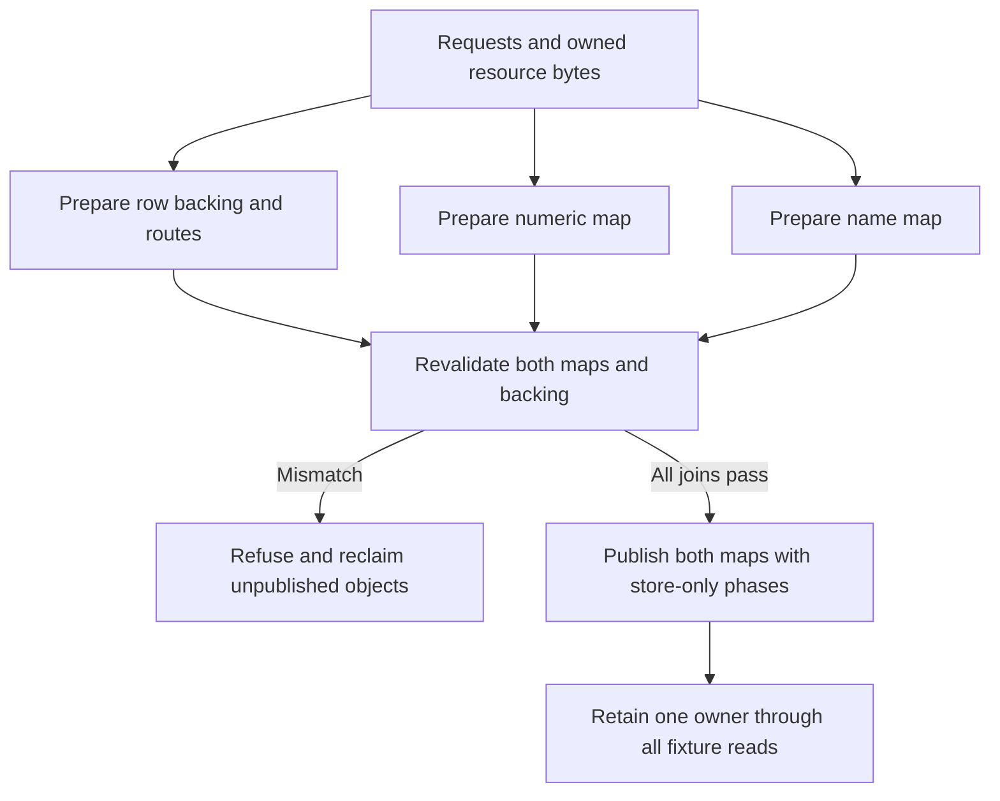

# Paired item publication experiment

## Purpose and status

This maintained C++ experiment joins both item identity maps to one retained
owner before a newly visible ordinal can be resolved. It is the bounded
`CDISO-RE-02A` research increment under the
[canonical independent-content goal](../../../beta-progress/cditem-conflict-isolation-plan.md).

The executable operates on memory it owns. It models numeric/name lookup,
decoded rows, metadata and completed resource bytes. The production CMake
targets and release provenance do not include this directory. Actual engine
constructors, native lookups, private file I/O, a game reader boundary and native
package admission remain separate work.

Source owners:

- [paired_item_publication.hpp](paired_item_publication.hpp) owns the fixed
  experimental storage, common preparation, validation, publication and lifetime.
- [paired_item_publication_fixture.cpp](paired_item_publication_fixture.cpp)
  owns executable refusal, visibility, reentry and cleanup checks.
- [Independent items](../../../cdmw/ui/new_item/INDEPENDENT_ITEMS.md#runtime-registration-research)
  owns the broader identity/backend contract and evidence boundaries.

## Why a joined operation is needed

The retained B111 experiment validates one map immediately before publishing it.
Calling its numeric publication and then its name publication leaves a fallible
validation between the two operations. The second map can refuse after the first
has exposed an item. A new isolated reproducer confirmed that sequence using
the retained B111 C++ source on owned memory.

Source review also found that B111's diagnostic observer could recursively call
publication while the object was still marked prepared. The nested validation
could refuse and release nodes still reachable by the outer operation. The
successor enters a distinct publishing state before the first store; recursive
prepare, publish and fault-injection requests then refuse without cleanup.

These are findings about composing the retained experiment. They do not describe
a failure in an enabled production item-registration backend.

## Ownership and publication contract

`PairedPublication` is a noncopyable, nonmovable owner with two seeded stock map
entries and room for at most four new experimental entries. It owns both maps,
fixed primary pointer cells, expiry cells, metadata, decoded fixture rows,
resource bytes and newly allocated map nodes. Views remain valid only while
that owner remains alive.

The retained map layout is explicit: a 32-byte header, 256-byte buckets with at
most 31 key/index pairs, and 12-byte nodes. The model requires a 64-bit,
little-endian C++20 target. These layout checks describe the selected research
representation; they do not qualify a game ABI or every map specialization.



Preparation copies the supplied identity and resource expectations. Changes to
the caller's input after preparation cannot change the prepared content.
Identity carries package bytes, retained numeric/name keys, donor provenance
and the expected ordinal. This experiment does not parse `.cditem` or
`.cdprofile`, allocate production IDs or implement save migration.

Before any map write, publication validates both captured map states and every
new ordinal's concrete joins:

| Join | Required relationship |
| --- | --- |
| Primary cell | Points to the owned decoded fixture row at the expected ordinal |
| Identity | Package, numeric key, name key, donor and ordinal match the copied request |
| Expiry and metadata | Initialized expiry; exact numeric key and owned route index |
| Resource owner | Row points to its retained resource object |
| Resource selection | Exact expected archive identity and bounded range |
| Resource completion | Complete fixture state; requested/completed lengths equal the payload length; archive slice and completed bytes match the expected bytes |

The test data deliberately distinguishes a 112-byte archive from its 102-byte
payload. These are owned synthetic bytes. A `complete` fixture state is not
evidence of any native file operation.

After validation, the unit changes to `publishing` and executes the numeric and
name store phases. The core performs no allocation or fallible validation after
the first write. The diagnostic observer is `noexcept` and must keep its active
owner alive. It can inspect each store and exercise safe refusal of recursive
operations.

Both maps retain their original entry and bucket backing. Each visible new
ordinal resolves to its prepared row and distinct resource owner, including
observations before the final diagnostic owner count. The two same-donor
fixtures have separate identities and resource sentinels.

## Failure and lifetime

Before publication, a failed request, allocation, map snapshot or backing join
refuses without changing either map. All successfully allocated unpublished
nodes, rows and resources are reclaimed exactly once.

Once publishing begins, no supported mutation or repeat-publication call can
discard the owner. The owner retains every reachable object through the
observations. Fixture destruction clears its own lookup reachability before
reclaiming nodes, rows and resources. This is a single-threaded teardown of
owned memory; it does not establish live game unloading or borrowed-pointer
retirement.

The numeric and name stores remain sequential. The fixture deliberately observes
intermediate states where one map exposes a new entry and the other does not.
Complete backing does not make the two maps atomic for arbitrary readers. A
production route still requires a demonstrated reader boundary or synchronization
contract, plus all affected consumer and failure behavior.

## Focused verification

From the repository root on the isolated Linux C++20 runner:

```bash
cditem_fixture_dir="$(mktemp -d)"
g++ -std=c++20 -Wall -Wextra -Werror -pedantic -O1 -g \
  -fsanitize=address,undefined -fno-omit-frame-pointer \
  native/cdmw_virtual_loader/research/paired_item_publication_fixture.cpp \
  -o "$cditem_fixture_dir/paired_item_publication"
ASAN_OPTIONS=detect_leaks=0 "$cditem_fixture_dir/paired_item_publication"
```

The recorded runner cannot inspect the process metadata required by
LeakSanitizer. AddressSanitizer and UndefinedBehaviorSanitizer remain enabled;
allocation/destruction assertions check the fixture's exact ownership counts.
No Windows compiler, game installation, provider or release build is used by
this command.

The executable exits nonzero on a failed assertion. Its JSON result separates
case/check counts and observed visibility from the native I/O, constructor,
lookup, concurrent-reader, game and admission fields, which remain false.

Coverage includes two distinct same-donor contributions, each preparation
allocation failing in turn, stale numeric/name snapshots, second-map collisions,
prepared backing drift, pending/failed/short/mismatched resource completion,
invalid identity/ranges/counts, recursive publication and retained ownership.
The previous offline archive-review tests have their own scope and do not need
to be rerun for this experiment.

## Evidence and continuation

Reviewed source basis: `main@0aa0a1bea155c982a5aea8ce0ac39edf9d3e166f`,
2026-10-21, Europe/Stockholm. The predecessor sources remain sealed and unchanged:

| Retained source | SHA-256 |
| --- | --- |
| B61 `map_snapshot.hpp` | `49046738be1e20c81ae39bc5a9732768169535e70747efdb77b6ae3eaadde730` |
| B111 `fixed_append.hpp` | `56cbba41ac3bab70331131e4b5004eb26490f2cfa6f8d9391b53080a6085d4b0` |

The machine-local source pins, original sequential-call reproducer, build/run
results and review receipt belong in
`workspace/reports/cditem-execution/20261021-publication-readiness/`.
No extracted executable bytes or game assets are needed by the maintained
experiment.

B106 executed retained native array/null-cell construction in a separate
Windows fixture. This portable experiment does not repeat that execution or
treat null pointer cells as complete ItemInfo rows. Its stock primary cells
remain null; stock checks cover map state and keys, while new rows are modeled.

The next integration must join actual constructed backing, native metadata and
decoder routing to the same publication discipline. The current
[concrete I/O source contract](../../../cdmw/ui/new_item/INDEPENDENT_ITEMS.md#native-io-continuation-after-image-preparation)
now qualifies the bounded normal-return small-read premise. AL success still
hides terminal errors and actual count; exact native bytes and general
retirement remain unproved. Native two-item acquisition, equip, restart,
updates/removal, save reload and missing-provider behavior remain open.
