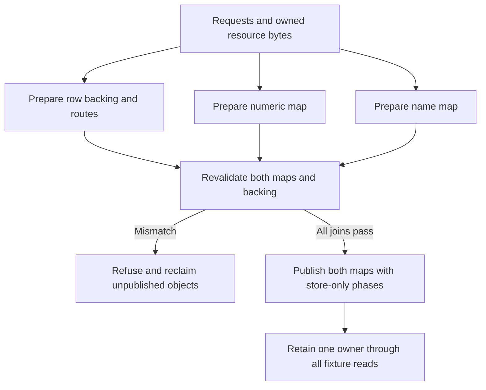

# Paired item publication experiment

## Purpose and status

This maintained C++ experiment joins both item identity maps to one retained
owner before a newly visible ordinal can be resolved. It is the bounded
`CDISO-RE-02A` research increment under the
[canonical independent-content goal](../../../beta-progress/cditem-conflict-isolation-plan.md).

The executable operates on memory it owns. It models numeric/name lookup,
decoded rows, metadata and completed resource bytes. The production CMake
targets and release provenance do not include this directory. Actual engine
constructors, native lookups, private file I/O, a game reader boundary and native
package admission remain separate work.

Source owners:

- [paired_item_publication.hpp](paired_item_publication.hpp) owns the fixed
  experimental storage, common preparation, validation, publication and lifetime.
- [paired_item_publication_fixture.cpp](paired_item_publication_fixture.cpp)
  owns executable refusal, visibility, reentry and cleanup checks.
- [Independent items](../../../cdmw/ui/new_item/INDEPENDENT_ITEMS.md#runtime-registration-research)
  owns the broader identity/backend contract and evidence boundaries.

## Why a joined operation is needed

The retained B111 experiment validates one map immediately before publishing it.
Calling its numeric publication and then its name publication leaves a fallible
validation between the two operations. The second map can refuse after the first
has exposed an item. A new isolated reproducer confirmed that sequence using
the retained B111 C++ source on owned memory.

Source review also found that B111's diagnostic observer could recursively call
publication while the object was still marked prepared. The nested validation
could refuse and release nodes still reachable by the outer operation. The
successor enters a distinct publishing state before the first store; recursive
prepare, publish and fault-injection requests then refuse without cleanup.

These are findings about composing the retained experiment. They do not describe
a failure in an enabled production item-registration backend.

## Ownership and publication contract

`PairedPublication` is a noncopyable, nonmovable owner with two seeded stock map
entries and room for at most four new experimental entries. It owns both maps,
fixed primary pointer cells, expiry cells, metadata, decoded fixture rows,
resource bytes and newly allocated map nodes. Views remain valid only while
that owner remains alive.

The retained map layout is explicit: a 32-byte header, 256-byte buckets with at
most 31 key/index pairs, and 12-byte nodes. The model requires a 64-bit,
little-endian C++20 target. These layout checks describe the selected research
representation; they do not qualify a game ABI or every map specialization.



Preparation copies the supplied identity and resource expectations. Changes to
the caller's input after preparation cannot change the prepared content.
Identity carries package bytes, retained numeric/name keys, donor provenance
and the expected ordinal. This experiment does not parse `.cditem` or
`.cdprofile`, allocate production IDs or implement save migration.

Before any map write, publication validates both captured map states and every
new ordinal's concrete joins:

| Join | Required relationship |
| --- | --- |
| Primary cell | Points to the owned decoded fixture row at the expected ordinal |
| Identity | Package, numeric key, name key, donor and ordinal match the copied request |
| Expiry and metadata | Initialized expiry; exact numeric key and owned route index |
| Resource owner | Row points to its retained resource object |
| Resource selection | Exact expected archive identity and bounded range |
| Resource completion | Complete fixture state; requested/completed lengths equal the payload length; archive slice and completed bytes match the expected bytes |

The test data deliberately distinguishes a 112-byte archive from its 102-byte
payload. These are owned synthetic bytes. A `complete` fixture state is not
evidence of any native file operation.

After validation, the unit changes to `publishing` and executes the numeric and
name store phases. The core performs no allocation or fallible validation after
the first write. The diagnostic observer is `noexcept` and must keep its active
owner alive. It can inspect each store and exercise safe refusal of recursive
operations.

Both maps retain their original entry and bucket backing. Each visible new
ordinal resolves to its prepared row and distinct resource owner, including
observations before the final diagnostic owner count. The two same-donor
fixtures have separate identities and resource sentinels.

## Failure and lifetime

Before publication, a failed request, allocation, map snapshot or backing join
refuses without changing either map. All successfully allocated unpublished
nodes, rows and resources are reclaimed exactly once.

Once publishing begins, no supported mutation or repeat-publication call can
discard the owner. The owner retains every reachable object through the
observations. Fixture destruction clears its own lookup reachability before
reclaiming nodes, rows and resources. This is a single-threaded teardown of
owned memory; it does not establish live game unloading or borrowed-pointer
retirement.

The numeric and name stores remain sequential. The fixture deliberately observes
intermediate states where one map exposes a new entry and the other does not.
Complete backing does not make the two maps atomic for arbitrary readers. A
production route still requires a demonstrated reader boundary or synchronization
contract, plus all affected consumer and failure behavior.

## Focused verification

From the repository root on the isolated Linux C++20 runner:

```bash
cditem_fixture_dir="$(mktemp -d)"
g++ -std=c++20 -Wall -Wextra -Werror -pedantic -O1 -g \
  -fsanitize=address,undefined -fno-omit-frame-pointer \
  native/cdmw_virtual_loader/research/paired_item_publication_fixture.cpp \
  -o "$cditem_fixture_dir/paired_item_publication"
ASAN_OPTIONS=detect_leaks=0 "$cditem_fixture_dir/paired_item_publication"
```

The recorded runner cannot inspect the process metadata required by
LeakSanitizer. AddressSanitizer and UndefinedBehaviorSanitizer remain enabled;
allocation/destruction assertions check the fixture's exact ownership counts.
No Windows compiler, game installation, provider or release build is used by
this command.

The executable exits nonzero on a failed assertion. Its JSON result separates
case/check counts and observed visibility from the native I/O, constructor,
lookup, concurrent-reader, game and admission fields, which remain false.

Coverage includes two distinct same-donor contributions, each preparation
allocation failing in turn, stale numeric/name snapshots, second-map collisions,
prepared backing drift, pending/failed/short/mismatched resource completion,
invalid identity/ranges/counts, recursive publication and retained ownership.
The previous offline archive-review tests have their own scope and do not need
to be rerun for this experiment.

## Evidence and continuation

Reviewed source basis: `main@0aa0a1bea155c982a5aea8ce0ac39edf9d3e166f`,
2026-10-21, Europe/Stockholm. The predecessor sources remain sealed and unchanged:

| Retained source | SHA-256 |
| --- | --- |
| B61 `map_snapshot.hpp` | `49046738be1e20c81ae39bc5a9732768169535e70747efdb77b6ae3eaadde730` |
| B111 `fixed_append.hpp` | `56cbba41ac3bab70331131e4b5004eb26490f2cfa6f8d9391b53080a6085d4b0` |

The machine-local source pins, original sequential-call reproducer, build/run
results and review receipt belong in
`workspace/reports/cditem-execution/20261021-publication-readiness/`.
No extracted executable bytes or game assets are needed by the maintained
experiment.

B106 executed retained native array/null-cell construction in a separate
Windows fixture. This portable experiment does not repeat that execution or
treat null pointer cells as complete ItemInfo rows. Its stock primary cells
remain null; stock checks cover map state and keys, while new rows are modeled.

The 2026-10-22 retained-source join against build `1.0.0.2976` confirms that
B106 does not route appended rows to private definition bytes. B81 separately
exercised real decoding through explicit private-cache calls. The central
getter's cold branch first obtains the stock body Reader, and bulk has a
distinct materializer call. Selecting private bytes at materialization leaves
that earlier dependency to qualify; actual central routing remains unproved.
This source conclusion does not record a new game failure or native admission.

The separate 2026-10-23 passive loader experiment on game `1.0.0.2976` observes
the registered ItemInfo owner already globally visible at loader entry with
empty count/metadata/backing, then 6,816 entries and matching metadata/cookie
after normal return. Global pointer presence cannot serve as readiness. The
observed loader and bootstrap threads differ; no TLS sample was captured.
The later actual return RIP joins the unchanged serial 149-family dispatcher.
All `+0x20` and `+0x60` calls precede AF1; four later passes precede controller
completion, and outer task completion occurs later still. Existing B115 AF1
evidence already records guarded controller membership, all 6,816 stock rows
resident with matching keys, zero expiry and both maps. Body `owner+0x90` is zero;
both full stock snapshots precede C and phase TLS remains unknown. Reuse these
observations; a duplicate generic phase probe is unnecessary. They supply no
all-reader, maintenance or lifetime boundary for central publication.
Exact source, compiled controls, consumed captures and
restoration belong to the [current execution checkpoint](../../../beta-progress/cditem-execution-goal.md#resumed-with-direct-authority-2026-10-23).
The maintained owned-memory experiment itself is unchanged and was not rerun.

The next integration must join actual constructed backing, native metadata and
decoder routing to the same publication discipline. The current
[concrete I/O source contract](../../../cdmw/ui/new_item/INDEPENDENT_ITEMS.md#native-io-continuation-after-image-preparation)
now qualifies the bounded normal-return small-read premise. AL success still
hides terminal errors and actual count; general retirement remains unproved.
Native two-item acquisition, equip, restart,
updates/removal, save reload and missing-provider behavior remain open.

The separately retained small-read correction passed all 18 compiled fixture
cases on 2026-10-23 with its actual probe header and CFG unchanged. Actual
own-process API guards and the original ASI's no-session inactive check also
pass. The subsequent unchanged B115 game run returned all 102 expected bytes
from the exact 112-byte private archive. Independent review joins the physical
open/read captures, source and owned processes; restoration completed in 39.235
seconds. Both full stock snapshots precede the private operation. This fixed
byte observation does not establish resource-consumer behavior, API success/count
or retirement. Two separate actual-compiler images with distinct 144-byte slices
at offset 2704 are prepared. Their separate producer now passes 17 compiled native
cases and 13 aggregate reviews, including A-after-B and the full-payload last-byte
controls. The subsequent caller-v2 game attempt refused at both metadata checks
before reading and restored in 40.860 seconds; independent capture/restoration
review passes. The preparer sliced expected group bytes at 16:28 rather than the
actual serialized 12:24 boundary, while the fixture seeded the same wrong bytes.
Separately frozen v4 corrects those two expectations with four generation/format
boundary checks, preserving all runtime code, guards and images. Its own 17
native cases/13 aggregate reviews and inactive loading now pass in 21.304 seconds;
independent linked review also passes. Caller-v3's game capture now compares both
complete 144-byte payloads with zero mismatches, rechecks A after B and joins one
exact physical PAZ open to each native read interval: records 381/382 in the
538-record trace, read thread 41096/TLS family 0, distinct from AF1 thread 21752.
Restoration takes 40.985 seconds. Independent actual-capture review passes;
original raw/offline false flags remain unchanged. Resource use, general
independence, lifetime and native admission remain open.

B120-v2 separately qualifies 21 compiled reserved-tail adapter/near-edge/observer
cases and inactive loading with owned responses/synthetic callers. The terminal
refusal correction prevents a later valid primary call from reserving after a
pre-CAS refusal. These fixtures execute no original game-header/cleanup
instructions. Current PE guards
include the real cleanup thunks. Independent linked review now passes 42 functions
and the wrapper/GFID/argument/unwind joins. Controlled-caller source review also
passes: 216 full pins/167 runtime origins, with exactly 210 recovery sources
within the unchanged 256 limit. The subsequent controlled game capture passes
four original-helper forwards and the AF1 shape with counts/maps 6,816,
cookie/capacity 6,820, four null tail slots and all stock rows resident on
thread 51672/TLS family 0. Root physical/process/restoration checks pass in
30.719 seconds; independent actual review also passes. No private Cache/Rows,
count/map publication, cleanup execution or lifetime proof follows.

B121 now stages four checked off-count records using Cache.configure/get with
base N/full native spans N+4 unchanged. Router/null-tail snapshots remain separate
contracts. The real constructor and two-argument Bool decoder are called; the
central four-argument materializer remains unhooked. The new observer anchors the
full stock prefix/header/maps before staging, allows only four exact tail
witnesses and guards known source/stock/map/previous-allocation aliases. The V1
include failure was caught before compilation; V2 includes full map entry-capacity
alias coverage. Partial or uncertain state is retained without retry.
Eight owned Stage/Cache cases, actual encoder-body/parser checks with unchanged
strict game-address refusal and inactive `0/0/0` pass in 11.515 seconds.
Independent linked review joins 100 emitted functions and four raw encoded frames.
The final caller retains 218 full pins/167 runtime origins/three decoders, with
212 recovery rows within the unchanged 256 limit and no omitted runtime owners.
The subsequent game capture completes four real allocation/construction/Bool
decode/inspection paths with exact keys/names/cursors and 20 steps on thread
45824/TLS family 0. Public counts/maps remain 6,816 and capacity/cookie 6,820;
full represented stock prefix/header/maps differ only in four exact tail pointers.
Root physical/source/process checks and 29.391-second restoration pass;
independent capture review also passes. All five owned roles are absent and seven
companions/stock match. This is one item/three perk rows, with no central lookup,
bulk, resource-use, derived-state, cleanup, reader-lifetime or save acceptance.

Executable-source review identifies the ItemInfo manager's typed reset, setter,
clearer and loader slots: `+0x08` resets and `+0x20` loads. The actual passive
observations above do not establish safe publication. B122-v4 now prepares
unpublished pairs through B66/B64/B67 on owned native responses. Ten cases,
including N=6,816, five literal encoder channels with unchanged strict decoder
refusal and inactive loading pass. Independent emitted-code review joins 166
functions and 26 core contracts across all three images; the 369-pin native
proof is sealed. Actual game pair preparation now also passes: both unpublished
maps have 6,820 entries after eight original inserts, with twelve name callbacks,
45 steps and 13,636 accepted allocations. Public maps/counts remain 6,816, and
represented source/owner/metadata/expiry/records remain unchanged. Root joins all
five physical channels, 222 source pins, seven companions/stock and absence of
five owned roles, with 47.188-second restoration. Independent actual-capture
review now passes with no material defects. Guardian closure used the retained
stale-heartbeat policy at age 5,218ms, without a close request at that decision;
the game closed normally while offline review ran. This historical restoration
predates the user's separately authorized Sword overlay. No public map/count,
cleanup execution or native admission is established. Then join both getter/bulk routes under
concrete reader/maintenance coverage, coherent publication, failure-stop and
lifetime. Native numeric values are WORD ordinals; name values are DWORD numeric
keys. Real metadata uses body offsets. This portable model's name values and
route indexes are fixture ABIs, so it remains an ordering reference. The native
adapter must guard known source/clone ranges before controlled writes/releases;
B64's assumed clone freshness is insufficient by itself. No whole-heap inventory
or guessed uncertain cleanup is implied.

The newer complete consumer-source pass explains stock eager materialization
and the later derived-manager validation. Expiry zero permits sampled eviction;
it cannot pin a private record permanently. Ordinary walks use N and cleanup uses
the cookie; actual cleanup execution remains unverified. The executed reservation
and checked tail stage do not qualify central getter/bulk, private body offsets,
derived-state acceptance or lifetime. Central in-memory registries are permitted
by the objective; combined replacement definition/index/mount/archive carriers
remain prohibited. Exact source/native/caller/capture and next-step pins live in
the [current execution checkpoint](../../../beta-progress/cditem-execution-goal.md#resumed-with-direct-authority-2026-10-23).

The user's separate Sword test install uses the existing composed physical
overlay, item 1,990,000 in group 0041, with verified backup/readback and seven
unchanged loader companions. It intentionally changes PAPGT/PATHC after B122.
The supported shop update subsequently adds one sword to Tranan's stock, with
verified backups, exact readback and independent file review. The user reports
successful acquisition and supplies screenshots showing the custom sword at
Tranan and visibly equipped. Sheath duplication and held orientation are accepted
test limits, with no cosmetic work requested. The Live Edit Add callback timeout
remains separate; save/reload and independent-native activation are unproved. See
[the installation boundary](../../../beta-progress/cditem-execution-goal.md#sword-installation-for-the-users-visual-test).

The V3 owned-dummy DbgEng platform check now passes: eight complete held threads,
five snapshots, typed contexts/TIBs/stacks, explicit detach and independently
observed worker resumption, with cleanup in 1.701304 seconds within 20 seconds.
Independent actual review passes 88 source/build/capture pins without defects.
V1/V2 failures remain preserved. Paused debugger-read counters do not exclude
caching, and the selected read-only pause stops the target writer too. B74
covers only wrapped entrants; B78 cannot prebind the incomplete N/N+4 owner.
The V4 owned scratch-store source is frozen and independently reviewed, with
16 changed pure checks passing. It requires exact byte counts and independent
physical readback/restoration; its strict-build qualifier is also reviewed.
The first build preflight refusal is preserved. After the foreign helper
naturally disappears, the unchanged strict build and one owned run pass exact
32-byte write/restoration, three independent process-memory phases, held counters
and explicit detach/resumption, with cleanup in 2.388533 seconds. Root verifies
all 68 raw files; independent actual review passes 120 closure pins without
material defects. No game reader
lease, writer/Router activation, publication or admission is established. See
[the platform evidence and writer boundary](../../../beta-progress/cditem-execution-goal.md#reader-boundary-platform-qualification-remains-open).

The finite historical-B122 source roster supplies 14 prospective data fields/72
bytes, but no dormant Router activation ABI or durable Cache continuation. The
staging allocator requires original owner counts/maps/zero metadata tail and the
incomplete AF1 worker/controller; configure-once state cannot adopt its live
witnesses through a supported API. Final-shape hot/cold routing, actual later
thread/TLS/source validity, maintenance and lifetime proof remain unresolved.
The underlying byte-identical backend separately retains B81's selected
family-zero later-thread controlled-rematerialization witness. Preserve that
bounded evidence; do not equate the Stage guard with a native AF1-only rule or
promote the selected callback into general later getter/bulk thread safety.
The read-only family-zero follow-up now joins 12 bounded entries to PE/unwind
and independently decoded instruction bytes. It proves a separate indexed TLS
heap context, the `0x440` aligned route's `0x44F` byte request and an explicit
atomic non-owner free queue. A selected follow-up independently verifies 131
instruction records across the raw dispatch/general allocation and aligned-pointer
recovery entries. It exposes further context/block/pointer services and requires
coherent metadata with a nonzero recovery size. Transitive services, live
initialization, queue draining and borrowed lifetime remain unresolved. Unwind
extents do not establish complete logical functions.
Use the [current source evidence](../../../beta-progress/cditem-execution-goal.md#reader-boundary-platform-qualification-remains-open)
before preparing a direct-call stock cold witness or durable continuation.

The separately compiled direct-call precursor now passes all 27 owned native
cases on 2026-10-24, including forwarding, original C++ exceptions, TLS binding
restoration, nested/concurrent calls and terminal patch failures. Independent
linked review accepts genuine same-page calls, selected GuardCF targets and the
active unwind action; all owned children retire and input pins remain unchanged.
Independent actual review passes 90 distinct file pins and all raw logs/layouts.
This qualifies only the measured owned fixture. Early UAL startup does not
exclude younger threads or every executor from a shared code page. V4’s RW
scratch proof and unconditional detach cleanup cannot qualify code publication:
possible-mutation uncertainty must retain the exact owned target until
termination. Whole-page exclusion, checked executable-code publication and safe
resumption after already-used callers remain unqualified. Exact pins, preserved
build-postcheck failure and proof limits
are in the [owned direct-call checkpoint](../../../beta-progress/cditem-execution-goal.md#owned-direct-call-forwarding-and-installation-boundary-2026-10-24).
Game reader leases, publication, resources, lifetime and admission remain open.

The separately reviewed ordinary DLL packet now passes one owned non-ASLR
preferred-base load. Its three uncalled compiled wrapper addresses fit the
numeric source CALL range; this does not establish runtime CFG enforcement or
production placement. Effective CFG also requires `/DYNAMICBASE`, disabled by
this fixture. The original quoted-option postcheck failure remains separate
from the accepted compile/link proof. Static follow-up independently verifies
the selected allocator base/size adapter/body and 35 instructions. Subsequent
block-selection and classifier reviews pass 82 and 31 instructions; file-derived
`0x44F` arithmetic selects class 25/cell `H+0x668` on the small/default path.
No live cell is read. Independent candidate-helper review joins 64 instructions:
atomic tagged-head detachment precedes ordinary staged-list/counter updates.
Those writes still require external serialization. The overlength diagnostic
has no local detached-list requeue if it returns; no game defect or safe
reclamation follows. Replenishment also passes 67-instruction source review and
reaches the producer with full cell-derived size. The retained free/consumer
join matches offsets, without concrete base identity or separate context-queue
drain. Producer review passes 75 instructions and joins local metadata stores.
The 35-instruction descriptor wrapper only routes onward. The normal descriptor
target also passes 140-instruction review: its block-count store targets scanned
`D`, without proving identity with returned `M`. Post-call R11 preservation stays
unresolved. Descriptor/backing provenance, coherent nonzero size and lifetime
remain unqualified. The
[placement/source checkpoint](../../../beta-progress/cditem-execution-goal.md#ordinary-dll-placement-and-allocator-source-2026-10-24)
retains the exact evidence and the stopped, unqualified publication draft.

The bounded TLS-initializer capture places its guard store before a list of
nineteen callback cells and has no local heap-pointer check. The numeric loader
TLS index is unobserved. Completed initialization, exception behavior, heap
ownership and ordinary-caller lifetime remain unqualified.

Independent callback/template, lazy-entry and thread-heap reviews join the
initial `+0x90` template pointer to the allocator's lazy branch. The nineteen
callbacks do not locally write it. A reviewed leaf capture identifies the
dynamic TLS store before an unclosed tail. Null candidate allocation still reaches
attempt-counter work; no live readiness, exception, ownership or thread/heap
lifetime proof follows.

The [owned Cache and Router continuation](../../../beta-progress/cditem-execution-goal.md#owned-cache-and-router-continuation-2026-10-24)
passes source/linked review and its strict build. A fresh Cache is retained
through dormant preparation and versioned local activation, with mandatory
final checks before its own publication lock releases. Old Stage/Cache guards
remain unchanged. All fifteen owned cases now pass after a preserved resource-guard
refusal, including a later-worker hot/evict/cold path. Independent actual review
passes 62 current pins, raw child/exit joins and lifecycle/refusal assertions
without material defects. No runtime CFG, engine context, all-reader or
native-admission proof is established.
