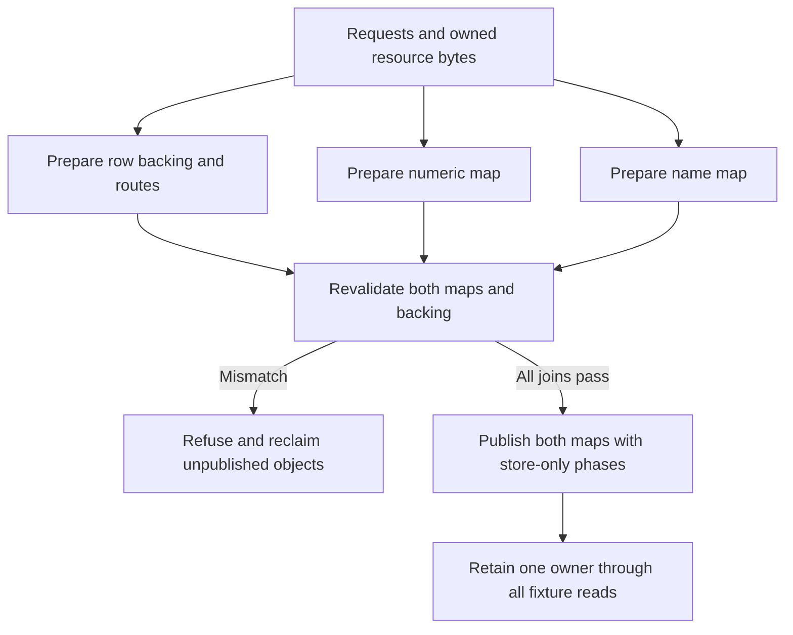

# Paired item publication experiment

## Purpose and status

This maintained C++ experiment joins both item identity maps to one retained
owner before a newly visible ordinal can be resolved. It is the bounded
`CDISO-RE-02A` research increment under the
[independent-content contract](../../../cdmw/ui/new_item/INDEPENDENT_ITEMS.md).

The executable operates on memory it owns. It models numeric/name lookup,
decoded rows, metadata and completed resource bytes. The production CMake
targets and release provenance do not include this directory. Actual engine
constructors, native lookups, private file I/O, a game reader boundary and native
package admission remain separate work.

Source owners:

- [paired_item_publication.hpp](paired_item_publication.hpp) owns the fixed
  experimental storage, common preparation, validation, publication and lifetime.
- [paired_item_publication_fixture.cpp](paired_item_publication_fixture.cpp)
  owns executable refusal, visibility, reentry and cleanup checks.
- [Independent items](../../../cdmw/ui/new_item/INDEPENDENT_ITEMS.md#runtime-registration-research)
  owns the broader identity/backend contract and evidence boundaries.

## Why a joined operation is needed

The retained B111 experiment validates one map immediately before publishing it.
Calling its numeric publication and then its name publication leaves a fallible
validation between the two operations. The second map can refuse after the first
has exposed an item. A new isolated reproducer confirmed that sequence using
the retained B111 C++ source on owned memory.

Source review also found that B111's diagnostic observer could recursively call
publication while the object was still marked prepared. The nested validation
could refuse and release nodes still reachable by the outer operation. The
successor enters a distinct publishing state before the first store; recursive
prepare, publish and fault-injection requests then refuse without cleanup.

These are findings about composing the retained experiment. They do not describe
a failure in an enabled production item-registration backend.

## Ownership and publication contract

`PairedPublication` is a noncopyable, nonmovable owner with two seeded stock map
entries and room for at most four new experimental entries. It owns both maps,
fixed primary pointer cells, expiry cells, metadata, decoded fixture rows,
resource bytes and newly allocated map nodes. Views remain valid only while
that owner remains alive.

The retained map layout is explicit: a 32-byte header, 256-byte buckets with at
most 31 key/index pairs, and 12-byte nodes. The model requires a 64-bit,
little-endian C++20 target. These layout checks describe the selected research
representation; they do not qualify a game ABI or every map specialization.



Preparation copies the supplied identity and resource expectations. Changes to
the caller's input after preparation cannot change the prepared content.
Identity carries package bytes, retained numeric/name keys, donor provenance
and the expected ordinal. This experiment does not parse `.cditem` or
`.cdprofile`, allocate production IDs or implement save migration.

Before any map write, publication validates both captured map states and every
new ordinal's concrete joins:

| Join | Required relationship |
| --- | --- |
| Primary cell | Points to the owned decoded fixture row at the expected ordinal |
| Identity | Package, numeric key, name key, donor and ordinal match the copied request |
| Expiry and metadata | Initialized expiry; exact numeric key and owned route index |
| Resource owner | Row points to its retained resource object |
| Resource selection | Exact expected archive identity and bounded range |
| Resource completion | Complete fixture state; requested/completed lengths equal the payload length; archive slice and completed bytes match the expected bytes |

The test data deliberately distinguishes a 112-byte archive from its 102-byte
payload. These are owned synthetic bytes. A `complete` fixture state is not
evidence of any native file operation.

After validation, the unit changes to `publishing` and executes the numeric and
name store phases. The core performs no allocation or fallible validation after
the first write. The diagnostic observer is `noexcept` and must keep its active
owner alive. It can inspect each store and exercise safe refusal of recursive
operations.

Both maps retain their original entry and bucket backing. Each visible new
ordinal resolves to its prepared row and distinct resource owner, including
observations before the final diagnostic owner count. The two same-donor
fixtures have separate identities and resource sentinels.

## Failure and lifetime

Before publication, a failed request, allocation, map snapshot or backing join
refuses without changing either map. All successfully allocated unpublished
nodes, rows and resources are reclaimed exactly once.

Once publishing begins, no supported mutation or repeat-publication call can
discard the owner. The owner retains every reachable object through the
observations. Fixture destruction clears its own lookup reachability before
reclaiming nodes, rows and resources. This is a single-threaded teardown of
owned memory; it does not establish live game unloading or borrowed-pointer
retirement.

The numeric and name stores remain sequential. The fixture deliberately observes
intermediate states where one map exposes a new entry and the other does not.
Complete backing does not make the two maps atomic for arbitrary readers. A
production route still requires a demonstrated reader boundary or synchronization
contract, plus all affected consumer and failure behavior.

## Focused verification

From the repository root on the isolated Linux C++20 runner:

```bash
cditem_fixture_dir="$(mktemp -d)"
g++ -std=c++20 -Wall -Wextra -Werror -pedantic -O1 -g \
  -fsanitize=address,undefined -fno-omit-frame-pointer \
  native/cdmw_virtual_loader/research/paired_item_publication_fixture.cpp \
  -o "$cditem_fixture_dir/paired_item_publication"
ASAN_OPTIONS=detect_leaks=0 "$cditem_fixture_dir/paired_item_publication"
```

The recorded runner cannot inspect the process metadata required by
LeakSanitizer. AddressSanitizer and UndefinedBehaviorSanitizer remain enabled;
allocation/destruction assertions check the fixture's exact ownership counts.
No Windows compiler, game installation, provider or release build is used by
this command.

The executable exits nonzero on a failed assertion. Its JSON result separates
case/check counts and observed visibility from the native I/O, constructor,
lookup, concurrent-reader, game and admission fields, which remain false.

Coverage includes two distinct same-donor contributions, each preparation
allocation failing in turn, stale numeric/name snapshots, second-map collisions,
prepared backing drift, pending/failed/short/mismatched resource completion,
invalid identity/ranges/counts, recursive publication and retained ownership.
The previous offline archive-review tests have their own scope and do not need
to be rerun for this experiment.

## Evidence and continuation

Reviewed source basis: `main@0aa0a1bea155c982a5aea8ce0ac39edf9d3e166f`,
2026-10-21, Europe/Stockholm. The predecessor sources remain sealed and unchanged:

| Retained source | SHA-256 |
| --- | --- |
| B61 `map_snapshot.hpp` | `49046738be1e20c81ae39bc5a9732768169535e70747efdb77b6ae3eaadde730` |
| B111 `fixed_append.hpp` | `56cbba41ac3bab70331131e4b5004eb26490f2cfa6f8d9391b53080a6085d4b0` |

The machine-local source pins, original sequential-call reproducer, build/run
results and review receipt belong in
`workspace/reports/cditem-execution/20261021-publication-readiness/`.
No extracted executable bytes or game assets are needed by the maintained
experiment.

B106 executed retained native array/null-cell construction in a separate
Windows fixture. This portable experiment does not repeat that execution or
treat null pointer cells as complete ItemInfo rows. Its stock primary cells
remain null; stock checks cover map state and keys, while new rows are modeled.

The 2026-10-22 retained-source join against build `1.0.0.2976` confirms that
B106 does not route appended rows to private definition bytes. B81 separately
exercised real decoding through explicit private-cache calls. The central
getter's cold branch first obtains the stock body Reader, and bulk has a
distinct materializer call. Selecting private bytes at materialization leaves
that earlier dependency to qualify; actual central routing remains unproved.
This source conclusion does not record a new game failure or native admission.

The separate 2026-10-23 passive loader experiment on game `1.0.0.2976` observes
the registered ItemInfo owner already globally visible at loader entry with
empty count/metadata/backing, then 6,816 entries and matching metadata/cookie
after normal return. Global pointer presence cannot serve as readiness. The
observed loader and bootstrap threads differ; no TLS sample was captured.
The later actual return RIP joins the unchanged serial 149-family dispatcher.
All `+0x20` and `+0x60` calls precede AF1; four later passes precede controller
completion, and outer task completion occurs later still. Existing B115 AF1
evidence already records guarded controller membership, all 6,816 stock rows
resident with matching keys, zero expiry and both maps. Body `owner+0x90` is zero;
both full stock snapshots precede C and phase TLS remains unknown. Reuse these
observations; a duplicate generic phase probe is unnecessary. They supply no
all-reader, maintenance or lifetime boundary for central publication.
The maintained owned-memory experiment itself is unchanged and was not rerun.

The next integration must join actual constructed backing, native metadata and
decoder routing to the same publication discipline. The current
[concrete I/O source contract](../../../cdmw/ui/new_item/INDEPENDENT_ITEMS.md#native-io-continuation-after-image-preparation)
now qualifies the bounded normal-return small-read premise. AL success still
hides terminal errors and actual count; general retirement remains unproved.
Native two-item acquisition, equip, restart,
updates/removal, save reload and missing-provider behavior remain open.

The separately retained small-read correction passed all 18 compiled fixture
cases on 2026-10-23 with its actual probe header and CFG unchanged. Actual
own-process API guards and the original ASI's no-session inactive check also
pass. The subsequent unchanged B115 game run returned all 102 expected bytes
from the exact 112-byte private archive. Independent review joins the physical
open/read captures, source and owned processes; restoration completed in 39.235
seconds. Both full stock snapshots precede the private operation. This fixed
byte observation does not establish resource-consumer behavior, API success/count
or retirement. Two separate actual-compiler images with distinct 144-byte slices
at offset 2704 are prepared. Their separate producer now passes 17 compiled native
cases and 13 aggregate reviews, including A-after-B and the full-payload last-byte
controls. The subsequent caller-v2 game attempt refused at both metadata checks
before reading and restored in 40.860 seconds; independent capture/restoration
review passes. The preparer sliced expected group bytes at 16:28 rather than the
actual serialized 12:24 boundary, while the fixture seeded the same wrong bytes.
Separately frozen v4 corrects those two expectations with four generation/format
boundary checks, preserving all runtime code, guards and images. Its own 17
native cases/13 aggregate reviews and inactive loading now pass in 21.304 seconds;
independent linked review also passes. Caller-v3's game capture now compares both
complete 144-byte payloads with zero mismatches, rechecks A after B and joins one
exact physical PAZ open to each native read interval: records 381/382 in the
538-record trace, read thread 41096/TLS family 0, distinct from AF1 thread 21752.
Restoration takes 40.985 seconds. Independent actual-capture review passes;
original raw/offline false flags remain unchanged. Resource use, general
independence, lifetime and native admission remain open.

B120-v2 separately qualifies 21 compiled reserved-tail adapter/near-edge/observer
cases and inactive loading with owned responses/synthetic callers. The terminal
refusal correction prevents a later valid primary call from reserving after a
pre-CAS refusal. These fixtures execute no original game-header/cleanup
instructions. Current PE guards
include the real cleanup thunks. Independent linked review now passes 42 functions
and the wrapper/GFID/argument/unwind joins. Controlled-caller source review also
passes: 216 full pins/167 runtime origins, with exactly 210 recovery sources
within the unchanged 256 limit. The subsequent controlled game capture passes
four original-helper forwards and the AF1 shape with counts/maps 6,816,
cookie/capacity 6,820, four null tail slots and all stock rows resident on
thread 51672/TLS family 0. Root physical/process/restoration checks pass in
30.719 seconds; independent actual review also passes. No private Cache/Rows,
count/map publication, cleanup execution or lifetime proof follows.

B121 now stages four checked off-count records using Cache.configure/get with
base N/full native spans N+4 unchanged. Router/null-tail snapshots remain separate
contracts. The real constructor and two-argument Bool decoder are called; the
central four-argument materializer remains unhooked. The new observer anchors the
full stock prefix/header/maps before staging, allows only four exact tail
witnesses and guards known source/stock/map/previous-allocation aliases. The V1
include failure was caught before compilation; V2 includes full map entry-capacity
alias coverage. Partial or uncertain state is retained without retry.
Eight owned Stage/Cache cases, actual encoder-body/parser checks with unchanged
strict game-address refusal and inactive `0/0/0` pass in 11.515 seconds.
Independent linked review joins 100 emitted functions and four raw encoded frames.
The final caller retains 218 full pins/167 runtime origins/three decoders, with
212 recovery rows within the unchanged 256 limit and no omitted runtime owners.
The subsequent game capture completes four real allocation/construction/Bool
decode/inspection paths with exact keys/names/cursors and 20 steps on thread
45824/TLS family 0. Public counts/maps remain 6,816 and capacity/cookie 6,820;
full represented stock prefix/header/maps differ only in four exact tail pointers.
Root physical/source/process checks and 29.391-second restoration pass;
independent capture review also passes. All five owned roles are absent and seven
companions/stock match. This is one item/three perk rows, with no central lookup,
bulk, resource-use, derived-state, cleanup, reader-lifetime or save acceptance.

Executable-source review identifies the ItemInfo manager's typed reset, setter,
clearer and loader slots: `+0x08` resets and `+0x20` loads. The actual passive
observations above do not establish safe publication. B122-v4 now prepares
unpublished pairs through B66/B64/B67 on owned native responses. Ten cases,
including N=6,816, five literal encoder channels with unchanged strict decoder
refusal and inactive loading pass. Independent emitted-code review joins 166
functions and 26 core contracts across all three images; the 369-pin native
proof is sealed. Actual game pair preparation now also passes: both unpublished
maps have 6,820 entries after eight original inserts, with twelve name callbacks,
45 steps and 13,636 accepted allocations. Public maps/counts remain 6,816, and
represented source/owner/metadata/expiry/records remain unchanged. Root joins all
five physical channels, 222 source pins, seven companions/stock and absence of
five owned roles, with 47.188-second restoration. Independent actual-capture
review now passes with no material defects. Guardian closure used the retained
stale-heartbeat policy at age 5,218ms, without a close request at that decision;
the game closed normally while offline review ran. This historical restoration
predates the user's separately authorized Sword overlay. No public map/count,
cleanup execution or native admission is established. Then join both getter/bulk routes under
concrete reader/maintenance coverage, coherent publication, failure-stop and
lifetime. Native numeric values are WORD ordinals; name values are DWORD numeric
keys. Real metadata uses body offsets. This portable model's name values and
route indexes are fixture ABIs, so it remains an ordering reference. The native
adapter must guard known source/clone ranges before controlled writes/releases;
B64's assumed clone freshness is insufficient by itself. No whole-heap inventory
or guessed uncertain cleanup is implied.

The newer complete consumer-source pass explains stock eager materialization
and the later derived-manager validation. Expiry zero permits sampled eviction;
it cannot pin a private record permanently. Ordinary walks use N and cleanup uses
the cookie; actual cleanup execution remains unverified. The executed reservation
and checked tail stage do not qualify central getter/bulk, private body offsets,
derived-state acceptance or lifetime. Central in-memory registries are permitted
by the objective; combined replacement definition/index/mount/archive carriers
remain prohibited.

The user's separate Sword test install uses the existing composed physical
overlay, item 1,990,000 in group 0041, with verified backup/readback and seven
unchanged loader companions. It intentionally changes PAPGT/PATHC after B122.
The supported shop update subsequently adds one sword to Tranan's stock, with
verified backups, exact readback and independent file review. The user reports
successful acquisition and supplies screenshots showing the custom sword at
Tranan and visibly equipped. Sheath duplication and held orientation are accepted
test limits, with no cosmetic work requested. The Live Edit Add callback timeout
remains separate; save/reload and independent-native activation are unproved.

The V3 owned-dummy DbgEng platform check now passes: eight complete held threads,
five snapshots, typed contexts/TIBs/stacks, explicit detach and independently
observed worker resumption, with cleanup in 1.701304 seconds within 20 seconds.
Independent actual review passes 88 source/build/capture pins without defects.
V1/V2 failures remain preserved. Paused debugger-read counters do not exclude
caching, and the selected read-only pause stops the target writer too. B74
covers only wrapped entrants; B78 cannot prebind the incomplete N/N+4 owner.
The V4 owned scratch-store source is frozen and independently reviewed, with
16 changed pure checks passing. It requires exact byte counts and independent
physical readback/restoration; its strict-build qualifier is also reviewed.
The first build preflight refusal is preserved. After the foreign helper
naturally disappears, the unchanged strict build and one owned run pass exact
32-byte write/restoration, three independent process-memory phases, held counters
and explicit detach/resumption, with cleanup in 2.388533 seconds. Root verifies
all 68 raw files; independent actual review passes 120 closure pins without
material defects. No game reader
lease, writer/Router activation, publication or admission is established.

The finite historical-B122 source roster supplies 14 prospective data fields/72
bytes, but no dormant Router activation ABI or durable Cache continuation. The
staging allocator requires original owner counts/maps/zero metadata tail and the
incomplete AF1 worker/controller; configure-once state cannot adopt its live
witnesses through a supported API. Final-shape hot/cold routing, actual later
thread/TLS/source validity, maintenance and lifetime proof remain unresolved.
The underlying byte-identical backend separately retains B81's selected
family-zero later-thread controlled-rematerialization witness. Preserve that
bounded evidence; do not equate the Stage guard with a native AF1-only rule or
promote the selected callback into general later getter/bulk thread safety.
The read-only family-zero follow-up now joins 12 bounded entries to PE/unwind
and independently decoded instruction bytes. It proves a separate indexed TLS
heap context, the `0x440` aligned route's `0x44F` byte request and an explicit
atomic non-owner free queue. A selected follow-up independently verifies 131
instruction records across the raw dispatch/general allocation and aligned-pointer
recovery entries. It exposes further context/block/pointer services and requires
coherent metadata with a nonzero recovery size. Transitive services, live
initialization, queue draining and borrowed lifetime remain unresolved. Unwind
extents do not establish complete logical functions.

The separately compiled direct-call precursor now passes all 27 owned native
cases on 2026-10-24, including forwarding, original C++ exceptions, TLS binding
restoration, nested/concurrent calls and terminal patch failures. Independent
linked review accepts genuine same-page calls, selected GuardCF targets and the
active unwind action; all owned children retire and input pins remain unchanged.
Independent actual review passes 90 distinct file pins and all raw logs/layouts.
This qualifies only the measured owned fixture. Early UAL startup does not
exclude younger threads or every executor from a shared code page. V4’s RW
scratch proof and unconditional detach cleanup cannot qualify code publication:
possible-mutation uncertainty must retain the exact owned target until
termination. Whole-page exclusion, checked executable-code publication and safe
resumption after already-used callers remain unqualified. The preserved
build-postcheck failure remains part of the proof limits.
Game reader leases, publication, resources, lifetime and admission remain open.

The separately reviewed ordinary DLL packet now passes one owned non-ASLR
preferred-base load. Its three uncalled compiled wrapper addresses fit the
numeric source CALL range; this does not establish runtime CFG enforcement or
production placement. Effective CFG also requires `/DYNAMICBASE`, disabled by
this fixture. The original quoted-option postcheck failure remains separate
from the accepted compile/link proof. Static follow-up independently verifies
the selected allocator base/size adapter/body and 35 instructions. Subsequent
block-selection and classifier reviews pass 82 and 31 instructions; file-derived
`0x44F` arithmetic selects class 25/cell `H+0x668` on the small/default path.
No live cell is read. Independent candidate-helper review joins 64 instructions:
atomic tagged-head detachment precedes ordinary staged-list/counter updates.
Those writes still require external serialization. The overlength diagnostic
has no local detached-list requeue if it returns; no game defect or safe
reclamation follows. Replenishment also passes 67-instruction source review and
reaches the producer with full cell-derived size. The retained free/consumer
join matches offsets, without concrete base identity or separate context-queue
drain. Producer review passes 75 instructions and joins local metadata stores.
The 35-instruction descriptor wrapper only routes onward. The normal descriptor
target also passes 140-instruction review: its block-count store targets scanned
`D`, without proving identity with returned `M`. Post-call R11 preservation stays
unresolved. Descriptor/backing provenance, coherent nonzero size and lifetime
remain unqualified. The stopped publication draft remains unqualified.

The bounded TLS-initializer capture places its guard store before a list of
nineteen callback cells and has no local heap-pointer check. The numeric loader
TLS index is unobserved. Completed initialization, exception behavior, heap
ownership and ordinary-caller lifetime remain unqualified.

Independent callback/template, lazy-entry and thread-heap reviews join the
initial `+0x90` template pointer to the allocator's lazy branch. The nineteen
callbacks do not locally write it. A reviewed leaf capture identifies the
dynamic TLS store. Its separately reviewed tail forwards the pointer and global
index to the declared `FlsSetValue` import, without a caller-side result check.
A reviewed key writer passes a callback address to the declared `FlsAlloc`
import and unconditionally stores its returned DWORD. Null candidate allocation
still reaches attempt-counter work. The declared callback delegates cleanup
before its normal-return FLS-clear request; invocation and cleanup effects remain
unproved. Live key validity, successful registration/
association, cleanup and thread/heap lifetime remain unproved. B81's later-thread
rematerialization lacks an allocating-thread termination witness; the next
distinct lifetime check must establish that boundary before native inspect,
release and same-Cache rematerialization.

The owned Cache and Router continuation
passes source/linked review and its strict build. A fresh Cache is retained
through dormant preparation and versioned local activation, with mandatory
final checks before its own publication lock releases. Old Stage/Cache guards
remain unchanged. All fifteen owned cases now pass after a preserved resource-guard
refusal, including a later-worker hot/evict/cold path. Independent actual review
passes 62 current pins, raw child/exit joins and lifecycle/refusal assertions
without material defects. No runtime CFG, engine context, all-reader or
native-admission proof is established.

A separate owned thread-retirement fixture passes five cases and independent
source, linked and actual reviews. Its one Cache/fake Api spans worker A,
retained-handle OS-exit verification, coordinator inspection/release, worker B
rematerialization and the same checks. The parked-work negative retains all four
allocations and refuses release without OS-thread exit. The positive case checks
both four-row generations, 64 steps, 72 context events and all 16 phases. This
qualifies owned orchestration only: the decoder copies an identity prefix and
supplies a synthetic cursor. The configured eight-second wait is separate from
cleanup and does not prove a hard eight-second total wall limit.

A separately source-reviewed native retirement caller v1 passes its strict standalone
build, linked review and one exact-PID direct-interpreter inactive load. The first
virtualenv PID-join failure remains failed. Its context observer, retained Trial
and synchronous bounded codec are compiled; that caller's C++ encoder has not executed.
Raw TLS words establish neither readiness, first-ever use nor a coherent
snapshot/lifetime lease. File-only collector v2 passes nine new capture-order/
refusal checks and source review after the preserved v1 refusal. The separate
eight-second validator and collector still require active external guardian
arming, immediate current-PID stop, a fresh post-validation completion clock and
provenance/recovery integration. Actual B80 calls, native post-exit record
survival, game readers, publication and resource/save behavior stay open.

Arming gate v4 passes independent source and build-driver review after the preserved v2/v3
refusals. It requires the exact guardian acknowledgment before bridge installation
and permits mutable callbacks only after successful startup acknowledgment.
Seventeen pure acknowledgment-codec checks pass; this source remains uncompiled
and supplies no active guardian or deadline/stop proof. The retained process handle passes three owned Win32 cases and independent
actual review; its earlier foreign-build preflight refusal is preserved.
The standalone C++ wire fixture passes strict build, linked review and six
actual synthetic record cases.

Independent static FLS review qualifies owner-gated context retirement, possible
16-slot context caching and delegated backing handling. Outstanding item-record
payload free/preservation remains unknown. Further reviewed mode-2 visitors
distinguish raw zero-node metadata/backing handling from nonzero region handoff;
deeper helpers, counter meanings and private-record-to-node ownership remain
open.

A further reviewed nonempty-head allocator path links raw block return to that
same counter increment. Aligned-pointer membership, complete accounting and
post-exit lifetime remain unproved.

A separate collection-decision component passes source review and 93 fake-only
checks. It samples the supplied clock after collector and wrapper validation
and immediately asks the same retained handle to stop on every final decision.
It supplies no active watchdog, actual Windows clock/stop or retirement proof.
The watch design separates collector work from the sole stop owner. Its
256-byte start-channel codec passes independent source review and 332 bytes-only
checks, joining the exact acknowledgment and one-shot 32-byte native start.
Stateless decoding supplies no publication history, atomic or readiness proof.

The injected crash-stop lease passes source review and 105 fake-only checks;
its lazy Win64 adapter separately passes source review and 62 fake ABI/wiring
checks. The source authenticates one handle with the additional Job-assignment right,
verifies a new unnamed noninherited kill-on-close Job and retains uncertain
ownership explicitly. Its owned Windows Job and guardian-crash behavior now pass actual review;
Steam/game compatibility and complete-watch Job ownership remain unqualified.

Caller v5 passes independent source/build-driver review. It opens the matching
start channel before bridge installation, then commits the same 32-byte start
and wake signal before the start-file write. The existing Trial and callback
publication order are retained. V5 remains uncompiled; no channel creator,
reader or active watch has executed. These are source prerequisites, with no
deadline, crash-stop, retirement, engine lifetime or native-admission proof.

File-only review of this host's pinned kernel32/KernelBase export tables finds
no named `InterlockedCompareExchange64` entry; no live symbol lookup occurred.
A separate data-only native atomic interface now passes source/build-driver
review. It owns fresh noninherited mapping/event handles, separates creation
from arming and acquires published state before reading the start payload.
The fixed Python binding passes independent review and 100 fake-only binding
checks, retaining publication history and quarantining uncertain ownership.
A benign producer and the complete owned IPC qualifier now pass independent
source review. The qualifier requires both actual build proofs and separate
linked reviews joined to its exact source before native loading or child
creation. Its 201 fake-only checks cover pipe capacity/ownership, framed status
and explicit process retirement. A frozen predecessor was refused because
optimized Python could erase helper assertions; its successor requires isolated,
nonoptimized interpreters before setup. Timestamp and failure-receipt corrections
retain the failed first fake run. Those IPC2 source-stage results remain
historical; the IPC3 failure and current IPC4 qualification are recorded below.

The retained guardian V2 source passes independent review and 243 focused
file-only checks, including witnessed empty diagnostic logs while refusing empty
code and JSON. Its three owned Win32 handle cases, six compiled synthetic wire
cases and three owned crash-lease cases retain their independent actual reviews.
Those three component records remain unchanged.

The current V6 caller now passes strict zero-warning compile/link from a shorter
source and output location. All 34 native program/CMake/header files match V5
byte for byte. This actual build resolves the observed path-length failures;
the existing identity header was never missing. The original long-path failures
and the intervening guard refusal before compilation remain preserved. The
fresh output has its own reviewed wrapper and dispatch record; later linked
review must join both that outer provenance and the inner build proof.

Both V2 channel products also pass strict zero-warning compile/link and exact
linked review for the source-reviewed IPC3 qualifier. Its 201 focused fake
checks pass. The first actual publish case refuses the pipe endpoint/type/read
mode/instance predicate before starting the producer. The failing endpoint,
individual comparison and raw returned values were not recorded. That failed
attempt remains unchanged; the separate fresh-pipe diagnosis follows below.

Independent bounded cleanup review confirms the two first input-pipe handles,
owner DLL/kernel references and the direct case process were released; the
case process exited 1 and its retained handle closed. The original case and
outer failure/resource-false flags remain unchanged. This does not certify the
legacy identity module, lifetime Job, unexposed tool handle or whole process
tree. No later IPC3 case ran. The first pipe-only diagnostic source was
refused for exceptional child cleanup and final-receipt gaps and never ran.

The corrected V2 diagnostic now passes complete independent source and actual
review. One fresh owned pair reports flags 9 on the server and 8 on the
client: the local-clients-only bit is returned with the endpoint bit. The
old exact endpoint-only comparison rejects both of these observed values.
Read mode remains zero, maximum/current instances one and both quotas 4096;
peer identity, noninheritance and pipe type also pass. Both pipe handles,
child kernel reference and parent identity reference have checked release;
the exact diagnostic child exits zero with its retained handle closed.
This reproduces the flags mismatch on that new pair; it does not recover
the original IPC3 endpoint/scalars or qualify a producer/channel/game run.

The frozen IPC4 successor requires exactly the observed local-only plus
endpoint flags and retains all mode, instance, peer, quota and handle
checks. Its 209 focused fake-only checks pass, including missing local
protection, wrong endpoints, message mode/type and unknown flag bits. The
native products are unchanged and their exact linked reaffirmations bind
the approved complete IPC4 source. All seven fresh owned Windows cases
now pass independent actual review: publish, claim-pending, regression,
mutation, malformed record, mapping collision and event collision. All
seven direct case processes retire with fresh signal/exit-zero and
explicit retained-handle closure. The five launched producers retire
normally; collision cases start none. Every scoped case/controller
resource check passes, with unchanged inputs and empty fresh censuses.
This establishes the owned IPC channel only. Legacy outer identity, Job,
tool-handle and whole-tree limits remain; the failed IPC3 result is not
relabeled and no game/native-feature admission follows.

Watcher V3 and V4 remain frozen and refused. V3 missed an integration
reference; V4 omitted exact current-watch component-review joins and coupled
the first owned full-watch prerequisite to the game-only caller. Frozen V5
corrects those source contracts and passes 299 focused fake-only checks. It
requires the production V6 source, build, linked and inactive-load proofs in
both modes, while its owned mode additionally requires a separate native test
target and evidence profile. Fixture evidence cannot satisfy game mode. The
completed fixture record must join the actual ACK identities and armed tick
before the final decision. V5 has complete independent source approval with
all deferred actual
qualifications still mandatory. The 299 passing fake-only checks and source
approval do not activate the watcher or replace a complete owned-watch run.

The separate owned fixture reuses the real retirement core with OS threads
and allocations, plus the unchanged Lease/ACK/RCS1 helpers. Its manifest and
record format explicitly identify fixture evidence and do not imitate game
installation or engine support. Its first frozen build owner was independently
refused for checks that did not survive the blocking process census and an
ordinary Job-service import that did not bind execution to pinned source bytes.
The reviewed successor loads witnessed sources directly and rechecks the full
frozen input set after each census. It passes 131 focused checks and its strict
x64 compile/link completes with zero warnings or errors. All four direct build
tools retire normally with their retained handles closed, the identity module
reference is explicitly released, and fresh scoped censuses are empty. The
lifetime Job and outer tool/tree proof limits remain explicit. The fixture now has complete independent linked approval: its six callbacks
and read-only token match the actual executable. Its entry path uses the
separate fixture adapter; unused production parser symbols retained in linked
protocol code are not evidence of game execution. The fixture has not run;
actual complete-watch qualification remains required.

The production V6 source/PE/MAP/disassembly linkage now has complete
independent approval against this exact watcher and its actual build/output
wrapper. The inspection/step callbacks match the compiled image, ABI, unwind
and compiled CFG metadata. This remains static evidence; runtime CFG, reader
exclusion, process retirement and engine behaviour are separate proof levels.
A fresh independently reviewed inactive qualification loads the exact V6
image in a direct BASE test process, observes state zero before and after
initialization, explicitly unloads it and observes its absence. The child
retires normally on its retained handle, which is closed; its kernel and the
controller's identity module references are explicitly released. Fresh scoped
censuses are empty and no timeout, forced cleanup or unknown owner is recorded.
Independent actual review confirms this inactive prerequisite only. Lifetime
Job return, the outer tool handle and universal process/kernel closure remain
outside that recorded proof; no engine API or game session ran.

The nineteen retained component cases now have exact current-watch independent
reaffirmations, without replay, and the owned launch scope is independently
reviewed. The frozen component bundle passes the actual admission validator.
The first frozen external operator passes 37 isolated checks but its complete
independent source review refuses two uncovered failure paths: uncertain pipe
creation could bypass quarantine, and a fresh Job-helper digest could admit
changed source after validation. That source and its refusal remain immutable;
it was never executed. The successor protects the full creation-to-ownership
registration boundary and loads only the unique frozen Job source row. It
preserves the original checks, adds the failure regressions and passes all 62
focused isolated cases. V2 is frozen for a separate complete independent source
review, with the same approved fixture, component bytes and owned launch scope.
Neither operator has run; actual complete-watch qualification remains pending. No engine/resource/item/save
lifecycle proof or native admission follows from these prerequisite results.

The actual owned complete-watch qualification remains required before
controlled game testing. Game mode additionally requires reviewed current launch,
installation and recovery scope. Normal worker completion is required; forced
cleanup establishes retirement only. No controlled game run occurred. Engine
lifetime, coherent publication/readers, native resources, item lifecycle and
saves remain open; native_admission=false and all original acceptance lines
remain unchanged.

The three-case owned crash-lease qualifier now passes actual Windows review,
including guardian death with an independently retained target handle and live
unassigned sentinel. Composed-watch execution, deadline and stop latency,
game Job compatibility and admission remain open.
`native_admission=false`.
