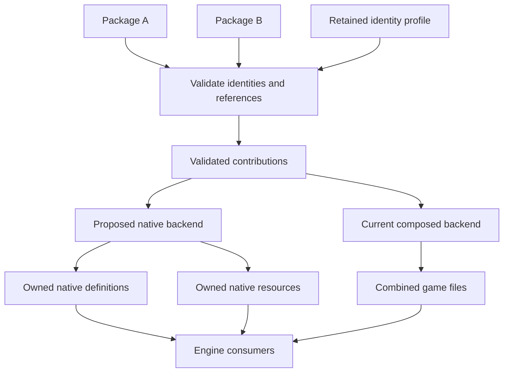
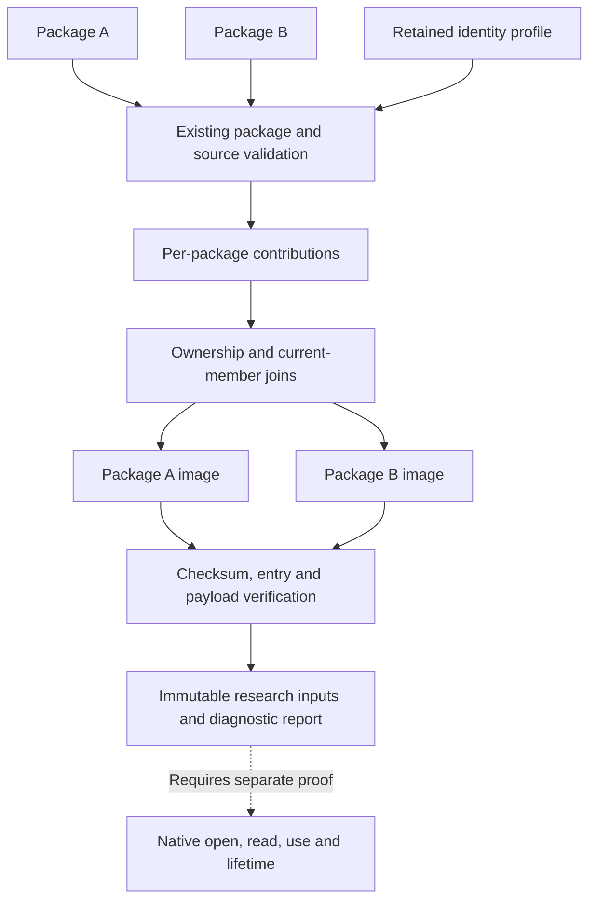
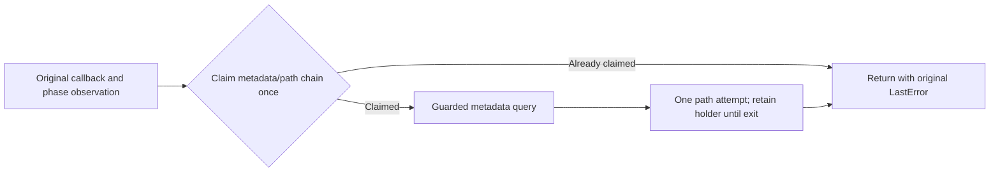
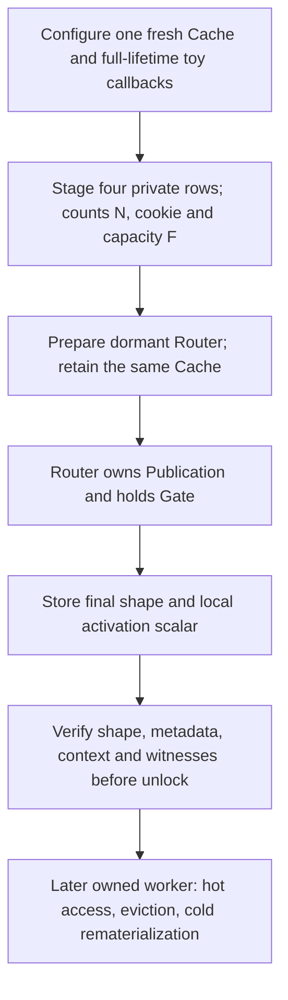
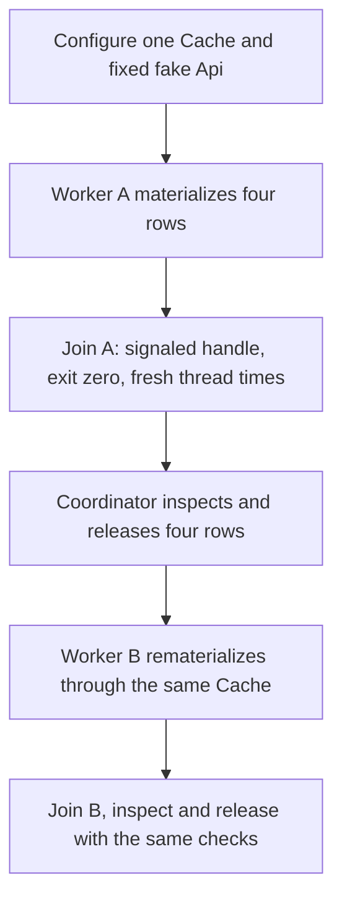
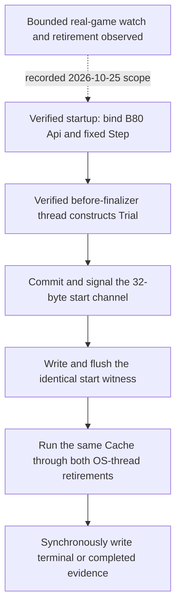
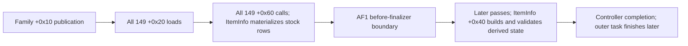
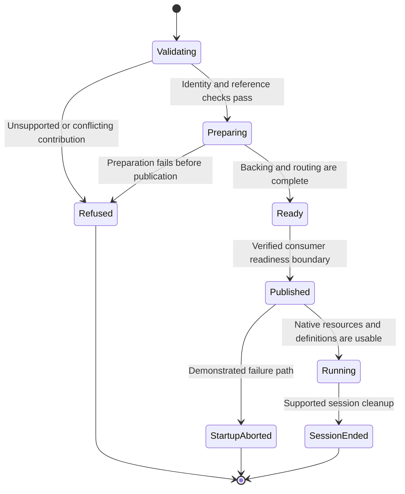

# Native runtime registration research (parked)

> **Status, 2026-10-25: parked.** `.cditem` ships as ownership-independent:
> each package owns its identities, names, keys and asset paths, CDMW refuses
> overlaps, and installation composes the shared game tables. This document keeps
> the native no-merge research for a separate experimental branch. It is not a
> user-facing contract, and nothing here is enabled in releases.
>
> Moved from [Independent item packages](../../../cdmw/ui/new_item/INDEPENDENT_ITEMS.md)
> with only link paths and heading levels changed. The
> [paired publication experiment](README.md) holds the C++ experiment and its run log.

## Objective and current boundary

The native-content objective is independently owned definitions and resources
with stable logical identity and retained engine bindings, loaded without combined
replacement game tables, indexes or archive carriers. A central runtime registry
can contain entries owned by different packages. It must preserve that ownership
and the relevant lifetime rules.

The current authoring and overlay code still rebuilds shared table paths.
Physical installation does not enable a native loader or modify the executable.
[Virtual loading](../../../cdmw/ui/new_item/VIRTUAL_LOADER.md) uses the same package identity reservations
for a private composed profile and reviewed experimental launches. Both current
backends therefore keep `isolated_new_item_admitted=false`.

The separate runtime Workshop route exposes export; its inventory type
identifiers are not established substitutes for ItemInfo table keys. An engine
function address or successful metadata lookup does not enable a new package
capability.

## Identity and backend architecture

| Identity layer | Existing contract | Native continuation requirement |
| --- | --- | --- |
| Package | Stable UUID, separate canonical content and exact archive digests | Preserve UUID across supported revisions |
| Object | Namespace and stable local symbol resolve through retained bindings | Use the same mapping for each admitted native object |
| Engine | Destination-specific numeric keys, names and resource identities | Refuse collisions; do not renumber an established object |
| Resource | Owned paths and decoded dependency assessment | Prove actual lookup, payload use and lifetime for the supported graph |
| Profile | Retained current and retired reservations | Preserve mappings on supported transfer; do not infer save migration |

The following diagram shows the current deployment branch and the proposed
native branch. The proposed branch is not a production loading route.



Two clean profiles can assign different numeric bindings to the same package
UUID. The existing `.cdprofile` transfer contract preserves the mapping needed
by its packages; arbitrary saved-reference relocation remains unimplemented.
Intentional `item.fields` and `texture.replace` stock edits retain their current
classification rather than acquiring an independent-new-item claim.

## Retained evidence and unresolved contracts

Review scope: 2026-10-21 continuation from
`099e9f7e7a5555f07246ab475b399c15215e419c`, retained native/publication results
and the new per-package resource preparation. The new verification uses actual
package/compiler and archive code on owned synthetic fixtures. Historical
native/game results and the preceding C++ run remain separate evidence.

| Evidence | Established for that scope | Not established |
| --- | --- | --- |
| Controlled composed-profile observations | Two saved swords, name-only updates, one-package removal and reversed reinstallation under retained bindings | Native no-composition behavior or saving while a provider is absent |
| B84 recorded game experiment | Four additional ItemInfo rows with numeric/name/getter joins | Full inventory acquisition, all consumers or ordinary cache lifetime |
| B106 native isolated experiment | Original typed array backing and retained cleanup under explicit helper substitutions | Live allocator/unwind admission or coherent publication |
| B111 native isolated experiment | Stable selected map backing and initialized results during deterministic write-step observations | Full native name callback, concurrent readers/writers, coherent ItemInfo owner or game admission |
| New portable paired-publication experiment | Common preflight, concrete modeled backing, reentry refusal and retained ownership across both map store phases | Actual engine constructors/lookups/metadata/decoding/I/O, atomic concurrent visibility or game admission |
| B99 recorded game experiment | Private metadata parsing and lookup of the expected entry | Native payload read/use, shared visibility, retirement or saved ownership |
| B109 and current concrete I/O source qualification | Wrapper, actual open/read/size and holder construction; bounded normal-return completion inference | Actual private byte delivery/use, generic diagnostic paths or safe general retirement |
| Per-package resource image preparation | Actual validated compiler outputs, separate archive bytes, retained/proposed reservations and owned-fixture lifecycle | Native routing, image consumption, full resource closure, runtime lifetime or saves |

The retained B111 result is built and executed, correcting an earlier
prepared-only handoff. Its qualified receipt has SHA-256
`98ecd954cfe82c35847ca0c19b4be66957bec9a05bcb1ed0881c5e8b5230552f`.
A read-only integrity review matched all twelve referenced artifacts, including
the seven prepared source files and exact fixture binary. The result remains
owned-memory evidence with heap/TLS substitutes and an explicit DWORD model.

**Publication constraint:** the selected native numeric lookup can return a new
ordinal when a bucket pair becomes visible, before the final map header count
changes and before a diagnostic owner count includes that ordinal. Count-last
is not a readiness barrier. Actual primary/expiry/metadata storage and private
decoder routing must be ready before the first visible entry in either map.
Other readers, iterators, writers and borrowed-pointer lifetimes still require
their own qualification.

## Paired map publication and retained ownership

The maintained [C++ experiment and diagram](README.md)
join both maps to one owner of primary cells, expiry, modeled metadata, decoded
fixture rows and resource bytes. Both snapshots and every new ordinal's concrete
joins validate before the first map write. The remaining store phases allocate
nothing and perform no fallible validation. A publishing state rejects recursive
prepare/publish and fault-injection calls without releasing active backing.

A new isolated reproducer confirmed the retained B111 composition hazard:
numeric publication can succeed before name publication refuses its stale state.
Source review also found that observer reentry could release nodes while the
outer B111 publication continued. The new unit addresses those failure boundaries
without changing the sealed predecessor.

The portable successor passes 41 cases and 963 checks with address/undefined
sanitizers. Its 34 write observations include 42 valid backing resolutions before
the final owner count and 32 partial numeric/name visibility observations.
Those partial states explicitly preserve the need for a qualified game reader
boundary. Final tested/reviewed source hashes match the project files; evidence
is in `workspace/reports/cditem-execution/20261021-publication-readiness/`.

Both lookup paths and resource completion are modeled. The fixture checks exact
owned archive/range/payload bytes; it performs no file I/O or native query.
B106's separate native constructor evidence initializes null pointer cells and
does not establish construction of full decoded ItemInfo rows. Fixture teardown
is single-threaded and proves no native retirement with outstanding readers.
The new sources remain outside production CMake targets and release provenance.

The 2026-10-22 source join against build `1.0.0.2976` further separates B106's
typed backing from definition-byte delivery. The ordinary getter returns
resident primary cells directly; its cold branch obtains the stock body Reader
before calling the materializer. Bulk materialization has a separate direct
call. B81's retained real-constructor/decoder result used explicit private-cache
calls and proves no central-getter routing. A private materializer can select
retained row bytes once reached, but the earlier stock-fetch dependency and
both actual consumer routes still need qualification. No new game failure or
publication safety is established by this source join.

## Per-package resource image preparation

The research service [independent_item_native_resources.py](../../../cdmw/services/independent_item_native_resources.py)
prepares separate resource images from actual validated package/compiler
contributions. The diagnostic command
[inspect_cditem_native_resources.py](../../../scripts/inspect_cditem_native_resources.py)
consumes those same images and prints their identities and byte-level checks.
This is the `CDISO-RE-03B` preparation increment. It does not install a profile
or provide a callable game backend.

Each package retains its own PAPGT, PAMT and PAZ byte strings. The private PAPGT
contains one group for that package, and the archive contains only the current
resource additions joined to its validated ownership and reservations. The group name `0000` and archive ordinal zero are local to each image;
they do not allocate global engine identities or establish native routing. Shared
definition tables, texture registries and shop/group integrations remain listed
as omitted work. The builder never combines the packages into one carrier.



### Identity and reservation provenance

| Identity | Meaning |
| --- | --- |
| Package UUID | Logical owner, preserved across supported revisions |
| Canonical content digest | Package recipe/content identity |
| Artifact digest | Exact input ZIP bytes, which can change on repacking |
| Binding digest | Destination reservation mapping, including retained claims |
| Resource image digest | Exact generated resource files, separate from package identity |

Each symbol/path is classified against the resolver's captured prior profile.
Existing matching claims remain retained; new claims remain proposed. An update
can contain both. The preparation does not commit proposals or make them stable
in a later independent profile. Retired reservations remain visible but are not
silently emitted as current archive entries.

Two fresh profiles can assign different numeric bindings depending on order.
Reversed-order equivalence therefore requires the same retained or imported
profile. A name-only update can change package content while leaving every
resource-image byte unchanged, because shared definitions are outside the image.
Repacking identical canonical content can change the artifact digest without
changing the resource image.

### Byte contract and side effects

The implementation reuses the existing archive serializers and readers. It
validates the captured source PAPGT before preserving its header metadata,
builds a fresh private group list, then checks the full PAPGT/PAMT/PAZ checksum
chain, exact member set, offsets, sizes and payload bytes. Current image entries
are uncompressed raw data. This proves a generated format/input relationship;
it does not prove that every game resource family accepts this storage route.

Package, source revision, external contribution and observed registry/profile/
mount state are checked through the existing owners. A changed state refuses
preparation. Limits and cancellation apply before a successful image set is
returned. Stock-only/mixed packages, unsupported private ownership and empty
private-resource contributions refuse this research route.

The images remain in memory and the command does not publish a game archive,
profile or resource image. Existing checksum policy may use temporary PAZ data
and the installed checksum helper above its size threshold. The work does not
build that helper, and helper execution is distinct from invoking the game's
native file manager.

### Evidence and continuation

Verification uses actual package reading, compiler lowering, identity
reservation logic, archive serialization and parsing on owned synthetic game
fixtures. It covers two same-donor packages, exact member bytes, retained-profile
order, independent update/removal/reinstall and profile transfer, plus input
and output refusal paths. Native capture, game asset consumption and save
compatibility remain separate evidence.

The focused Windows verification establishes 24 cases: 23 initially passed,
then the cancellation assertion was corrected to the actual `RunCancelled`
type and its single targeted rerun passed. The service and command were unchanged.
The other 23 passing cases were not rerun. Independent source and identity
reviews pass. The update case demonstrates retained numeric symbols with mixed
retained/proposed resource paths; fresh-profile numeric proposals are a separate
case.

Both archive and default virtual preparation contexts produced these small
fixture images. These sizes describe this fixture, not a general mod budget or
a performance benchmark.

| Observed image | Members | Logical payload | PAZ | PAPGT + PAMT | Total |
| --- | ---: | ---: | ---: | ---: | ---: |
| 1 | 4 | 2,818 B | 2,848 B | 843 B | 3,691 B |
| 2 | 4 | 2,820 B | 2,848 B | 845 B | 3,693 B |

Their PAZs are below the existing 64 KiB helper threshold. Evidence, exact source
pins, the initial assertion failure and the successful correction are retained
in `workspace/reports/cditem-execution/20261021-package-resource-images/`.

### Commands and API

Run the diagnostic command from the project root. Paths below are placeholders:

```powershell
.\.venv\Scripts\python.exe scripts\inspect_cditem_native_resources.py --game-root "C:\path\to\Crimson Desert" "C:\path\to\item.cditem"
```

The default `--target virtual` selects the existing identity/dependency context;
`--target archive` selects the other current context. Neither option selects a
native backend. Repeat `--folder` for ordinary mod folders required by the
existing dependency checks. The command prints JSON and does not export images.

The service API returns a tuple of `NativeResourceImage` owners. Each owner's
`files` property returns the exact `meta/0.papgt`, `0000/0.pamt` and
`0000/0.paz` relative names paired with immutable bytes. `report()` returns a
detached JSON object. A future research producer must consume these exact
bytes and establish its own current source/profile and native-lifetime checks;
this result is not a persistent runtime lease.

The focused verification owner is the single new test module:

```powershell
$cditemImagesTemp = Join-Path $env:TEMP ("cdmw-resource-images-" + [guid]::NewGuid().ToString("N"))
.\.venv\Scripts\python.exe -m pytest -q -s -p no:cacheprovider tests\test_independent_item_native_resources.py --basetemp "$cditemImagesTemp"
```

## Native I/O continuation after image preparation

The 2026-10-21 continuation qualifies the concrete methods against the unchanged
`1.0.0.2976` executable and current/retained REA evidence. Manager `0x146a85460`
uses vtable `0x1457122f0`. The complete open/read/size roots contain 1,582
bytes/371 instructions; size has an additional 5-byte entry thunk. The 205-byte,
50-instruction holder constructor matches an existing full REA capture. Empty
older instruction replies and the new size-entry decompilation refusal remain
retained evidence; they were not treated as complete bodies.

| Method | Qualified selected contract | Refusals and limits |
| --- | --- | --- |
| Open `0x1413273a0` | Manager, fresh holder-output pointer, narrow NUL-terminated path, 64-bit cached-size override, fifth DWORD flags; returns the output-slot address | Use override `UINT64_MAX` and flags zero for a real size query; null output means failure. Return address is not an open Boolean |
| Read `0x1413276b0` | Manager, private holder, buffer, DWORD capacity, DWORD requested count, DWORD low file offset; seventh retained caller argument is unused | Only AL is defined. AL `1` also follows diagnosed I/O failure and exposes no actual transferred count. Refuse request zero, offset beyond size, or request exceeding capacity/remaining bytes |
| Size `0x141327b50` → `0x14b68a7e0` | Returns holder `+0x10` when size-valid byte `+0x0c` is set; otherwise calls `GetFileSizeEx` without caching that query | Null holder diagnoses and returns zero; failed query diagnoses and returns `UINT64_MAX` |
| Holder `0x141326550` | Allocates 24 bytes aligned to 16 using current TLS byte `+0x1fd`; initializes HANDLE `+0`, flags `+8`, dword `+0x0c=0x100` and size `+0x10=0` | Allocation failure raises a noncontinuable exception. B109 release ignores conditional-close failure and chooses the free family from current TLS; general retirement is unproved |

The read uses a unique stack `OVERLAPPED` and event. With a valid retained
private handle, original Win32 semantics, one outstanding operation and normal
return, every captured branch is terminal: a pending `ReadFile` always reaches
`GetOverlappedResult(..., TRUE)` before event close and return. This is an
inference from the complete body and the official
[ReadFile](https://learn.microsoft.com/en-us/windows/win32/api/fileapi/nf-fileapi-readfile)
and [GetOverlappedResult](https://learn.microsoft.com/en-us/windows/win32/api/ioapiset/nf-ioapiset-getoverlappedresult)
contracts, not observed native completion. Process retention is an ownership
choice; it is not the completion barrier and does not qualify exceptional or
invalid-handle diagnostic paths.

The next bounded discriminator must open the exact B93 archive with real size
112, require capacity/request 102 and offset zero, seed each buffer byte with
`expected[i] ^ 0xff`, then compare all 102 bytes and expected SHA-256 only after
normal return. Keep the private index, native/raw paths, file holder and buffer
until the owned process exits. A passing comparison would establish observed
exact content, not an API success status, exposed transferred count, decoding,
resource use or production retirement. Actual replay remains unperformed.

Source pins, physical captures, retained failures, API assumptions and joins
are recorded in
`workspace/reports/cditem-execution/20261021-native-path-continuation/io-method-review/io-source-joins.json`,
SHA-256 `0516d5f8f51bef73c4ef3c2495ce6ac6be1307704e1854e470ddd5d2581d25d6`.
The complete provider bundle was exported and normally closed. Preparing
per-package images does not close native byte delivery or admission gates.

## Bounded private-path probe continuation

The separately versioned B113 current-loader experiment continues B112's
path-only scope. One atomic claim covers both metadata production and the
following path call. A concurrent or reentrant callback must not independently
win the path one-shot while another callback writes the metadata result.
Deterministic native controls reproduce that old interleaving; the successor
passes with explicit synchronized fixture dependencies. These checks execute
the actual callback headers, not the engine metadata/path functions.



The current game matches retained build `1.0.0.2976`. Static UAL 9.7.4 inspection
preserves the required forwarding/startup instruction shapes at moved offsets.
A differing whole-file hash alone does not establish incompatibility. The
experiment uses separately qualified witnesses and retains actual IAT, phase,
first-thread, outside-loader and observed-frame guards. Its strict build,
startup-frame fixture and no-session inert check pass. The first controlled
activation now passed startup and callback/phase/IAT installation with that
loader. It closed on monitor liveness before any result body; four valid headers
and an empty stock wire are incomplete failed evidence, not a path result.
The consumed heartbeat was not logged. Source review found a clock race and
terminal packet misclassification; v5 reads heartbeat before sampling uptime,
samples the decision clock after all blocking identity/file work, records the
close judgement and measures completion after restoration. It preserves every
native guard and the fixed 225/240-second deadline. Seventy-six focused mocked
cases and independent source review pass. The unchanged B113 binary then
produced a complete actual exact-path result through that caller.

The first run restored original ASI absence and exact stock staging, left all
owned processes absent and retained 14 selected input/preservation matches.
The old 32.422s value is a pre-restoration sample, not exact total duration;
the preserved timing correction makes that distinction. Current FastLoad's
automatic latest-save transition stays unchanged under existing recorded human
scope, while the caller issues no input/explicit load or configuration change.
The next actual run independently verifies the exact prepared B93 private
archive path, with provider 1/1 and ItemInfo 6816 unchanged. All five complete
wires, actual process/birth/session/source joins and restoration pass fresh
review; post-restoration duration is 24.406s with healthy-heartbeat terminal
closure. The first failed result remains retained. Native byte delivery/use and
general retirement remain unproved. Production bootstrap/admission and sealed
B112/native B113 bytes are unchanged.

The retained B114 source provides the fixed 102-byte normal-return byte
observation. The separate B115 successor adds three selected Windows module
identities, 17 complete entry/root spans (1,949 bytes), eight thunk slots and
nine exports, preserving the strict IAT planner and AL/byte distinction. Full
system-file hashing occurs at configure; the callback rechecks bounded live
identity/bytes/slots/exports and preserves LastError. Exact selected R29/R30/R31
hook-source/compiler joins transfer the conditional source interpretation.
Internal OS callees/handlers/data retain the documented-semantics assumption.

The B115 wire has 70 QWORD fields, ten pointers and 102 bytes in each 744-byte
frame; six added witnesses record the selected guard counts before/after read.
Source review and 69 synthetic decoder checks pass. All four strict native
targets compile, but only eight API controls and five pre-call read refusals
pass the first compiled run; 13 read controls terminate `0xc0000409` after
reaching the simulated getter boundary. Static COFF/PE inspection finds fixture
function addresses computed 4 GiB too high; the actual targets have valid linked
CFG entries. The abort site itself was not captured. Retain the failed source
and ASI. On 2026-10-23 the separate fixture-only runtime-address correction
passes all 18 compiled cases using the unchanged actual header and CFG. The
actual own-process API guard reports 3 modules/17 spans/1,949 bytes/8 slots,
and the unchanged original ASI remains inactive without a session. The complete
six-step envelope and source/binary pins validate; that qualification used no
game or installation. The original failed fixture remains retained.

The subsequent reviewed caller-v5 game run on 2026-10-23 returned all 102
expected B93 payload bytes from the exact 112-byte archive, with capacity/request
102, offset zero and zero mismatches. Independent external review joins all six
physical captures to the retained wires, actual process/source/session and exact
PAZ open inside the native interval before read. The selected guards pass before
and after. The fixed normal-return byte observation is verified under the stated
API assumptions; AL does not expose terminal API success or transferred count.
The wire-only decoder's false provenance/execution/API flags remain unchanged.
Private holders remain process-retained. Exact restoration and owned-process
closure completed in 39.235 seconds. Both full stock snapshots precede the
private operation; no post-read full-stock comparison is claimed.

Two distinct actual-compiler fixture images now prepare a 144-byte DDS each at
offset 2704. The bounded native read through both retained contexts is recorded below.
Their selected 20-byte file records are identical; the final payload byte differs.
Each image has 19 folder/four file records, with the selected file at `files+60`.
The constructor's global-byte addition requires explicit A-after-B metadata,
query and path observations before inferring coexistence. These synthetic inputs
preserve proposed-binding and unresolved-reference limits. Resource-consumer
use, general retirement and native item admission remain open. The separately
frozen producer now passes 17 compiled native cases and 13 aggregate reviews,
using engine substitutes for the construction/query/path/read flow. These include
the complete A-after-B recheck, both full payloads, byte-143 discrimination and
alias/refusal controls. Its actual caller-v2 game attempt then refused both
metadata checks before reading: the preparer selected PAPGT 16:28 instead of the
serialized 12:24 group record, and the fixture seeded that same wrong expectation.
Both factories had returned true once; this is not a demonstrated format refusal.
Independent physical/source/restoration review passes, with restoration in 40.860
seconds. Separately frozen v4 corrects the expected arrays and passes four actual
generation/parser/serializer boundary cases. Runtime algorithms, guards and input
images are unchanged. V4 now passes its own 17 native cases/13 aggregate reviews
and inactive loading in 21.304 seconds, followed by independent linked review.
Caller-v3 now compares both complete 144-byte payloads in the game, rechecks A
after B construction and joins exact PAZ opens 381/382 in the 538-record trace to
each read interval on thread 41096/TLS family 0, distinct from AF1 thread 21752.
Restoration takes 40.985 seconds; independent actual-capture review passes with
no material defects. Original raw/offline false flags remain unchanged. This fixed-byte
observation does not establish resource consumption, general independence or
retirement.

The separate B120-v2 reserved-tail adapter passes 21 compiled cases and inactive
loading with owned responses and synthetic caller instructions. It forwards four
original helpers, reserving cookie/capacity N+4 while logical counts/maps stay N;
the observer checks full stock joins and null tails. A pre-CAS terminal-refusal
gap is corrected and covered. Current PE guards include actual cleanup entry
thunks, but no original game-header/cleanup instructions execute in these
fixtures. Independent linked and controlled-caller source reviews now pass. The
caller protects all 216 full pins/167 runtime origins with 210 recovery sources
within the unchanged 256 limit. Its subsequent controlled game capture passes
four original-helper forwards and the AF1 shape: logical counts/maps 6,816,
cookie/metadata capacity 6,820, four null tail slots and all stock rows resident
on thread 51672/TLS family 0. Root physical/process/restoration checks pass in
30.719 seconds; independent actual review also passes. That reservation-only
capture supplies no private Rows/Cache staging, public-map, cleanup or lifetime proof.

B121 now uses that unchanged Cache with base N/actual spans N+4. Router and the old
null-tail observer remain separate rejecting contracts. The stage calls the real
constructor and checked Bool decoder (Reader*, record), while the four-argument
central materializer remains unhooked. Source/stock/map/previous-allocation alias
guards and retained partial failures pass eight owned native cases. Actual
encoder bodies pass separate production-parser checks while strict game review
correctly refuses the ordinary fixture addresses; independent linked review
joins 100 emitted functions. The 218-pin caller retains all 167 runtime origins
and three decoders with 212 recovery rows within the unchanged 256 limit.
Its subsequent game capture completes four checked records with exact keys,
names and input cursors. All represented stock prefix/header/maps remain equal
except four exact tail pointers; public counts/maps stay N=6,816 and capacity/
cookie N+4. Root physical/source/process checks and 29.391-second restoration
pass; independent capture review also passes. This proves one item/three perk
records in off-count slots, without central lookup/bulk, resource use, derived
state, cleanup execution, reader lifetime, retirement or save acceptance.

B122-v4 now qualifies B66/B64/B67 unpublished pair preparation on owned native
responses: ten cases, including N=6,816, five physical encoder channels, strict
game-address refusal and inactive loading pass. Independent emitted-code review
joins 166 functions and 26 core cross-image contracts. The 369-pin native proof
is sealed. Independent caller classification/final packet review pass with 222
full pins and 216 recovery sources inside 256. The first controlled game capture
also passes: two unpublished 6,820-entry maps, eight native inserts, twelve
callbacks, 45 steps and 13,636 allocations from stock N=6,816 plus four Rows.
Public maps/counts and represented source/owner/metadata/expiry/records remain
unchanged. Root physical/source/process/restoration checks pass in 47.188 seconds;
independent actual-capture review now passes with no material defects. Guardian
closure used the stale-heartbeat policy at age 5,218ms while offline review ran,
without a close request at that decision. This historical recovery predates the
later authorized Sword overlay; it proves no central header/count/map publication,
cleanup execution or native admission.
Native name-map values are DWORD item keys, numeric values are WORD ordinals and native
metadata contains body offsets. The portable model's name values/route indexes
are fixture contracts. Its publication ordering cannot supply native ABI or
reader safety. Known source/clone aliases must be guarded before adapter-controlled
writes/releases; uncertain native insertion state stays retained.

The V3 owned-dummy platform check passes strict compilation, complete eight-thread
inspection over five snapshots, typed contexts/TIBs/stacks and independently
observed resumption, with cleanup in 1.701304 seconds within 20 seconds and
independent actual review passing 88 pins. This does not qualify game exclusion:
the read-only pause stops the target writer,
and debugger-read counter equality does not exclude caching. B78's Router
requires a coherent final count/metadata/span/cookie shape before binding and
refuses materialization while unbound. External stores, prepared activation and
resumed continuations need separate qualification. The V4 owned scratch-store
source is frozen with 16 changed pure checks and independent source/build-qualifier
reviews passing. After the preserved foreign-MSBuild preflight refusal resolves
without intervention, its unchanged strict build and one owned native run pass
exact 32-byte scratch write/restoration, three independent process-memory phases,
paused counters and explicit detach/resumption. Cleanup completes in 2.388533
seconds; root verifies 68 raw files and independent actual review passes 120
closure pins without material defects.
This establishes an owned external-API premise, not game owner-field publication.

The current staged Cache is also a startup backend: cold allocation requires
the original counts/maps/zero metadata tail, original reservation worker and
incomplete AF1 controller. Its configure-once API cannot adopt the populated
private cells/witnesses into a final-shape continuation. A concrete durable
Cache/Router activation contract must cover later hot/cold getter/bulk use,
allocator/TLS/source validity and borrowed lifetimes before native admission.
The underlying native callback API has a separate retained B81 family-zero witness for
controlled rematerialization on two different threads, both TLS selector zero.
That selected callback evidence does not establish arbitrary later getter/bulk
thread validity or final-owner publication.
Read-only build-2976 byte inspection now distinguishes the slot-zero family
selector from the allocator's indexed TLS block (`+0x98` initialization,
`+0x90` heap). A `0x440`/align-16 record takes the general route requesting
`0x44F` bytes. Free compares the current TEB identity with the allocation-region
owner and has an explicit atomic non-owner queue path. Twelve bounded entries
pass independent PE/instruction review; their external helpers, queue draining
and record lifetime remain unqualified. The constructor's global default,
name decoder's temporary/TLS cleanup and separate WORD/FFFF global-map lookup
also remain part of the native context contract. The selected follow-up now
independently verifies the raw allocation dispatch/general body and aligned-pointer
recovery. Recovery uses a service-supplied base and nonzero metadata or extended
block size; the general body's context, preparation, block and final pointer services remain
unclosed. These bounded source checks do not establish live readiness or arbitrary
thread safety. Qualify the remaining selected services and a natural ordinary
cold caller before changing the final Cache/Router backend.
The ordinary getter/materializer/constructor/decoder chain uses direct E8 calls,
outside the qualified loader-vtable observation seam. Primary publication occurs
after decoding; a passive observer must associate actual constructor/decoder
arguments. The stock Reader initializes only its flag byte at `+8` and carries a
row cursor into the shared body, so private Row padding/full-consumption checks
cannot validate that ordinary caller.

The separately frozen direct-call precursor passes 27 actual owned native cases
on 2026-10-24. It covers typed forwarding, actual constructor-return association,
C++ unwind of the adapter’s own TLS binding, nesting/concurrency, bounded event
loss and terminal installer failures. Independent linked review accepts the
three same-page calls, selected GuardCF targets and active unwind action.
Independent actual review passes all raw logs/runtime layouts and 90 file pins.
The fixture’s truthful before-first-use/exclusive phase does not transfer to
UAL startup: younger threads and an evidence writer remain possible. A code
successor needs whole-page exclusion, checked remote protection/write/flush and
physical readback before safe resumption; uncertainty after mutation requires
owned termination while held.
No natural game caller, durable backend, resource use or admission is established.

The separate ordinary compiled-DLL experiment now loads once at its non-ASLR
preferred base and places all three uncalled wrapper addresses in range of the
numeric source CALL identities. Independent linked review checks actual
RX/GuardCF/unwind membership. This proves neither runtime CFG enforcement nor
production placement: effective CFG requires `/DYNAMICBASE`, disabled by this
exact fixture. Its quoted-option build postcheck failure is retained beside a
separate accepted compile/link proof. No code-publication qualification follows.
Static source follow-up independently verifies the allocator's selected
base/size adapter and body, with 35 instructions and complete local normal
control flow. Block-selection and classifier source reviews also pass: the
selected `0x44F` request derives class 25/cell `H+0x668` on the small/default
path. That is static arithmetic without a live cell read. Independent candidate
helper review joins 64 instructions, including atomic tagged-head detachment
and ordinary staged-list/counter updates. It establishes neither serialization
nor safe reclamation; an overlength diagnostic has no local requeue if it returns.
No game defect is inferred. Replenishment source review also passes, reaching
the producer with a full cell-derived size. Matching free/consumer offsets do
not establish concrete metadata-base identity or complete queue drain. Producer
review also joins its local owner/size/quotient/flag stores. The reviewed
descriptor wrapper only routes onward. The normal descriptor target also passes
140-instruction review: its block-count store targets scanned `D`, without
proving identity with returned `M`. Post-call R11 preservation stays unresolved.
Descriptor/backing provenance, coherent nonzero size and lifetime remain
unqualified.

The bounded TLS-initializer capture joins 31 instructions. Its `+0x98` guard
store precedes a list of nineteen callback cells, without a local `+0x90` heap
check. The loader's numeric TLS index is unobserved. This supplies no completed
native context, exception, ownership or lifetime contract for a fresh Cache.

Independent callback/template, lazy-entry and thread-heap reviews now join the
initial `+0x90` template pointer to the allocator's lazy branch. The nineteen
callbacks do not locally initialize that field. A fresh nonnull path requests
copies and makes ordinary links before a delegated TLS store; null allocation still
reaches attempt-counter work. A reviewed leaf capture locates the dynamic
`+0x90` store. Its reviewed three-instruction tail passes the pointer and global
index to the declared `FlsSetValue` import; the caller ignores the result. A
reviewed key writer passes a callback address to the declared `FlsAlloc` import
and unconditionally stores the returned DWORD. Live key validity, successful
registration/association and cleanup remain unproved. The declared callback
delegates cleanup before a normal-return FLS-clear request, without witnessing
invocation or cleanup effects. Slot zero and
a dynamic element can share the same block; no pointer nonaliasing or completed
readiness is inferred. B81's later-thread rematerialization does not witness the
allocating OS thread's termination. Native post-termination inspect/release and
same-Cache rematerialization remain a distinct required lifetime experiment.

A separate owned Cache and Router continuation
is source/linked reviewed and compiled. It retains one fresh Cache through a
versioned local activation transaction; it neither adopts old Stage witnesses
nor changes engine guards. Its fifteen owned cases now pass after a preserved
resource-guard refusal, including later-worker hot/evict/cold behavior. Independent
actual review passes 62 current pins, raw child/exit joins and lifecycle/refusal
assertions without material defects. Actual engine context, reader coverage, central routing,
resource use and lifetime remain unqualified.

This diagram describes only that owned fixture's lifecycle:



A separate owned thread-retirement fixture passes five cases and independent
source, linked and actual reviews. One Cache and the same fake Api survive
worker A, retained-handle OS-exit verification, coordinator inspection/release,
then worker B rematerialization and the same checks. The parked-work negative
refuses inspection/release when work is done but the OS thread has not exited.
Its positive case verifies both four-row generations, 64 steps, 72 context
events and all 16 phases. The fake decoder supplies only an identity prefix and
synthetic cursor; this does not qualify native decoding or heap lifetime.

This diagram describes that separate owned fixture only:



A separate source-reviewed native retirement caller v1 passes its strict standalone
build, independent linked review and one exact-PID direct-interpreter inactive
load. The original virtualenv PID-join failure remains failed. The caller
includes the read-only context observer, retained Trial and synchronous
terminal/completed codec; that caller's C++ encoder has not executed. Raw current-thread
TLS values imply no readiness or first-ever use. A file-only collector v2 passes
nine new capture-order/refusal checks and source review after its preserved v1
review refusal. The eight-second file/clock validator and collector still need
an active external guardian, arming, immediate owned-process stop and a fresh
post-validation completion clock. Actual B80 calls, native post-exit record
survival, reader exclusion, publication and resource/save proof remain open.

A separate arming gate v4 passes independent source and build-driver review after the
preserved v2/v3 refusals. It requires an exact guardian acknowledgment before
bridge installation and publishes mutable callback permission only after startup
acknowledgment succeeds. Seventeen pure acknowledgment-codec checks pass. This
source is uncompiled and supplies no active guardian or deadline/stop proof.
The retained process handle passes three owned Win32 cases and independent
actual review; its earlier foreign-build preflight refusal is preserved.
The standalone C++ wire fixture passes strict build, linked review and six
actual synthetic record cases.

Independent static FLS review qualifies owner-gated context retirement, possible
retention in a 16-slot context cache and delegated backing handling. It establishes
neither freeing nor preserving outstanding item-record payloads. Further reviewed
mode-2 visitors distinguish raw zero-node metadata/backing handling from nonzero
region handoff. Deeper helpers, counter meanings and the private-record-to-node
ownership join remain open. A further reviewed nonempty-head allocator path
links raw block return to that same counter increment; aligned-pointer membership,
complete accounting and post-exit lifetime remain unproved.
`native_admission=false` is unchanged.

A separate collection-decision component passes source review and 93 fake-only
checks. It samples the supplied clock after collector and wrapper validation
and immediately asks the same retained handle to stop on every final decision.
It supplies no active watchdog, actual Windows clock/stop or retirement proof.
The watch design separates collector work from the sole stop owner. Its
256-byte start-channel codec passes independent source review and 332 bytes-only
checks, joining the exact acknowledgment and one-shot 32-byte native start.
Stateless decoding supplies no publication history, atomic or readiness proof.

The injected crash-stop lease passes source review and 105 fake-only checks;
its lazy Win64 adapter separately passes source review and 62 fake ABI/wiring
checks. The source authenticates one handle with the additional Job-assignment right,
verifies a new unnamed noninherited kill-on-close Job and retains uncertain
ownership explicitly. Its owned Windows Job and guardian-crash behavior now pass actual review;
Steam/game compatibility and complete-watch Job ownership remain unqualified.

Caller v5 passes independent source/build-driver review. It opens the matching
start channel before bridge installation, then commits the same 32-byte start
and wake signal before the start-file write. The existing Trial and callback
publication order are retained. V5 remains uncompiled; no channel creator,
reader or active watch has executed. These are source prerequisites, with no
deadline, crash-stop, retirement, engine lifetime or native-admission proof.

File-only review of this host's pinned kernel32/KernelBase export tables finds
no named `InterlockedCompareExchange64` entry; no live symbol lookup occurred.
A separate data-only native atomic interface now passes source/build-driver
review. It owns fresh noninherited mapping/event handles, separates creation
from arming and acquires published state before reading the start payload.
The fixed Python binding passes independent review and 100 fake-only binding
checks, retaining publication history and quarantining uncertain ownership.
A benign producer and the complete owned IPC qualifier now pass independent
source review. The qualifier requires both actual build proofs and separate
linked reviews joined to its exact source before native loading or child
creation. Its 201 fake-only checks cover pipe capacity/ownership, framed status
and explicit process retirement. A frozen predecessor was refused because
optimized Python could erase helper assertions; its successor requires isolated,
nonoptimized interpreters before setup. Timestamp and failure-receipt corrections
retain the failed first fake run. Those IPC2 source-stage results remain
historical; the IPC3 failure and current IPC4 qualification are recorded below.

The retained guardian V2 source passes independent review and 243 focused
file-only checks, including witnessed empty diagnostic logs while refusing empty
code and JSON. Its three owned Win32 handle cases, six compiled synthetic wire
cases and three owned crash-lease cases retain their independent actual reviews.
Those three component records remain unchanged.

The current V6 caller now passes strict zero-warning compile/link from a shorter
source and output location. All 34 native program/CMake/header files match V5
byte for byte. This actual build resolves the observed path-length failures;
the existing identity header was never missing. The original long-path failures
and the intervening guard refusal before compilation remain preserved. The
fresh output has its own reviewed wrapper and dispatch record; later linked
review must join both that outer provenance and the inner build proof.

Both V2 channel products also pass strict zero-warning compile/link and exact
linked review for the source-reviewed IPC3 qualifier. Its 201 focused fake
checks pass. The first actual publish case refuses the pipe endpoint/type/read
mode/instance predicate before starting the producer. The failing endpoint,
individual comparison and raw returned values were not recorded. That failed
attempt remains unchanged; the separate fresh-pipe diagnosis follows below.

Independent bounded cleanup review confirms the two first input-pipe handles,
owner DLL/kernel references and the direct case process were released; the
case process exited 1 and its retained handle closed. The original case and
outer failure/resource-false flags remain unchanged. This does not certify the
legacy identity module, lifetime Job, unexposed tool handle or whole process
tree. No later IPC3 case ran. The first pipe-only diagnostic source was
refused for exceptional child cleanup and final-receipt gaps and never ran.

The corrected V2 diagnostic now passes complete independent source and actual
review. One fresh owned pair reports flags 9 on the server and 8 on the
client: the local-clients-only bit is returned with the endpoint bit. The
old exact endpoint-only comparison rejects both of these observed values.
Read mode remains zero, maximum/current instances one and both quotas 4096;
peer identity, noninheritance and pipe type also pass. Both pipe handles,
child kernel reference and parent identity reference have checked release;
the exact diagnostic child exits zero with its retained handle closed.
This reproduces the flags mismatch on that new pair; it does not recover
the original IPC3 endpoint/scalars or qualify a producer/channel/game run.

The frozen IPC4 successor requires exactly the observed local-only plus
endpoint flags and retains all mode, instance, peer, quota and handle
checks. Its 209 focused fake-only checks pass, including missing local
protection, wrong endpoints, message mode/type and unknown flag bits. The
native products are unchanged and their exact linked reaffirmations bind
the approved complete IPC4 source. All seven fresh owned Windows cases
now pass independent actual review: publish, claim-pending, regression,
mutation, malformed record, mapping collision and event collision. All
seven direct case processes retire with fresh signal/exit-zero and
explicit retained-handle closure. The five launched producers retire
normally; collision cases start none. Every scoped case/controller
resource check passes, with unchanged inputs and empty fresh censuses.
This establishes the owned IPC channel only. Legacy outer identity, Job,
tool-handle and whole-tree limits remain; the failed IPC3 result is not
relabeled and no game/native-feature admission follows.

Watcher V3 and V4 remain frozen and refused. V3 missed an integration
reference; V4 omitted exact current-watch component-review joins and coupled
the first owned full-watch prerequisite to the game-only caller. Frozen V5
corrects those source contracts and passes 299 focused fake-only checks. It
requires the production V6 source, build, linked and inactive-load proofs in
both modes, while its owned mode additionally requires a separate native test
target and evidence profile. Fixture evidence cannot satisfy game mode. The
completed fixture record must join the actual ACK identities and armed tick
before the final decision. V5 has complete independent source approval with
all deferred actual
qualifications still mandatory. The 299 passing fake-only checks and source
approval do not activate the watcher or replace a complete owned-watch run.

The separate owned fixture reuses the real retirement core with OS threads
and allocations, plus the unchanged Lease/ACK/RCS1 helpers. Its manifest and
record format explicitly identify fixture evidence and do not imitate game
installation or engine support. Its first frozen build owner was independently
refused for checks that did not survive the blocking process census and an
ordinary Job-service import that did not bind execution to pinned source bytes.
The reviewed successor loads witnessed sources directly and rechecks the full
frozen input set after each census. It passes 131 focused checks and its strict
x64 compile/link completes with zero warnings or errors. All four direct build
tools retire normally with their retained handles closed, the identity module
reference is explicitly released, and fresh scoped censuses are empty. The
lifetime Job and outer tool/tree proof limits remain explicit. The fixture now has complete independent linked approval: its six callbacks
and read-only token match the actual executable. Its entry path uses the
separate fixture adapter; unused production parser symbols retained in linked
protocol code are not evidence of game execution. The fixture has now run in
the first complete owned attempt described below. Independent physical-byte
review finds its record internally consistent; this does not establish timely
Collector qualification or complete-watch success.

The production V6 source/PE/MAP/disassembly linkage now has complete
independent approval against this exact watcher and its actual build/output
wrapper. The inspection/step callbacks match the compiled image, ABI, unwind
and compiled CFG metadata. This remains static evidence; runtime CFG, reader
exclusion, process retirement and engine behaviour are separate proof levels.
A fresh independently reviewed inactive qualification loads the exact V6
image in a direct BASE test process, observes state zero before and after
initialization, explicitly unloads it and observes its absence. The child
retires normally on its retained handle, which is closed; its kernel and the
controller's identity module references are explicitly released. Fresh scoped
censuses are empty and no timeout, forced cleanup or unknown owner is recorded.
Independent actual review confirms this inactive prerequisite only. Lifetime
Job return, the outer tool handle and universal process/kernel closure remain
outside that recorded proof; no engine API or game session ran.

The nineteen retained component cases now have exact current-watch independent
reaffirmations, without replay, and the owned launch scope is independently
reviewed. The frozen component bundle passes the actual admission validator.
The first frozen external operator passes 37 isolated checks but its complete
independent source review refuses two uncovered failure paths: uncertain pipe
creation could bypass quarantine, and a fresh Job-helper digest could admit
changed source after validation. That source and its refusal remain immutable;
it was never executed. The successor protects the full creation-to-ownership
registration boundary and loads only the unique frozen Job source row. It
preserves the original checks, adds the failure regressions and passes all 62
focused isolated cases. V2 passes complete independent source review with the
same approved fixture, component bytes and owned launch scope. Its first launch
is refused before any owned native operation because another build is active.
That build exits naturally; the separately verified idle orphaned reuse worker
is stopped under the user's standing authorization. The unchanged fresh attempt
passes its global guards, prepares both monitoring workers, binds the actual
fixture/host/guardian identities, publishes the ACK and runs the native fixture.

The first actual complete-watch result is failed and remains immutable. The
Collector refuses a start record as future. Independent source review identifies
a stale pre-I/O timestamp race: newly published start bytes may be compared with
an earlier tick, and completion work may be backdated. The exact failed poll tick
was not logged. Independent decoding consumes all 7,616 fixture bytes and joins
the actual manifest, policy, ACK, start, scalar channel, actor births/session and
seven linked API addresses. The owned record has consistent native worker
retirement and lifecycle counters, but the Collector qualified no physical
completion and recorded no qualified completion tick. Both monitoring workers
exit zero normally, and the guardian's scoped target/worker/control retirement
checks pass. The outer controller exits one, forcibly stops its host, reports
unknown ownership and resources false, and retains nine handles without explicit
closure or API-module release proof. Process exit does not turn this into a
global resource-return certificate. A repeated pending-stop source defect is a
qualified secondary explanation; swallowed cleanup diagnostics prevent assigning
that exact branch to this actual attempt.

Watcher V6 has complete independent source approval for all 17 authored
files and 917 declared inputs. Its combined pure run records 670 passed and one
skipped physical-symlink creation branch in 59.99 seconds; synthetic reparse and
hard-link checks remain covered. The physical start observer samples its clock
after reads, and both Collectors sample after reads, decoding, metadata joins
and result projection. Those source repairs preserve the native protocol,
13-key result projection and deferred launch gates. Source and pure checks do
not alone prove actual Windows timing or a complete watch.

The nineteen retained component cases have separate Watch V6 independent
reaffirmations without replay, and the fresh owned launch scope V2 is reviewed.
The V7 production linked review joins this exact Watch V6 source and approval
to the unchanged production V6 image, source, build/output wrapper and ABI.
The owned fixture C++ and compiled binary are unchanged. The current component
bundle V2 joins those prerequisites to the current inactive-load evidence.

Inactive qualifier V5 now has complete independent source and actual approval
for this Watch V6 context. Its newly created direct BASE child loads the exact
production V6 image, observes state zero before and after initialization,
explicitly unloads it and observes its absence. The retained child handle and
child/controller query-module references have recorded explicit release; no
timeout, forced cleanup, partial observation or unknown owner is reported.
This is inactive evidence only. The sealed external return receipt retains an
inherited WatchV5 descriptive label; its exact current source/linked pins and
the separate actual review bind Watch V6. That old receipt is unchanged.
Lifetime Job return, the outer tool process handle and global process/kernel
closure remain outside the recorded proof; no engine API or session ran.

External operator V3 is frozen with three authored files and 990 declared
inputs and has complete independent source approval. It joins an already
requested stop on the same retained child and keeps diagnostic failures from
erasing ownership facts. Its first final pure run retains one failed inherited
V2-path assertion and 66 passing cases. Correcting only that test to check the
fresh scope and immutable failed predecessor leaves the operational sources
unchanged; the final run records all 67 cases passing in 0.84 seconds. A separate
global-guard refusal before Job, child or handle creation remains preserved.
Those checks and source approval are distinct from the fresh owned actual below.

The second complete owned-watch attempt is failed and independently refused.
The Collector reports that its decoded result differs from the actual native
wire, then exits two with a stop attempt and forced cleanup. No Collector FINAL
or qualified completion tick is recorded, and the guardian exits one. The ACK
publisher exits zero, while the host requires a forced stop. This is not a
successful watch or an end-to-end verification of the clock repairs.

Independent decoding consumes the complete 7,616-byte owned record. A separate
pure reproduction identifies the same representation mismatch: JSON copying
changes only the decoder's counts tuple into a list, preserving all six values
but violating strict equality with the reparsed raw record. The strict transport
correctly refuses that change. The source analogue also exists in the production
Collector; no production execution was performed. The worker's hidden result,
status and completion tick were not retained, so the physical counterexample
does not establish timely acceptance or rule out additional unlogged issues.

The outer operator records all 18 direct handles and its API reference returned
with known ownership. The inner worker records close all 14 handles, and parent
control resources return, but the guardian's aggregate resource result remains
false and Collector retirement required forced cleanup. This separates scoped
cleanup from qualification; it is not a lifetime Job, outer tool handle or global
process/kernel closure certificate. Both failed complete-watch attempts and
their independent refusals remain unchanged.

The previously pending Watcher V7 source review and owned complete-watch
qualification are complete. `retirement-watch-owned-actual-v3` records normal
completion and return of its declared owned resources. Earlier failed actuals
remain retained. The game adaptation reuses the qualified native watch and
transport bodies, ASI and host; unchanged binaries and developer qualification
were not rebuilt or replayed.

**Bounded real-game result, 2026-10-25:** Crimson Desert `1.0.0.2976`, PID 40416,
executed the B80 private Cache/Router retirement route. The physical 7,616-byte
completed record is accepted with failure reason zero, all 16 phases, 64 step
events and 72 context events. Both native OS threads have matching process/thread
identities, successful work and independently observed OS retirement with exit
code zero. The represented stock-manager snapshot is identical before and after,
including its 6,816 primary and metadata entries; this is a bounded snapshot,
not a proof of general publication or reader safety.

The external collector and ACK publisher also exit normally with code zero.
The complete watch qualifies the physical result and returns its declared owned
resources without forced worker cleanup or unknown ownership. The ACK is observed
within the original ten-second launch deadline, and completion is within the
native and outer deadlines, without rebasing the clock. The watch then requests
the bounded game stop and proves target retirement; target exit code 1 is retained.
No visible gameplay or playable independent item was observed.

The original runner receipt remains `FAILED_OR_INCOMPLETE`: recovery refused to
remove additional FastLoad settings/logs. The temporary ASI, session and staged
stock generation are removed. Postflight confirms six installed loader/mod
companions unchanged, 39 complete file hashes unchanged (35 PAMT indexes and four
metadata files), 193 PAZ metadata fingerprints unchanged, and all 26 saves and
verified backup copies unchanged. PAZ payloads were not fully hashed. The user
explicitly chose to keep the current FastLoad runtime data, including later
runtime logs; original folder/startup-file absence is deliberately not restored.
That retention decision is recorded separately and does not rewrite the failed
runner receipt.

The confirming source baseline is `aab11130c90ac1e1180529c135dfaaf3ce4f92ae` plus
the separately frozen game adapter. The real-game receipt is
`retirement-game-actual-v5/actual-result.json`, SHA-256
`e20e0cca21b44860f8620a0436cc09fc51afcdff2464733e5556e20e5d820e41`;
its preservation assessment records the explicit runtime-data exception.
This closes the bounded game-experiment milestone. Coherent publication/readers,
actual resource consumption, independent-item registration and native save
lifecycle remain open. `native_admission=false`; all 45 original CDISO/CDRUN
acceptance lines remain unchanged and full feature completion remains unproved.

The separately qualified three-case owned crash lease remains retained,
including guardian death with an independently retained target handle and live
unassigned sentinel. The bounded game result above now exercises the composed
watch; general game Job compatibility, hard real-time Windows guarantees and
production admission remain unproved.

The diagram describes the caller ordering exercised by the bounded game run
above. The complete external watch and native thread retirement are observed
for that recorded scope; production item admission remains closed:



A first external sword package also passes actual full import, four hand/sheath
attachment checks and exact package/model/texture readback with a persistent
UUID. Its separate compiler image contains 24 private PAC/PAC_XML/DDS/prefab
resources; 29 shared outputs stay excluded and 12 resource boundaries remain
unresolved. Source material double-sided behavior has no verified plain-PBR
shader mapping. Package/image preparation does not establish rendered appearance,
native discovery/use, acquisition, equip or persistence. At the user's request,
the existing composed physical installer subsequently installs this package as
item 1,990,000 in group 0041. A subsequent supported update adds quantity one to
Tranan's compiled stock, retaining all 112 prior lines and the other 435 stores.
Its 54-file overlay, verified pre-write backups, nine exact target writes and
seven unchanged loader companions are verified, including independent actual
review. The user then reports successful shop acquisition and supplies
screenshots showing the custom sword at Tranan and visibly equipped. Sheath
duplication and incorrect held orientation remain accepted test limits, with no
cosmetic work requested. Live Edit's longstanding Add timeout remains separate;
save/reload and independent native activation remain unproved. PAPGT/PATHC intentionally change after
the historical B122 recovery, and the consumed grant cannot be replayed. This is
a separate composed-route test, not independent native activation.

Executable-source review identifies typed ItemInfo manager loader slots and
the global setter/clearer. Vtable `+0x08` resets the manager; `+0x20` loads
definitions. The 2026-10-23 passive game witness now observes the global owner
equal to `this` at loader entry while count/metadata/backing are empty. Normal
return has 6,816 entries, matching metadata count/capacity and primary cookie.
The worker differs from the bootstrap thread; TLS was not sampled. Global
pointer presence is not a metadata-readiness boundary. Sequential observations
do not prove another reader used partial data, exclusion, safe publication or
lifetime. Constructor-registered key/name adapters are not lifecycle callbacks.
The later actual return RIP joins the unchanged serial dispatcher. Its observed
ordering is:



Consumed B115 already supplies actual AF1 source/unwind guards, controller
membership and two full stock snapshots with all 6,816 slots resident, matching
keys, zero expiry and both maps. Body `owner+0x90` is zero; both snapshots precede
the private operation. This avoids a duplicate phase observation. It does not
establish a stock cold-reader path, phase TLS, all-reader exclusion or borrowed
pointer lifetime. Join actual backing/private metadata/decoder/cache to ordinary
getter and direct bulk, then qualify coherent paired publication, reader and
maintenance coverage and failure-stop. Source inspection further establishes
that expiry zero permits sampled eviction and a hot getter does not refresh it;
eager loading is insufficient for future private rematerialization. The later
ItemInfo finalizer also needs manager state beyond the old private 0xA0 descriptor.

The retained B120 capture already qualifies original-header reservation with
four extra null slots: logical counts/maps N, primary cookie N+4 and metadata
capacity N+4. Getter, bulk and maintenance use N, while reset/destruction uses
the cookie. Its reserved observer validates that exact shape; the old
Snapshot/B78 Router contracts still refuse it. B121 separately demonstrates
checked private staging in those slots. Neither capture establishes cleanup
execution, final-owner activation or ordinary reader lifetime. Metadata-reserve
Bool false is a normal no-growth result.


## Proposed startup admission lifecycle

This is a target contract, not an implemented native state machine. Startup-only
activation bounds the first milestone; arbitrary live unloading is separate.



Publication requires a demonstrated consumer/readiness boundary. A Boolean
readiness assertion, final count store or successful isolated fixture cannot
supply that evidence. Partial publication must use a qualified cleanup or startup
abort path; it must not continue as a successfully loaded package.

## Private archive path evidence review

The maintained research command
[review_cditem_native_path.py](../../../scripts/review_cditem_native_path.py)
closes a specific gap in the prepared B112 decoder: membership beneath a private
root did not identify the exact archive. It leaves the sealed B112 producer and
decoder unchanged. It is an offline research tool, not a runtime backend or an
application admission API.

The expected archive comes from independently pinned preparation inputs, never
from the observed path. The current supported fixture has one group, one PAZ and
one nonempty, uncompressed resource. Other representations refuse review.

| Input or relationship | Required check |
| --- | --- |
| Preparation manifest | Independent SHA-256; bounded JSON; exact three private file references |
| Native candidate input | Independent SHA-256; exact supported root and resource declarations match preparation |
| Private PAPGT and PAMT | File pins; parsed group; checksum chain; one selected resource and PAZ ordinal |
| Private PAZ and resource | Exact declared archive path and digest; parsed offset and stored size; bounded uncompressed slice; expected payload digest |
| Path packet and metadata receipt | Independent input pins; existing callback/object/time joins; exact process ID and complete before/after wire |
| Observed archive path | Exact expected identity, allowing only slash/backslash equivalence; different archives, drives, case, relative components and stream suffixes refuse |

The observed path is comparison data. The tool reads only files selected from
the pinned preparation and explicit input arguments. A successful review does
not authenticate the capture, prove that the native candidate used every
initializer byte, or demonstrate native open/read/use. The existing execution
manifest and separately reviewed parent result still own those bindings.
Every output keeps `native_execution_verified`, `native_payload_read_verified`,
`resource_use_verified` and `native_admission` false.

From the repository root, first inspect the prepared inputs:

```powershell
.\.venv\Scripts\python.exe scripts\review_cditem_native_path.py prepare `
  --prepared "<absolute-prepared-inputs.json>" --prepared-sha256 "<independent-pin>" `
  --native-input "<absolute-resource_input.hpp>" --native-input-sha256 "<candidate-input-pin>"
```

The `review` operation uses the same preparation arguments and additionally
requires `--metadata`, `--metadata-sha256`, `--wire`, `--wire-sha256` and `--pid`.
It prints JSON to standard output. Exit 0 means the selected offline checks
passed; exit 2 means invalid or inconsistent inputs; exit 3 preserves an
explicit native refusal in a structurally valid packet. None grants a native
operation or certifies game behavior.

On 2026-10-21, the focused tests and read-only `prepare` operation verified the
retained B93 manifest, B98 native input, 112-byte private PAZ and its 102-byte
payload. This was a new offline check of retained files. No actual B112 path
call or native payload read was run. Evidence is retained locally in
`workspace/reports/cditem-execution/20261021-independent-content-start/`.
The [regressions](../../../tests/test_cditem_native_path_review.py) own this
checker's focused verification. Run them from the repository root:

```powershell
.\.venv\Scripts\python.exe -m pytest tests/test_cditem_native_path_review.py -q --basetemp "$env:TEMP\cdmw-cditem-native-path-<run-id>"
```

The local test matrix carries the same focused scope. The source-input reader
accepts the supported generated header form and pinned wide file-path literals.
It refuses comments, conditional preprocessing, line splicing and additional
root/resource declarations. It does not parse arbitrary C++ or attest compiled
initializer behavior.

## Next decisive proof

Carry the paired-publication ordering and ownership discipline into actual
constructed backing, private metadata and decoder routing for both native maps.
Qualify the real reader boundary and concrete native private-resource
open/read/use path. Then exercise two separately authored same-donor packages
with distinct private assets through acquisition, equip, restart, supported
updates/removal and save reload without combined replacement game files.

Keep load-with-provider-absent separate from save-with-provider-absent. After
restoring a provider, inspect the newly written absent-provider save as well as
the original saved copy. [Save-lineage and receipt limits](../../../cdmw/ui/new_item/VIRTUAL_LOADER.md)
remain unchanged. Native independence and general persistence admission stay
open until the relevant observations exist.
